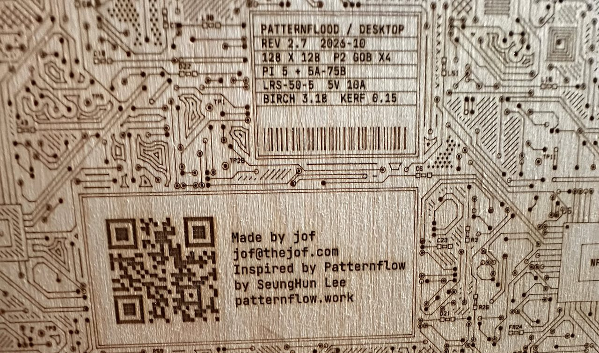
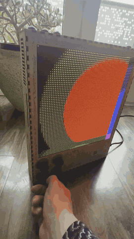
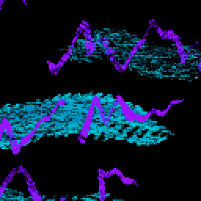
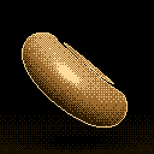
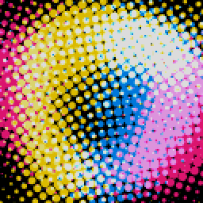
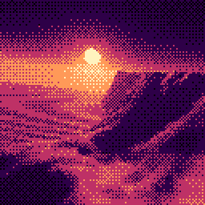
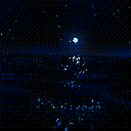
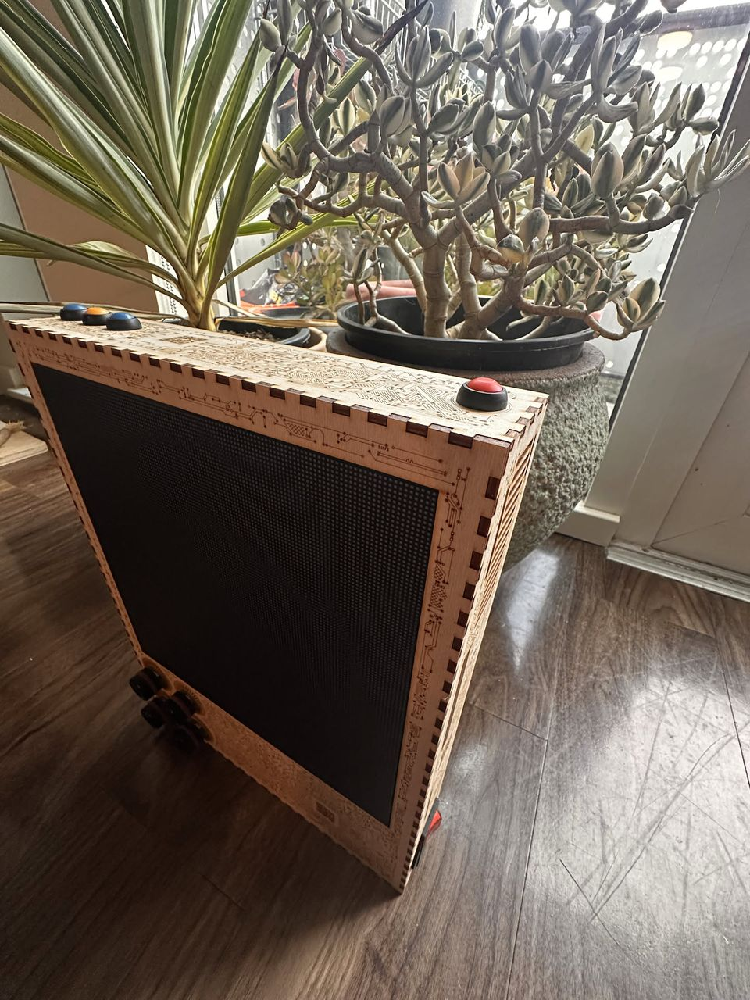
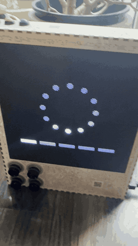

# Patternflood



A four-knob LED instrument: a 256 mm square of 128 × 128 pixels in a laser-cut
birch box, made to be played. Turn the knobs and the patterns answer. There are
toys, games, generative art, music visualizers, and a TV that surfs very weird
channels.

It is inspired by [**Patternflow**](https://github.com/engmung/patternflow), an
open-source LED synthesizer by SeungHun Lee, and it runs every one of
Patternflow's patterns, along with the ones its community has shared.

<p> </p>

<p>    </p>

*Five of [our demos](firmware/demos/README.md), straight from the renderer with nobody at the knobs: Solo Jazz, Obra, Riso, Valley and Sea.*

| | |
|---|---|
| Display | 4 × P2 64 × 64 GOB panels, 2 × 2: 128 × 128 px, 256 × 256 mm |
| Controls | 4 lit push-knobs (Adafruit 4991 I²C encoders), 4 push buttons |
| Brains | Raspberry Pi 5 renders; a Colorlight 5A-75B with open [receiver75](https://github.com/dgym/receiver75) gateware drives the panels |
| Power | Mains in, Mean Well LRS-50-5 inside, current-capped per frame |
| Box | 3 mm Baltic birch, finger-jointed and laminated, 293 × 373 × 61 mm, etched with generated circuit-board art |
| Software | 92 demos of our own, all of Patternflow's patterns, and the Patternflow community's, compiled and run natively on the Pi |

**Status:** the desktop build is complete. Two revisions have been built, and
Rev 2.7 is the current one.

<p>  </p>

*Rev 1, plain and single-sheet; Rev 2.7, laminated and etched, with buttons; the boot splash.*

A second, wall-sized project is at the concept stage ([below](#the-wall-project)).

## Build one

**[`docs/desktop/BUILD.md`](docs/desktop/BUILD.md)** is the build guide: the
parts list, flashing the Colorlight card, the Pi image, test cuts, cutting the
box, glue-up, wiring and first power-up. Everything it needs is in this
repository: the Onshape FeatureScript model, the cut sheets, the gateware and
the software. The model itself is public on Onshape:
**[Patternflood desktop in Onshape](https://cad.onshape.com/documents/8cfb8d4f799392c05f62f6ad/w/b5dfed0b24d2121a79e8b1a8/e/06ba580a80083894ed24609b)**.


[`docs/desktop/`](docs/desktop/README.md) has the reference docs and the design
notes behind the build.

## Try the software without the hardware

The demos run on any Linux machine with Python 3 and numpy (and Pillow, for text), and can
write an animated GIF instead of driving panels:

```sh
cd firmware/demos
./run.py --list
./run.py --demo etch --knobs auto --out preview:/tmp/etch.gif --seconds 8
```

`--knobs auto` is a random player turning the knobs. Upstream Patternflow's
patterns also need `g++` and a clone of upstream in `upstream/`
([`firmware/demos/README.md`](firmware/demos/README.md)).

## Repository layout

```
docs/desktop/          the desktop build: build guide, wiring, design notes
docs/wall/             the wall project (concept)
hardware/cad/          Onshape FeatureScript, export and art tools, vendor STEP models
hardware/laser/        cut files: one DXF per part, nested sheets, test cuts, diffusers
hardware/REVISIONS.md  what changed in each revision
firmware/demos/        the demos and the renderer (Python; runs on the Pi or a PC)
firmware/pi-controller/  the Raspberry Pi appliance image: provisioning, services, boot splash
firmware/colorlight/   the Colorlight card: JTAG tools, receiver75 build, frame protocol
firmware/knob_bridge/  a FeatherS3 that reads the knobs over USB, for bench work
firmware/patches/      the abandoned ESP32 / Matrix Portal fork of upstream
upstream/              a clone of upstream Patternflow (not in this repo; see .gitignore)
```

## The wall project

A room-sized LED wall (nine P3 panels, 576 mm square) that responds to the
people in front of it through a VL53L9CX depth sensor rather than knobs. It
shares the inspiration but not the code or the parts. It is a concept until the
sensor arrives: [`docs/wall/`](docs/wall/README.md).

## Credits

- **[Patternflow](https://github.com/engmung/patternflow)** by SeungHun Lee: the
  idea, the instrument's feel, and the patterns this box runs. Its community's
  patterns come from [community.patternflow.work](https://community.patternflow.work),
  each credited to its author on the panel.
- **[receiver75](https://github.com/dgym/receiver75)** by Jim Bailey: the open
  gateware for the Colorlight card (MIT).
- **[Sequoia Fabrica](https://sequoiafabrica.org)**, the community makerspace
  where much of this box was made: fertile ground for creative fabrication and
  artful programming.
- Vendor CAD models from Adafruit and Mean Well
  ([`hardware/cad/vendor/`](hardware/cad/vendor/README.md)).
- [JetBrains Mono](https://www.jetbrains.com/lp/mono/) for the etched lettering
  (SIL OFL 1.1).
- The Interdimensional Cable shelf's tapes are cut from public-domain films on
  the Internet Archive, and its news ticker reads headlines from The Onion,
  credited on screen.

## License

- **Code** (`firmware/`, `hardware/cad/tools/`, the FeatureScript): [MIT](LICENSE).
- **Hardware design and documentation** (the model, cut files, art, `docs/`):
  [CC BY-SA 4.0](LICENSE-hardware). Share alike: if you publish a modified box,
  publish its files under the same terms.

Third-party pieces keep their own licenses: receiver75 (MIT,
[`firmware/colorlight/receiver75/LICENSE`](firmware/colorlight/receiver75/LICENSE)),
JetBrains Mono (OFL, `hardware/cad/tools/fonts/OFL.txt`), the vendor STEP models
([`hardware/cad/vendor/README.md`](hardware/cad/vendor/README.md)), and the
ported Patternflow and community patterns, which are CC BY-SA 4.0 with their
authors' credits in each file's header.
