# Building the Patternflood desktop

A 256 mm square LED instrument: four P2 GOB panels in a 2 × 2 (128 × 128 px),
four knobs with light rings, four push buttons, and a laser-cut birch ply box
that runs off mains. A Raspberry Pi 5 renders the frames, and a Colorlight
5A-75B running open gateware drives the panels.

This guide builds **Rev 2.7**, the revision that is built and running
([`hardware/REVISIONS.md`](../../hardware/REVISIONS.md) has the history). Every
cut file, model and script referred to here is in this repository, and the CAD
model is public on Onshape: **[the Patternflood desktop document](https://cad.onshape.com/documents/8cfb8d4f799392c05f62f6ad/w/b5dfed0b24d2121a79e8b1a8/e/06ba580a80083894ed24609b)**
(open it to look around, or make a copy to change it).

<p> </p>

*Rev 2.7, front and top: the knobs with their light rings, and the four buttons along the top wall.*

The box stands upright, 293 × 373 × 61 mm: the display at the top, the four
knobs below it on the left, the supply behind the bezel on the right.

> ⚠️ **This build has mains wiring inside a wooden box.** The supply's input
> terminals are open screw terminals behind a removable back. Read
> [§8](#8-mains-and-5-v) before wiring anything, and if you are not
> comfortable working on mains, have someone who is check your wiring.

**Contents**

1. [What you need](#1-what-you-need)
2. [Flash the Colorlight card](#2-flash-the-colorlight-card)
3. [Make the Pi's SD card](#3-make-the-pis-sd-card)
4. [Bench test before you cut](#4-bench-test-before-you-cut)
5. [Test cuts](#5-test-cuts)
6. [Cut the box](#6-cut-the-box)
7. [Glue and assemble the box](#7-glue-and-assemble-the-box)
8. [Mains and 5 V](#8-mains-and-5-v)
9. [Electronics in](#9-electronics-in)
10. [First power-up](#10-first-power-up)
11. [Known gaps](#11-known-gaps)

---

## 1. What you need

Prices are US dollars, checked on 2026-10-30, before shipping and tax. They are
what one box uses: where a part comes in a pack, the price is the box's share of
it (the pack price is in the Source column). The links are where to find each
part, not the only place: the cheapest source is given first, and Amazon is
listed where it's the easy alternative. Expect them to drift. A summary of the
cost is [at the end of this section](#what-it-costs).

### Electronics

| Qty | Part | Source | ≈ USD | Notes |
|---|---|---|---|---|
| 4 | **Waveshare RGB-Matrix-P2-64x64-B** (GOB) | [Waveshare](https://www.waveshare.com/rgb-matrix-p2-64x64.htm?sku=33838) (SKU 33838); [Amazon](https://www.amazon.com/dp/B0GMTLNFL2) at $48 each | 123 | 128 × 128 mm, FM6124 column drivers, RUC7258 row drivers, 1/32 scan. Measured in [`enclosure-lasercut.md`](enclosure-lasercut.md) §11. Other panels need a different box: hole positions differ between panel types ([`enclosure-lasercut.md`](enclosure-lasercut.md) §11). Each panel comes with a HUB75 ribbon and a power harness (the next two rows) |
| 4 | HUB75 ribbon cables, 16-way IDC | With the panels | — | One per panel, from the card to the panel's IN |
| 3 | Waveshare panel power harness | With the panels | — | A fork pair at the 5 V bus, split to two 4-pin panel plugs. Six plugs: four panels, the card, one spare. The fourth harness is spare |
| 2 | 4-way barrier terminal strip, 25 A (TB-2504L or similar), with jumper bars | Amazon, a 6-pack with jumpers, $10 ([B0D7VTMTBH](https://www.amazon.com/dp/B0D7VTMTBH)) | 3 | The 5 V bus: one strip for +5 V, one for GND |
| 1 | **Colorlight 5A-75B**, v8.x | AliExpress (search "5A-75B V8.2"); Amazon at about $36 | 22 | Ours is a v8.2. The gateware is built for the v8.0 pinout, which v8.2 shares |
| 1 | **Raspberry Pi 5, 2 GB** | [PiShop.us](https://www.pishop.us/product/raspberry-pi-5-2gb/) or another approved reseller | 78 | Ours is an 8 GB, which is far more than needed: the running box uses about 350 MB, and the CPU is 96 % idle at 60 fps. Memory prices have pushed Pi 5 prices up through 2026 (4 GB $110, 8 GB $175), so buy the 2 GB. The 1 GB ($45) should also work, but hasn't been tried. A Pi Zero W was too slow ([design note](design-notes/pi-zero-w-controller.md)) |
| 1 | Raspberry Pi **Active Cooler** (official) | [Adafruit 5815](https://www.adafruit.com/product/5815) | 14 | The box is closed |
| 1 | microSD card, 16 GB or more | SanDisk Ultra 32 GB, Amazon | 18 | |
| 1 | 5 V → USB-C pigtail, bare leads, 20 AWG | Amazon, 5-pack, $8 ([B0H3BRQ2X1](https://www.amazon.com/dp/B0H3BRQ2X1)) | 2 | Feeds the Pi from the card's 5 V screw terminal. No USB-PD |
| 1 | Ethernet patch cable, Cat5e or better, 15–30 cm | Amazon, a 10-pack of short Cat6, $8 | 1 | Pi to card. The card will not link at 100 Mbit |
| 4 | **Adafruit 4991** I²C QT rotary encoder breakout | [Adafruit](https://www.adafruit.com/product/4991) | 24 | Each has a NeoPixel, which lights the knob's ring |
| 4 | **Adafruit 377** rotary encoder (EC11) | [Adafruit](https://www.adafruit.com/product/377) | 18 | Soldered to the 4991s. Adafruit 5880 is a 4991 with an encoder already fitted ($7.95), but it hasn't been tried in this box |
| 4 | Knobs for a 6 mm D shaft, about 1" (25.4 mm) | Amazon, aluminium set-screw knobs | 10 | The light slits sit just outside a 1" knob's skirt. Adafruit's knobs are 20 mm, too small for the slits |
| 3 | STEMMA QT / Qwiic cable, 100 mm | [Adafruit 4210](https://www.adafruit.com/product/4210), or DigiKey 1528-4210-ND | 3 | Between the encoders |
| 1 | STEMMA QT to female sockets, plus a 4-wire extension to about 300 mm (12") | [Adafruit 4397](https://www.adafruit.com/product/4397) (150 mm), extended with four female-to-male jumper wires or a lead crimped from the Dupont kit below | 1 | Last encoder to the Pi's header. The 4397 alone is too short. Estimated from the model, the run is about 270 mm: from the header, around the tray's edge, through the shelf hole over the right knob column, to the top-right encoder. Even pulled tight it's about 190 mm |
| 4 | 12 mm waterproof momentary push buttons, with a keyed lip | Amazon, a 15-pack in five colours, $7 ([B07F24Y1TB](https://www.amazon.com/dp/B07F24Y1TB)) | 2 | Any 12 mm panel-mount momentary will do. We used these because a pack was left over from repairing a VanMoof S3's boost button. The top wall's holes are keyed to this type (12 mm thread with two flats 11 mm apart), so change the hole in the model for a different button. Two blue, one orange, one black, in the build as drawn |
| — | Dupont (2.54 mm) female wire connector, 2 × 3 (or a 1 × 3 and a 1 × 2), with crimp pins and hook-up wire | Amazon, a Dupont crimp kit, $10 | 1 | Button leads, plugged onto the Pi's header pins |
| — | Insulated female spade terminals to fit the button tags, and WAGO 221 inline splices | Amazon: a spade assortment ($8) and a 10-pack of 221 inline splices ($9) | 6 | How ours are wired, with no soldering. Solder the leads to the tags instead if you prefer |

### Power

| Qty | Part | Source | ≈ USD | Notes |
|---|---|---|---|---|
| 1 | **Mean Well LRS-50-5** | [DigiKey](https://www.digikey.com/en/products/detail/mean-well-usa-inc/LRS-50-5/7705050) 1866-3358-ND (about $15), or Amazon at about $18 ([B019GYOCMM](https://www.amazon.com/dp/B019GYOCMM)) | 15 | 5 V, 10 A. Buy a genuine one: it sits on mains in a wooden box |
| 1 | IEC C14 inlet with rocker switch and 5 × 20 mm fuse holder | Amazon, a 3-pack, $9 ([B0BXDKKQ15](https://www.amazon.com/dp/B0BXDKKQ15)) | 3 | AC-14-F16A; cutout 46.75 × 27.25 mm, flange screws 40 mm apart. It comes with a fuse: check that it's the 1 A time-delay below |
| 1 | **1 A time-delay (T) fuse**, 5 × 20 mm | With the inlet. If it isn't 1 A time-delay: Littelfuse 0218001.MXP from DigiKey or Mouser, about $1.20 | — | Sized for the supply's 45 A inrush, not its load. A fast-blow fuse will trip at switch-on |
| 1 | IEC power cord | Any | 2 | |
| — | 18 AWG wire for mains (L, N, earth), rated 300 V or more | Amazon, silicone wire, $14 for 25 ft each of red and black | 1 | About 30 cm of each |
| — | 16 AWG red and black wire | Amazon, silicone wire, $8 for 10 ft each | 1 | Supply to the 5 V bus |
| — | Insulated fork terminals (#8, 22–10 AWG), heatshrink | Amazon, a fork assortment, $9 | 1 | Mains and 5 V at the supply. Heatshrink not priced |
| 1 | Insulating boot or shroud for the supply's input terminals | — | — | Not priced. See [§11](#11-known-gaps) |

### Enclosure

| Qty | Part | Source | ≈ USD | Notes |
|---|---|---|---|---|
| 6 | **3 mm Baltic birch ply, B/BB, 12 × 24"** | [Woodpeckers](https://woodpeckerscrafts.com/products/baltic-birch-plywood-1-8-x-12-x-24) ($5.57 a sheet), or a 12-pack on Amazon ($55) | 33 | For the box. Buy two more for your first: one for the test cuts and one spare. Every part fits a 305 mm wide bed. Check the edges for voids: [`enclosure-lasercut.md`](enclosure-lasercut.md) §13.5 |
| — | PVA wood glue | Titebond II, 4 oz, $4 | 1 | The laminations are glued; the box's finger joints are glued |
| — | Transfer tape (masking), 12" wide | Amazon, a 12" × 100' roll, $24 | 3 | For the good face, against smoke marks |
| — | Printer paper | — | — | Knob light diffusers |
| 4 | Feet, ≥ 8 mm tall (optional) | Amazon, self-adhesive rubber feet, about $10 | 2 | Estimated: most stick-on feet are 3–6 mm, so look for taller ones. The intake vents are in the bottom wall. It runs fine standing flat for a while; on feet for long runs at brightness |

### Fasteners

Every nut sits in a laser-cut three-layer pocket, so no inserts are needed.

| Qty | Fastener | Where |
|---|---|---|
| 6 | M3 × 10 ultra-low socket head (Ø5.5 × 1.0, e.g. Accu ZUL602); DIN 7984 low heads also work | Back cover |
| 8 | M3 × 8 + M3 washer | Panels to the upper and lower braces |
| 8 | M3 × 14 + M3 washer | Panels to the middle brace |
| 4 | M3 × 16 | Electronics tray to the middle brace |
| 4 | M3 × 8 | Colorlight to the tray |
| 4 | M2.5 × 8 + M2.5 nut | Pi 5 to the tray (its holes are 2.7 mm) |
| 2 | M3 × 8, no washer | Supply, up through the bottom wall (heads sit in recesses) |
| 1 + 1 | M3 × 16 and M3 × 12, each with a washer and nut | IEC inlet flange |
| 16 | M3 nuts | 6 back cover, 4 tray, 4 Colorlight, 2 IEC |

Screw lengths are taken from the model. The panel screws give about 4 mm of
thread in the panel's inserts. Don't go longer on the supply (it allows 5 mm
of screw into its case) or on the tray (M3 × 18 touches the panel).

**Buying them:** a metric socket-head assortment with nuts and washers covers
most of this (Amazon, $10–23). Check that it has M3 × 8, 12, 14 and 16 and
M2.5 × 8; many kits skip 14 mm. McMaster sells M3 × 14 alone (91292A027, a
pack of 100). The back cover's low heads come from Accu (ZUL602M3X10, UK) or
as DIN 7984 M3 × 10 from McMaster (92855A310). One box uses about $8 of
fasteners, most of it the six low heads. (An estimate: the McMaster and Accu
pages couldn't be checked.)

### What it costs

| Group | ≈ USD |
|---|---|
| Electronics | 325 |
| Power | 25 |
| Enclosure | 40 |
| Fasteners | 8 |
| **Total** | **about 400** |

That is what one box uses, before shipping and tax, and before tools. About
$240 of it is the four panels, the card, the Pi and its cooler. Buying whole
packs for a single build costs more up front (about $550), and leaves spares.
Buying the panels and the card on Amazon instead adds about $80.

### Tools

- A CO₂ laser with at least a 600 × 305 mm cut area. The files are set up for
  an xTool P2 and xTool Creative Space (XCS), but they are plain DXF and SVG.
- Calipers.
- A JTAG adapter for the card's one-time flash: a
  [Glasgow](https://glasgow-embedded.org/) (what we used), or an FT232H with
  openFPGALoader (what receiver75 documents; not tried here).
- Soldering iron (encoders, maybe the card's JTAG header), wire strippers, a
  crimper for the Dupont pins, a ratchet crimper for insulated terminals (the
  mains forks and the button spades), small screwdrivers, a 2 mm hex key.
- Clamps and two flat boards for the glue-ups.
- A multimeter, for trimming the supply.
- A Linux machine with an SD card reader, to provision the Pi's card.

---

## 2. Flash the Colorlight card

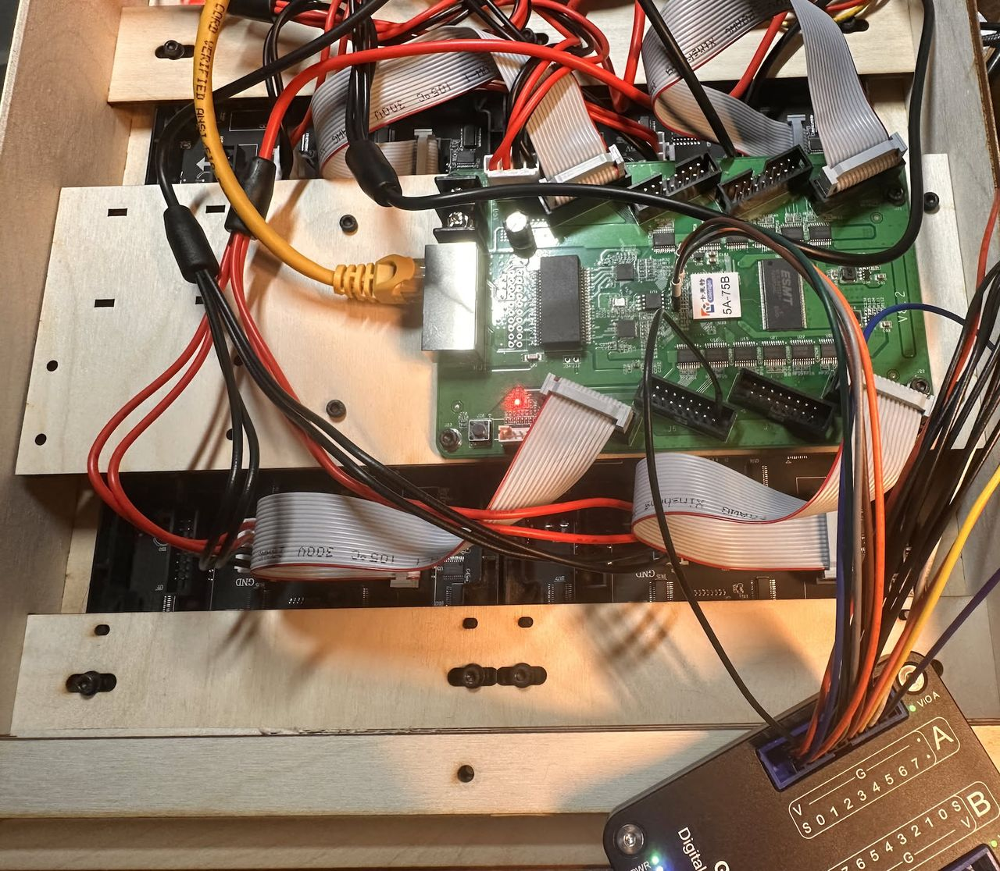

*Flashing in place on Rev 1: the Glasgow's port A on the card's JTAG pads. Doing it on the bench, before the card goes on the tray, is easier.*

The card ships with Colorlight's own gateware, which needs Windows software to
configure. Patternflood replaces it with
[receiver75](https://github.com/dgym/receiver75), open gateware that takes
frames as UDP packets. The version here adds a boot splash (a spinner and
progress bar while the Pi boots). It is in
[`firmware/colorlight/receiver75/`](../../firmware/colorlight/receiver75/README.md),
as patches and a ready-built bitstream.

1. **Back up the stock flash first**, so the card can go back to stock. With a
   Glasgow on port A ([wiring](../../firmware/colorlight/README.md#jtag-with-a-glasgow):
   J27 TCK, J31 TMS, J32 TDI, J30 TDO, ground from a spare HUB75 connector;
   don't connect the board's 3.3 V):

   ```sh
   cd firmware/colorlight
   glasgow script ecp5_flash_dump.py jtag-probe -V 3.3 -f 2000 -- stock.bin
   ```

   Keep `stock.bin` safe, and out of the repository: it is Colorlight's
   proprietary gateware.

2. **Write receiver75:**

   ```sh
   glasgow script ecp5_flash_write.py jtag-probe -V 3.3 -f 2000 -- receiver75/receiver75-splash-5f2185b.bit 0
   ```

   The stock flash is write-protected. The script lifts the protection, erases,
   writes, verifies every byte and puts the protection back.

3. **Power-cycle the card.** It boots dark, shows a dim spinner, and answers
   ARP at **192.168.75.39** (it doesn't answer ping). That address is built in.

With an FT232H instead of a Glasgow, `openFPGALoader --unprotect-flash
--write-flash` should do the same job. Keep the JTAG leads short: long leads
caused bit errors here ([`firmware/colorlight/README.md`](../../firmware/colorlight/README.md)).

---

## 3. Make the Pi's SD card

[`firmware/pi-controller/`](../../firmware/pi-controller/README.md) turns a
stock Raspberry Pi OS Lite (trixie, arm64) card into the appliance. It boots
straight into the demos, reads the knobs on I²C, and sends frames to the card
over the Pi's own Ethernet.

1. Write the image and **compare it after writing**. One write on a bench
   reader had a bad stretch:
   ```sh
   xz -dk 2026-10-06-raspios-trixie-arm64-lite.img.xz
   sudo dd if=2026-10-06-raspios-trixie-arm64-lite.img of=/dev/sdX bs=4M conv=fsync
   sudo cmp -n $(stat -c %s 2026-10-06-raspios-trixie-arm64-lite.img) 2026-10-06-raspios-trixie-arm64-lite.img /dev/sdX
   ```
2. Fetch upstream Patternflow (its patterns are compiled on the Pi):
   ```sh
   git clone https://github.com/engmung/patternflow upstream
   git -C upstream checkout 87700bd
   ```
3. Optionally fetch the community patterns
   ([`firmware/demos/README.md`](../../firmware/demos/README.md#community-patterns)).
4. Mount both partitions and provision, as root:
   ```sh
   sudo firmware/pi-controller/provision_card.py --boot /mnt/boot --root /mnt/root \
       --userconf userconf.txt --wifi-ssid YOUR_SSID --wifi-pass-file wifi.pass \
       --ssh-key ~/.ssh/id_ed25519.pub
   ```
   `userconf.txt` holds `USER:HASH` (make the hash with `openssl passwd -6`),
   and `wifi.pass` holds the Wi-Fi passphrase. The provisioning host needs
   `aarch64-linux-gnu-gcc` to build the boot-splash helper.

The first boot takes a few minutes: it installs packages over Wi-Fi and
compiles upstream's patterns. After that the Pi is reachable as
`patternflood.local`, and `firmware/pi-controller/update_pi.py` pushes code
changes to it.

---

## 4. Bench test before you cut

Get pixels on the panels on the bench, before any wood. It is much easier to
debug a ribbon or a panel lying flat.

1. Lay the four panels face down in their 2 × 2, as they will sit in the box
   (seen from behind, upper-left is on your right).
2. Ribbons from the card to each panel's **IN** connector, which is on the left
   seen from behind:

   | Panel (seen from the front) | Card connector |
   |---|---|
   | Upper left | **J5** |
   | Upper right | **J8** |
   | Lower left | **J4** |
   | Lower right | **J1** |

   J2, J3, J6 and J7 stay free. The mapping is also compiled into the card's
   splash, so keep to it.
3. Power the panels, the card and the Pi from the LRS-50-5 (temporary leads are
   fine on the bench; [§8](#8-mains-and-5-v) has the harness layout), a
   patch cable from the Pi to either of the card's jacks, and the encoder chain
   to the Pi ([`wiring.md`](wiring.md) §1).
4. Power on. The card shows its spinner within a couple of seconds, the bar
   steps forward as the Pi boots, and the demos start about 17 s after power-on.

If the picture is split or a quadrant is wrong, check the ribbons against the
table. `firmware/colorlight/r75_slot_ids.py` draws each output's slot number,
and `r75_frame.py` has a seam test.

---

## 5. Test cuts

The cut files have the stock thickness (**3.18 mm**) and the kerf (**0.15 mm**)
built in. Tabs, pockets and holes are compensated for them. Before you cut the
box, check that your laser and your ply match.

1. Caliper your sheet in several places.
2. Cut [`hardware/laser/test-cuts/`](../../hardware/laser/test-cuts/README.md)
   on a 12 × 12" sheet: finger-joint and tenon combs, nut pockets, a hole
   gauge, a panel fit jig, board templates, the IEC cutout and the supply's
   holes. Each piece's README section says what a good result looks like.
3. Cut [`hardware/laser/test-cuts/part-2/`](../../hardware/laser/test-cuts/part-2/README.md)
   on a second 12 × 12. It covers the two-sheet knob stack with its light slits and dial, the
   Pi 5 template, the button holes, and an etch sampler to tune the Score
   setting on (a fine, even line, and a QR code that scans).

<p>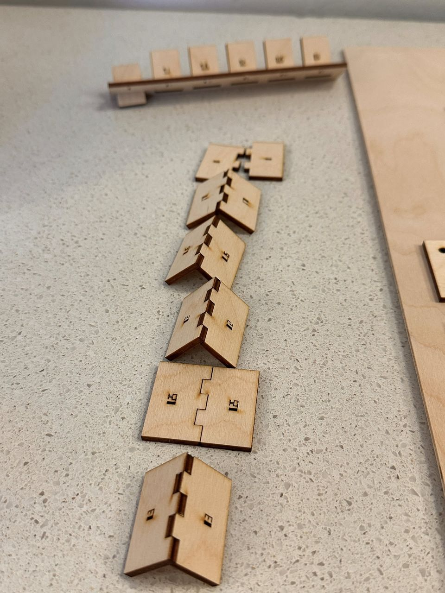 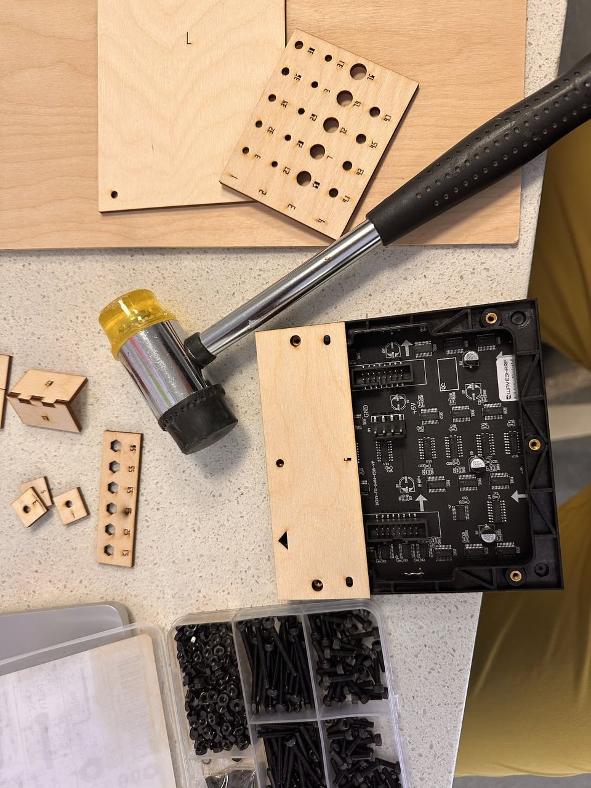</p>

*The first test cuts (Rev 1): finger-joint and tenon combs, and the panel fit jig against a real P2 panel.*

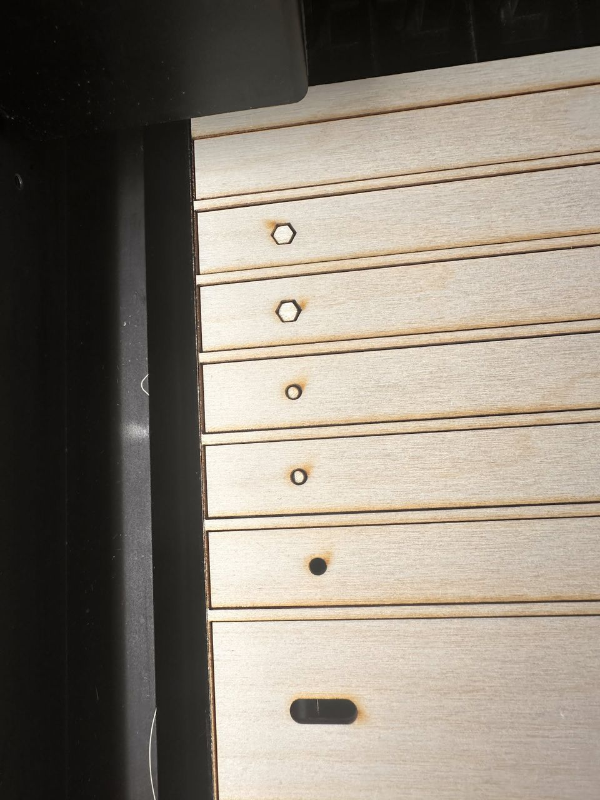

If the joints are loose or tight, or your stock isn't 3.18 mm, change
`#thickness` and `#kerf` in [the model](https://cad.onshape.com/documents/8cfb8d4f799392c05f62f6ad/w/b5dfed0b24d2121a79e8b1a8/e/06ba580a80083894ed24609b) (in your own copy) and
re-export the cut files ([`onshape-workflow.md`](onshape-workflow.md),
`hardware/cad/tools/export_dxf.py`, then `nest_sheets.py`).

---

## 6. Cut the box

[`hardware/laser/sheets/`](../../hardware/laser/sheets/README.md) has every part
nested on **six 12 × 24" sheets**, with a picture and a parts table for each.
That README covers the settings in detail. In short:

- **Load `sheet-N.svg`** for the sheets with etched art (1 to 3). In XCS,
  set **red = Cut** and **blue = Score**, put the blue layer above the red,
  and process **by layer**, so the art is scored before anything is cut loose.
  Sheets 4 to 6 have no art; their DXFs are fine.
- **Good face up, nothing mirrored.** Parts are drawn as seen from outside the
  box, so the face up on the bed becomes the outside. Mask it.
- **Inner shapes first** (XCS's default). The knob ribs are nested inside the
  inner bezel's display aperture on sheet 4.
- The art is a lot of line, about 160 m in all: the back cover's score alone
  took 2.5 to 3 hours on the xTool P2. At that rate, budget about 40 minutes
  for the bezel (sheet 1) and an hour for the three walls (sheet 3).
- Cut the **paper knob diffusers** too
  ([`hardware/laser/diffusers/`](../../hardware/laser/diffusers/README.md)).

Label the parts as they come off; the sheet pictures tell them apart.

<p>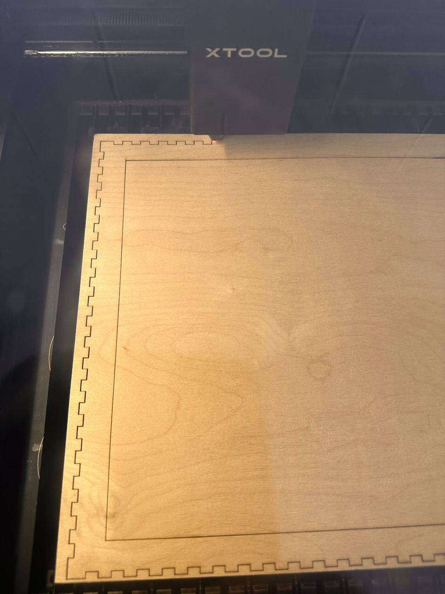 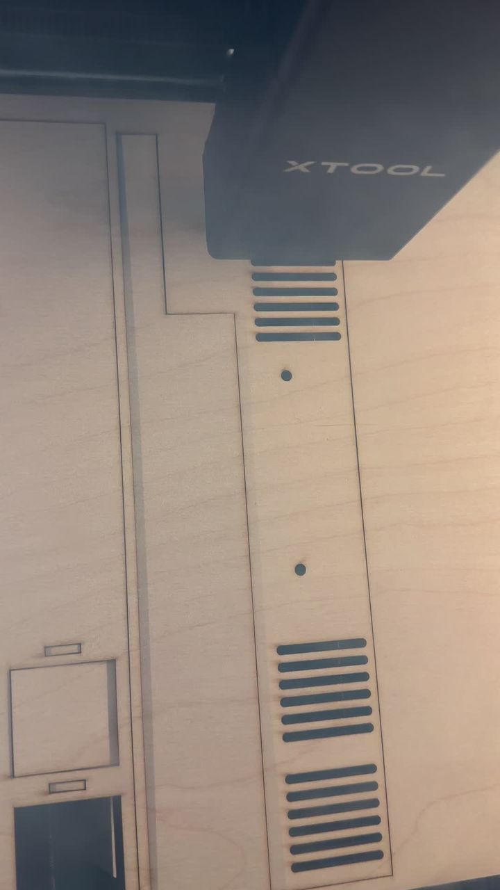</p>

*Cutting: Rev 1's bezel, and a Rev 2 wall with its vent slots and keyed button holes.*

<p>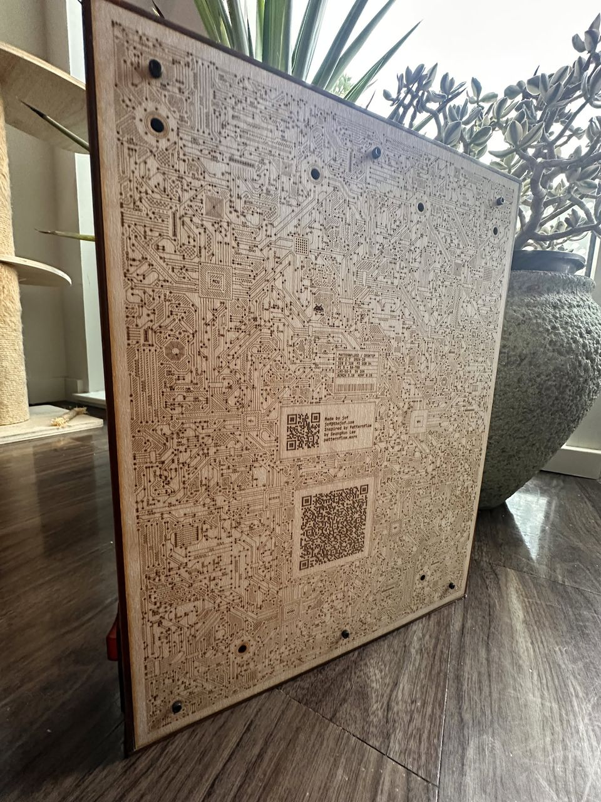 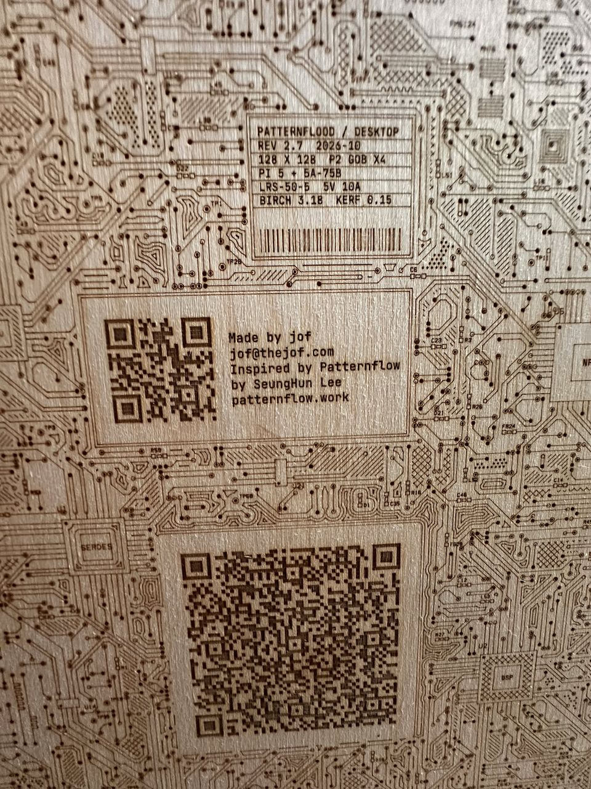</p>

*The back cover's etched art, and its title block and credits plate. Every QR code on the box scans.*

---

## 7. Glue and assemble the box

The bezel, every wall and the back cover are two sheets glued together. Glued,
two sheets bend as one section about eight times as stiff as a single sheet.
Rev 1 used single sheets, and pushing a knob visibly flexed the box.

<p>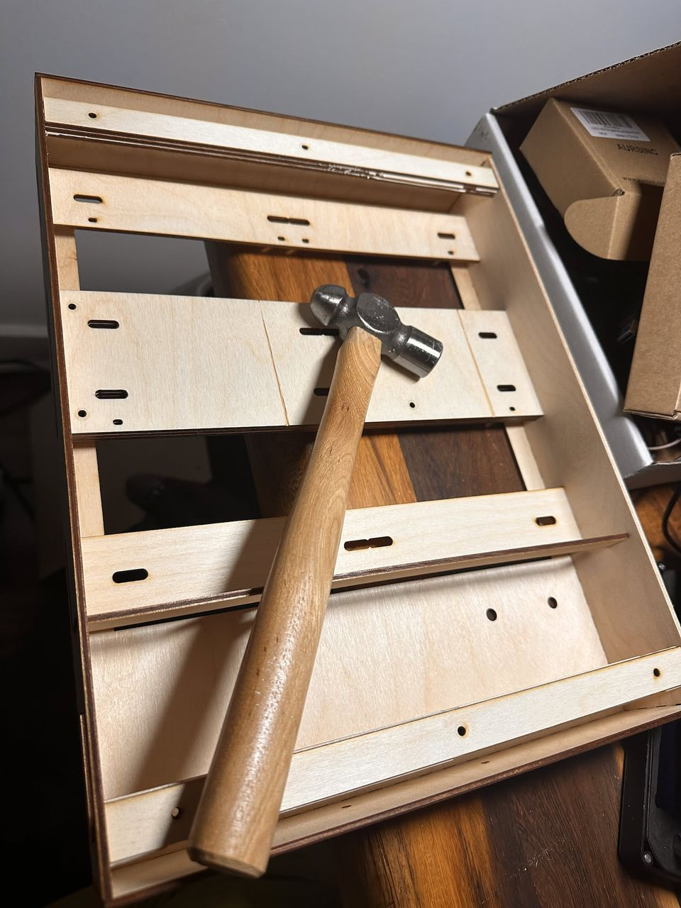 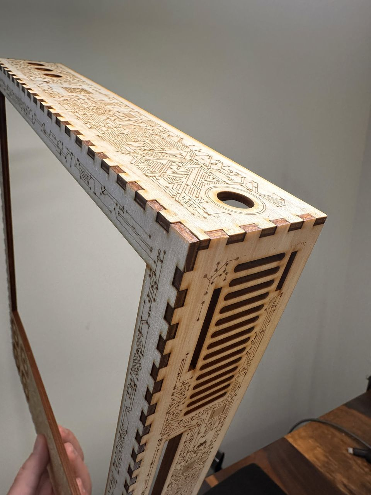</p>

*Rev 1's frame going together (single sheets, braces dry-fitted), and Rev 2's laminated walls with their art, vents and button holes.*

### 7.1 Laminate

PVA, clamped flat between boards. Keep glue out of mortises, holes and nut
pockets.

1. **Inner bezel to outer bezel**, face down, aperture edges flush. A panel
   dropped into the aperture squares them up.
2. **Each doubler to its wall.**
   - Side walls: push a brace and the stiffener shelf through the wall's and
     doubler's mortises, dry, to register them. Keep the doubler's front edge
     6.36 mm back from the wall's front edge; a two-sheet offcut is the gauge.
   - Bottom wall: line up the doubler's supply holes with the wall's using two
     M3 screws.
   - Top wall: centred, with the same 6.36 mm setback.
3. **Back cover doubler** to the inside of the back cover, in the band between
   the two rail stacks.

### 7.2 The box

Bezel face down on a flat surface.

1. **Knob ribs** into their slots in the inner bezel, standing up, glued.
2. **Walls**, glued at the finger joints. Then the **stiffener shelf**: glue its
   front edge, and where the ribs' top edges meet it. Glue the ribs' bottom
   edges to the bottom doubler as that wall goes on.
3. **Braces**, tenoned through the side walls. The middle brace is three
   sheets with the tray's four nuts trapped in the middle one: fit the front
   and middle sheets, drop four M3 nuts into the middle sheet's hex pockets,
   then fit the rear sheet. Its sheets are clamped together by the panel
   screws, not glued.
4. **Rail stacks**, top and bottom, glued: rail C (tenoned into the side
   walls), then rail B with three M3 nuts in its hex pockets, then rail A. The
   back cover's screws come through rail A into those nuts.

### 7.3 Front-panel parts

- **Encoders**: solder each 377 encoder to its 4991. Set the address jumpers so
  the four boards are **0x37, 0x38, 0x39 and 0x3A** (A0; A1; A0 + A1; A2). The
  board at 0x37 is k0, and it must be the **leftmost** knob seen from the front;
  the demos' seat layouts assume it.
- A **paper diffuser** in each knob pocket against the outer bezel sheet, then
  the encoder through it, its nut on the front. The nut clamps the outer sheet
  only; the inner sheet is pocketed.
- **Buttons** into the top wall's keyed holes. Left to right seen from the
  front: blue (previous), orange (select), blue (next), and the black one
  (sleep) alone at the right end. Their nuts clamp the outer wall; the top
  doubler is notched behind them.
- Daisy-chain the encoders with the STEMMA QT cables, through the cable holes
  in knob rib 1. Order doesn't matter: the knobs are numbered by address.

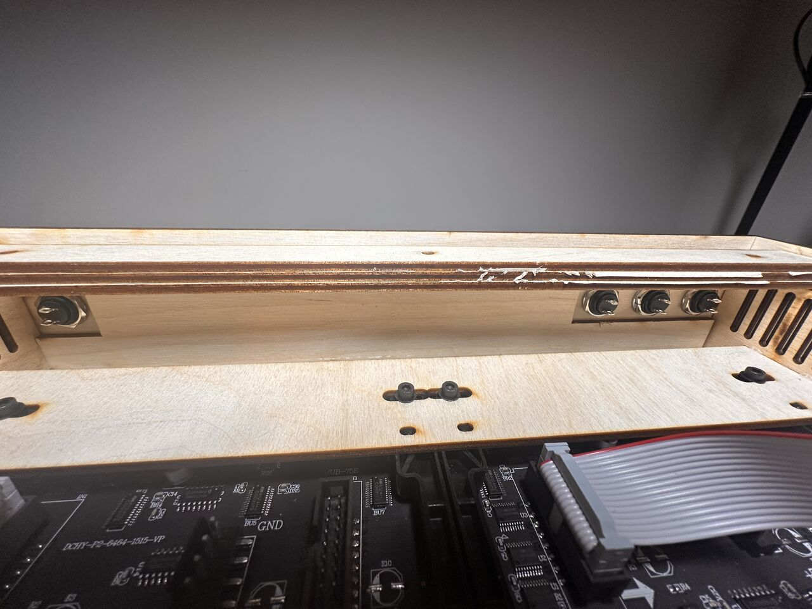

*The buttons from inside, before wiring. This is the back view, so the sleep
button is the one alone at the left; the top doubler is notched behind the
nuts.*

### 7.4 Panels

Each panel's two registration pins drop into holes in a brace, and four M3
screws with washers go through the braces into its inserts: **M3 × 8** through
the upper and lower braces, **M3 × 14** through the three-sheet middle brace.
The brace holes are exact vertically and have 1.5 mm of play sideways, so push
the panels together by hand before tightening. The seams are the most visible
thing on the box.

Panel screws are only reachable with the electronics tray out.

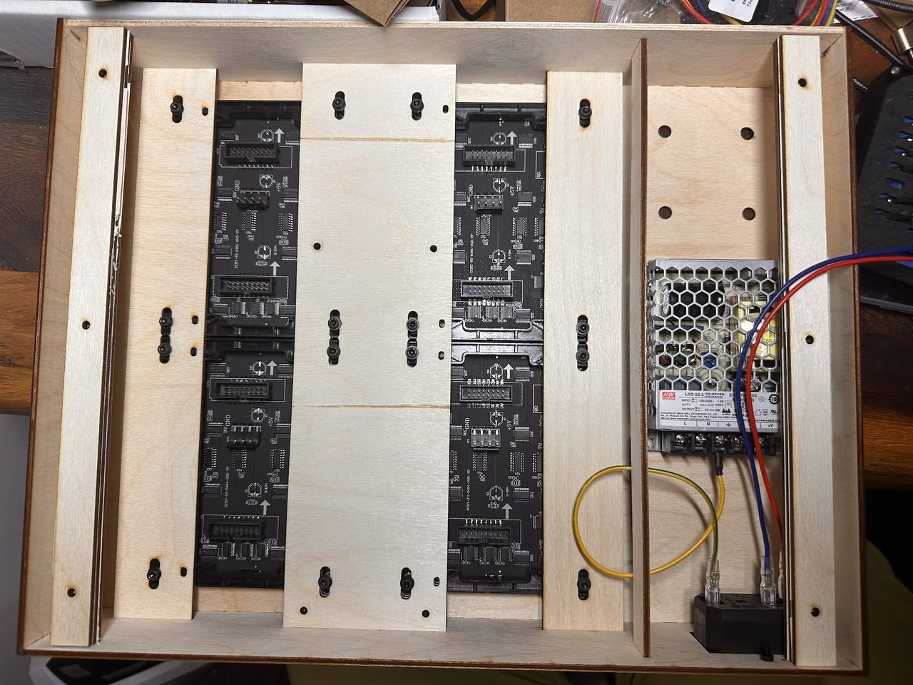

*Rev 1 from the back, before the electronics. Rev 2 adds the doublers, the knob ribs and shelf, and puts the supply on the bottom doubler instead of on spacers.*

---

## 8. Mains and 5 V

The supply sits in the bottom corner on the bottom doubler, against the bezel,
fixed by two **M3 × 8** screws up through the bottom wall. Their heads sit in
recesses, flush, so tighten gently: the supply rests on the doubler and the
screws only locate it. **Its terminals must face the back cover**, or they
can't be reached. The IEC inlet is in the right wall beside it.

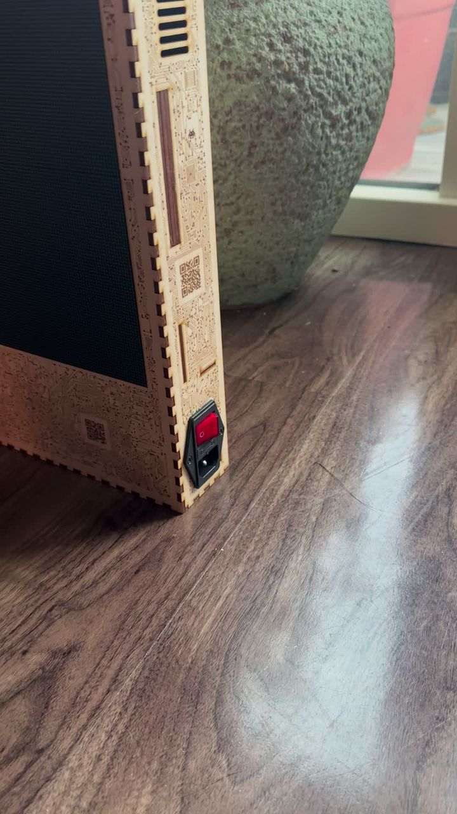

**Wire the supply before the rear rails get in the way.** There is about
19 mm above its terminals with the back cover off.

### Mains

Four things are not optional:

1. **Insulate the input terminals.** L, N and earth are open screw terminals,
   and the back comes off with six screws. Use insulated fork terminals with
   heatshrink, and a boot or shroud over the input block. The IEC switch is the
   second layer.
2. **Earth the supply.** IEC earth → the supply's FG terminal. The case is
   metal; the box isn't, so nothing else needs bonding.
3. **1 A time-delay fuse** in the inlet.
4. **Restrain the wiring.** Strain-relieve and tie down the mains leads at the
   inlet, and keep them away from the 5 V side and the I²C chain. It is a box
   that gets picked up.

The terminals are, in order: **L, N, FG (earth), −V, +V.**

### 5 V


The 5 V side is a small bus and three of the power harnesses that come with
the panels, each a fork pair split to two 4-pin panel plugs. Three fork pairs
stacked under the supply's screws is too crowded, so:

1. **Two 4-way barrier strips make the bus**, one for +5 V and one for GND.
   Bridge each strip's four positions with its jumper bar or short links. Ours
   sit on the lower brace, just above the supply.
2. **One pair from the supply**, 16 AWG with forks: +V to the +5 V strip, −V
   to the GND strip.
3. **The three harnesses' forks onto the strips**, red on +5 V, black on GND.

That gives six plugs:

- **four panels**, two on each of two harnesses;
- **the card's 4-pin power input**, on the third harness. The card also has a
  5 V screw terminal on the same rail: **screw the Pi's USB-C pigtail into
  it**, red to +, black to −;
- **one spare**, on the third harness with the card. It's live: cap or tape
  it, and tie it back away from the boards.

**Trim the supply to about 5.15 V** with its adjustment pot, measured at the
card's screw terminal, so the Pi sees at least 5.0 V under load.

The pigtail does no USB-PD, so the Pi assumes a 3 A supply and warns. Tell it
otherwise, once it's running:

```sh
sudo rpi-eeprom-config -e      # add: PSU_MAX_CURRENT=5000
```

Power budget: the supply is good for 8 A continuous. The Pi takes ~1.6 A and
the card ~0.8 A, which leaves ~1.4 A per panel. A typical pattern draws about
0.8 A per panel; full white draws 2.4 A. The renderer caps each frame's
estimated current, so full-white frames are scaled down rather than tripping
the supply ([`driver-colorlight.md`](driver-colorlight.md) §3).

---

## 9. Electronics in

The card and the Pi live on a removable **electronics tray**: two sheets
screwed to the back of the middle brace, the boards on its rear face, component
side facing the back cover.

1. **On the bench**, tray face down: M3 nuts into the rear sheet's hex pockets
   for the card, M2.5 nuts for the Pi, a spacer ring over each, then the boards.
   **M3 × 8** through the Colorlight, **M2.5 × 8** through the Pi. The card lies
   horizontal, its RJ45 end toward the left; the Pi stands on end at the left,
   Ethernet jack pointing down past the tray's edge. Fit the Active Cooler.

   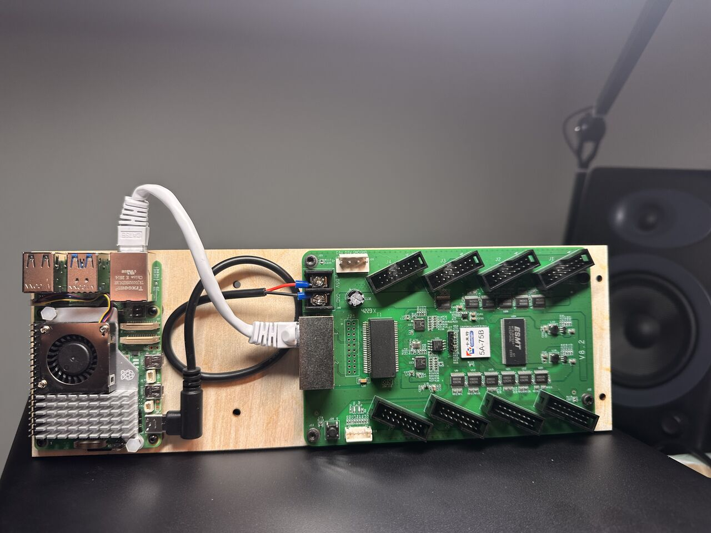

   *The tray on the bench, upside down from how it goes in, with the patch
   cable and the Pi's pigtail already fitted.*
2. **Plug the four HUB75 ribbons into the card** (J5, J8, J4, J1, as in
   [§4](#4-bench-test-before-you-cut)).
3. **Tray in from the back.** Plug each ribbon into its panel's IN, then four
   **M3 × 16** through the tray and a spacer ring into the brace's nuts.

   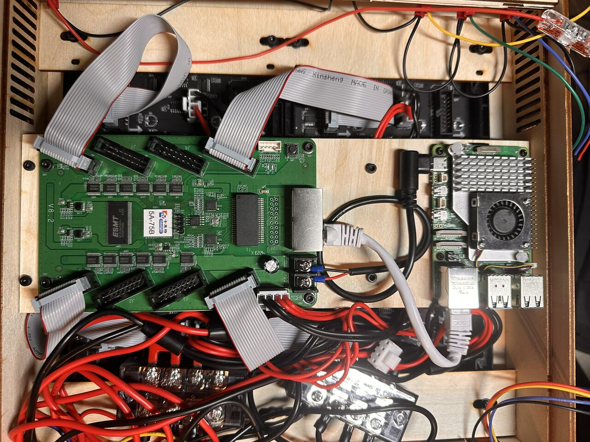

   *The tray in, seen from the back: four ribbons from the card to the
   panels' IN connectors, and the Pi on end at the right, its jack pointing
   down.*
4. **Patch cable** from the Pi's jack round the tray's bottom edge to the card.
5. **Knob chain** to the Pi's header, at **3.3 V**:

   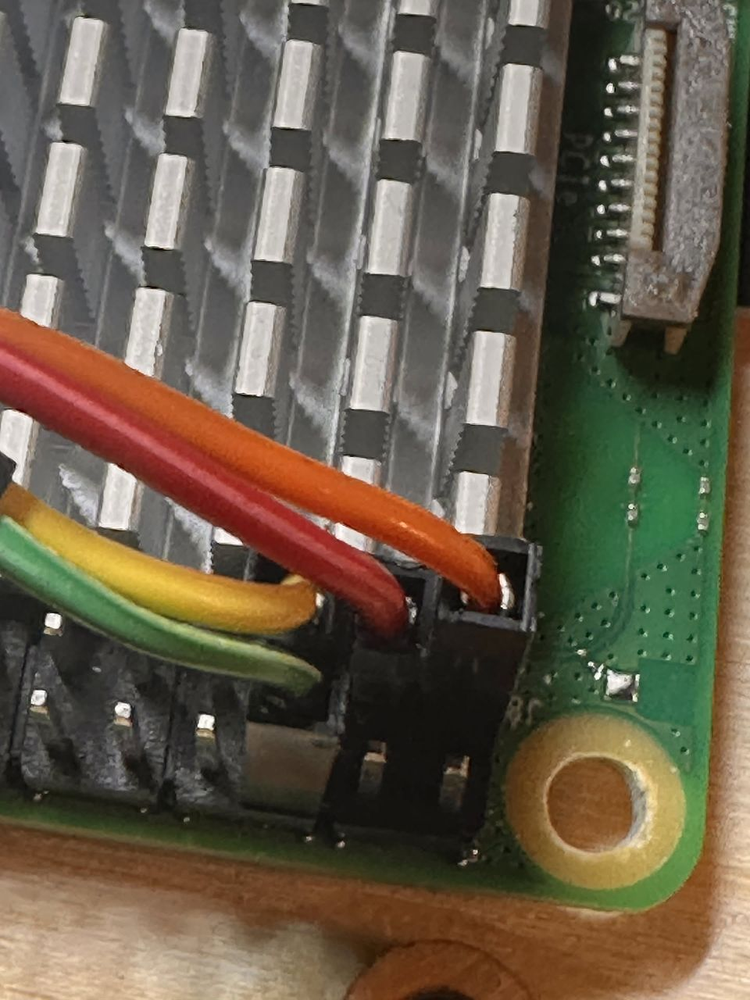

   *Where the knob chain lands on the header. Ignore the wire colours in the
   photo: we didn't have STEMMA QT-coloured leads on hand. Wire it by the
   table below.*

   | STEMMA QT wire | Pi pin |
   |---|---|
   | Red (V+) | **1** (3V3, *not* 5 V) |
   | Blue (SDA) | **3** |
   | Yellow (SCL) | **5** |
   | Black (GND) | **6** |

6. **Buttons**, each switching its GPIO to a common ground (no resistors; the
   Pi's pull-ups are used). Chain one ground wire from button to button, and
   give each button its own wire:

   | Wire | Pi pin |
   |---|---|
   | Common ground | **14** (GND) |
   | Previous (blue, left end) | **11** (GPIO17) |
   | Select (orange) | **13** (GPIO27) |
   | Next (blue) | **15** (GPIO22) |
   | Sleep (black, right end) | **16** (GPIO23) |

   One 2 × 3 Dupont connector over pins 11 to 16 takes all five, with pin 12
   empty. The sleep button's leads run ~270 mm along the top wall, under the
   top doubler.

   <p>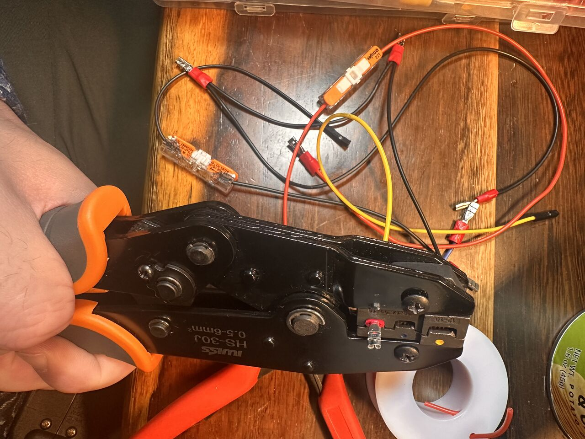 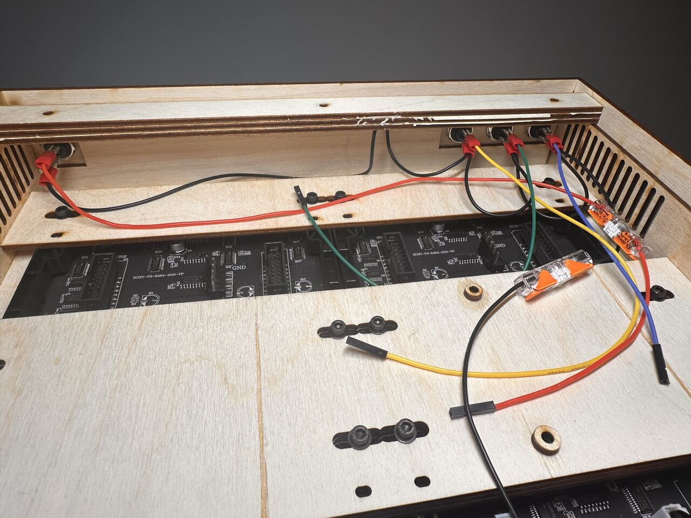</p>

   *Wiring the buttons without solder: insulated spades on the button tags,
   each button's ground looped on to the next, and WAGO splices joining the
   leads to their Dupont tails. Back view, so the sleep button is at the
   left.*
7. **5 V:** harness plugs into the four panels and the card's 4-pin input,
   the Pi's pigtail into the card's screw terminal, and the spare plug capped
   and tied back ([§8](#8-mains-and-5-v)).

   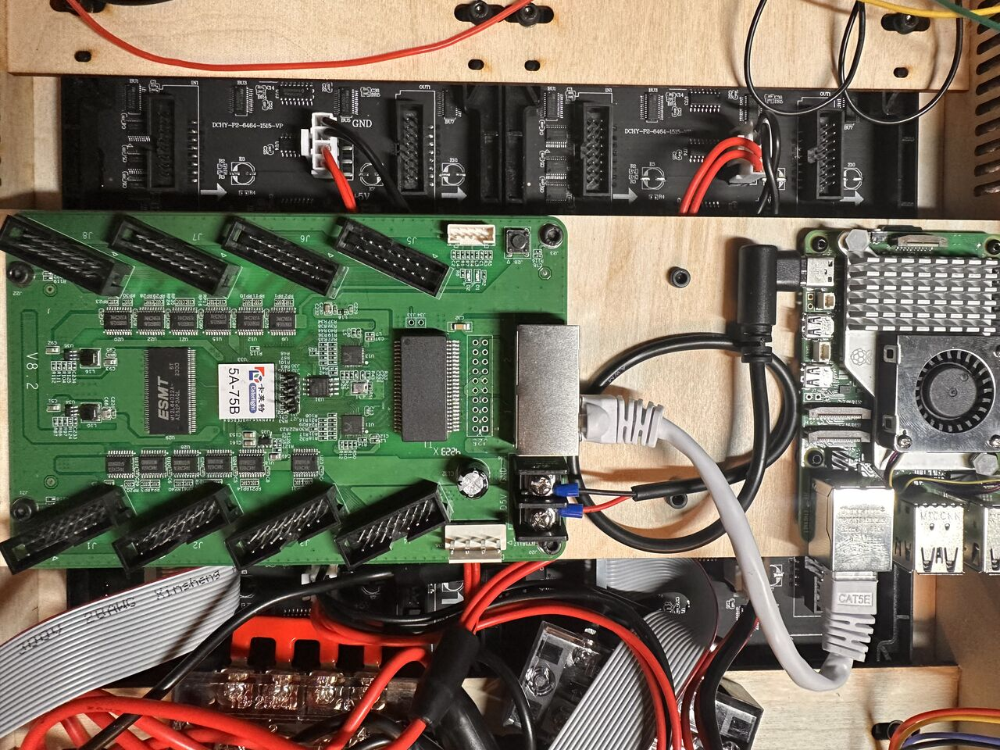

   *The card's 4-pin input, and the Pi's pigtail in its 5 V screw terminal in
   ferrules, red to D5V and black to GND. Two panels' plugs are at the top.*

8. Back cover on: six M3 × 10 low-head screws into the nuts in rail B.

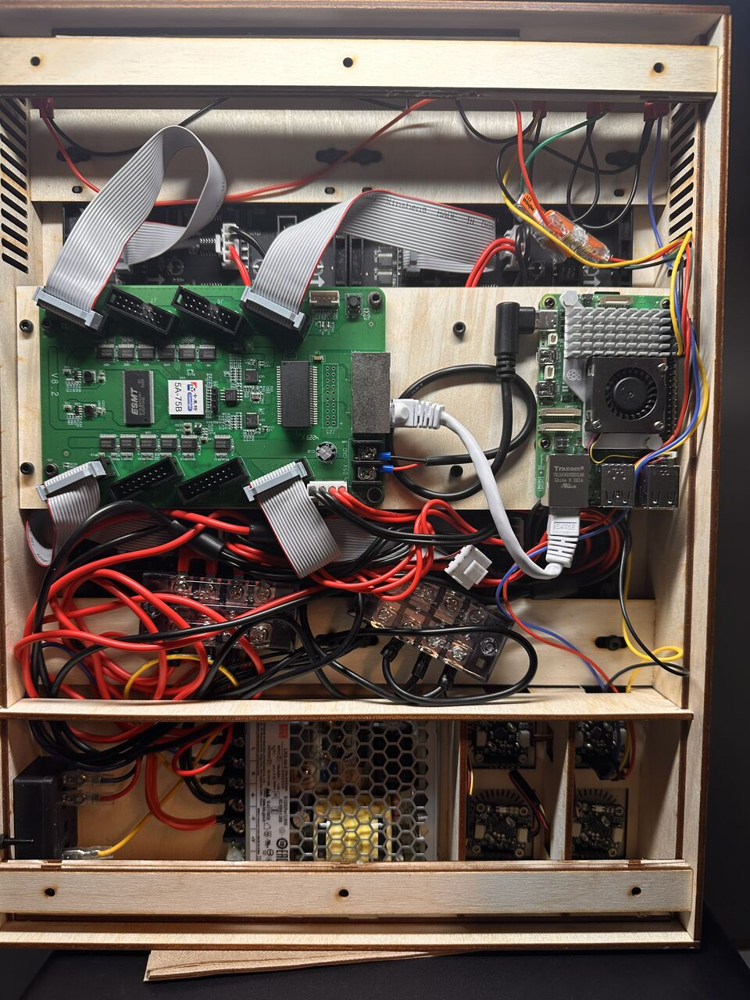

*Rev 2.7 with the back cover off: the tray on the middle brace, the button
leads down the right-hand side to the Pi's header, the two 5 V bus strips
just above the supply, the IEC inlet and the supply along the bottom, and the
knob boards in their pockets at the bottom right.*

[`wiring.md`](wiring.md) has the whole wiring in one place, with header
diagrams and the serial console.

---

## 10. First power-up


1. Switch on at the inlet. Within two seconds the card shows its spinner and the
   first segment of a five-step bar.
2. The bar steps forward as the Pi boots. The first demo starts about 17 s after
   power-on (the Pi's bootloader takes ~9 s of that).
3. Turn the knobs: their rings light up, following the brightness.
4. **The buttons:** previous and next step through the demos, and **select**
   opens the menu. In it, previous and next (or k1) pick a shelf, k0 a demo,
   k3 sets brightness, and select or a click on any knob closes it. Sleep
   blanks the box. A box provisioned before the buttons gets their overlays
   from `update_pi.py`, then needs one reboot.
   [`firmware/demos/README.md`](../../firmware/demos/README.md) describes the
   demos and the shelves.

If something is wrong, `ssh patternflood.local`:

```sh
i2cdetect -y 1                  # 37 38 39 3a: the four knobs
journalctl -u patternflood -f   # "knobs: 4 found", "buttons: 4 found", then frames per second every 5 s
```

Settings (start demo, brightness, which shelves) are in
`/etc/default/patternflood`. Edit, then `sudo systemctl restart patternflood`.

**Switching it off at the wall is safe** once it's running: the journal is in
RAM, writes are rare, and it was tested by forced reboots. Avoid it during an
`apt upgrade`. A hardware watchdog reboots a hung Pi, and the service restarts
a renderer that stops sending frames.

---

## 11. Known gaps

These are open in Rev 2.7:

- **The power cap is uncalibrated.** It assumes 2.4 A per panel at full white,
  measured upstream on a different driver. Measure one panel at full white,
  and at full red, green and blue, on this card.
- **No read-only root filesystem.** Power cuts have been safe in testing, but
  an overlay root is still the plan.
- **The supply's terminal shroud** is not yet a drawn part. Use a commercial
  boot or heatshrink.
- No microphone: the audio-reactive demos need a sound source on the Pi.
