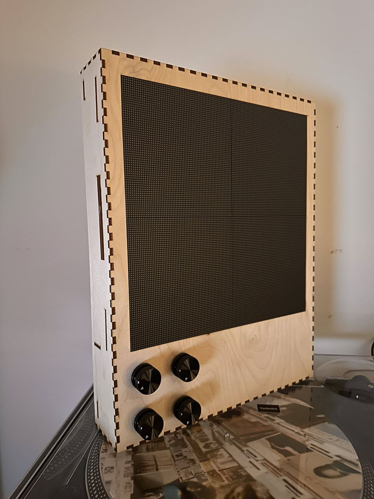
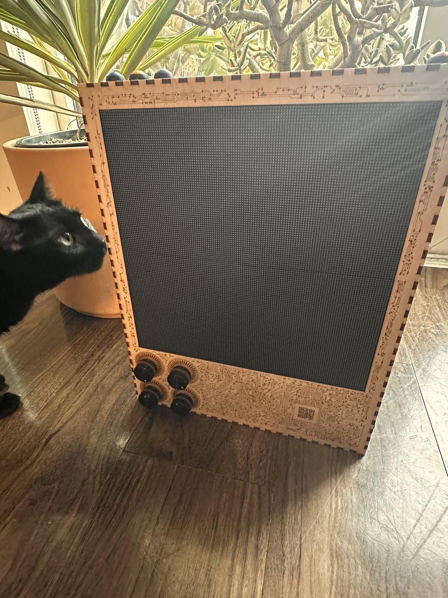

# Patternflood desktop

**Status: built and running (Rev 2.7).** Two physical revisions have been built:
Rev 1 (2026-10-20) and Rev 2.7 (finished 2026-10-28).

 

*Rev 1 (left): single sheets, no art; pushing a knob flexed the box. Rev 2.7 (right): laminated walls and bezel, etched art, knob light rings, buttons and a Pi 5.*

A four-knob LED instrument inspired by
[Patternflow](https://github.com/engmung/patternflow): a **2 × 2 array of P2 GOB
panels** (128 × 128 px, 256 mm square) in a laser-cut birch ply box, with four
lit knobs and four push buttons. A **Raspberry Pi 5** renders the frames and a
**Colorlight 5A-75B** running open gateware drives the panels.

| | |
|---|---|
| Panels | 4 × Waveshare RGB-Matrix-P2-64x64-B (GOB), 2 × 2 → 128 × 128 px |
| Controller | Raspberry Pi 5 + Colorlight 5A-75B ([receiver75](https://github.com/dgym/receiver75) gateware), over gigabit Ethernet |
| Input | 4 × Adafruit 4991 I²C encoders with NeoPixel light rings; 4 push buttons |
| Power | IEC mains → Mean Well LRS-50-5 (5 V, 10 A), per-frame current cap |
| Enclosure | 3 mm Baltic birch ply, finger-jointed and laminated, 293 × 373 × 61 mm, stands upright; six 12 × 24" sheets on an xTool P2, with etched circuit-board art |
| Software | 92 demos of our own, all 48 of upstream Patternflow's patterns and 287 from its community site, run natively on the Pi ([`firmware/demos/`](../../firmware/demos/README.md)) |

## Build it

**[`BUILD.md`](BUILD.md)** is the build guide: parts, flashing the card, the Pi
image, test cuts, cutting, glue-up, wiring and first power-up. The CAD model is
public on Onshape: **[Patternflood desktop](https://cad.onshape.com/documents/8cfb8d4f799392c05f62f6ad/w/b5dfed0b24d2121a79e8b1a8/e/06ba580a80083894ed24609b)**.

| Reference | Covers |
|---|---|
| [`wiring.md`](wiring.md) | All the wiring: knobs, buttons, Ethernet, HUB75 mapping, 5 V harnesses, serial console |
| [`../../hardware/laser/sheets/`](../../hardware/laser/sheets/README.md) | The cut sheets, with laser settings and parts tables |
| [`../../hardware/laser/test-cuts/`](../../hardware/laser/test-cuts/README.md) | Test cuts to calibrate kerf and fits before cutting the box |
| [`../../hardware/laser/`](../../hardware/laser/MANIFEST.md) | One DXF per part, with quantities |
| [`../../hardware/REVISIONS.md`](../../hardware/REVISIONS.md) | What changed in each revision, and why |
| [`../../firmware/pi-controller/`](../../firmware/pi-controller/README.md) | The Pi appliance image: provisioning, boot splash, service, updates |
| [`../../firmware/colorlight/`](../../firmware/colorlight/README.md) | The card: JTAG, flashing receiver75, frame protocol |
| [`../../firmware/demos/`](../../firmware/demos/README.md) | The demos and the renderer |

## Design notes

How it got this way. Useful if you want to change the design.

| Doc | Covers |
|---|---|
| [`driver-colorlight.md`](driver-colorlight.md) | Why a Colorlight and a Pi; the power budget and cap; the measured 5A-75B; the electronics tray |
| [`enclosure-lasercut.md`](enclosure-lasercut.md) | The finger-joint box: laminations, encoder bores, panel mounting, the back cover, material choice; measured panel data (§11) |
| [`onshape-workflow.md`](onshape-workflow.md) | The Onshape model: FeatureScript, variables, proxies, exporting the cut files and art |

## History

The project began as a fork of upstream Patternflow on an Adafruit Matrix
Portal S3 with two panels. On 2026-10-12 it moved to four P2 panels, which
want a driver that scales: the Colorlight 5A-75B with a Pi. That means it no
longer runs upstream's ESP32 firmware. Instead, the Pi compiles upstream's
pattern sources and runs them natively, alongside our own demos. It was renamed
Patternflood on 2026-10-22.

The research and plans from those earlier stages are in
[`design-notes/`](design-notes/README.md): the Matrix Portal / ESP32 build,
battery power, glueless fasteners, the Pi Zero W controller. They record what
was tried and why it changed, for comparison with what was built. They are not
a reference for building, and parts of them contradict the current design.
