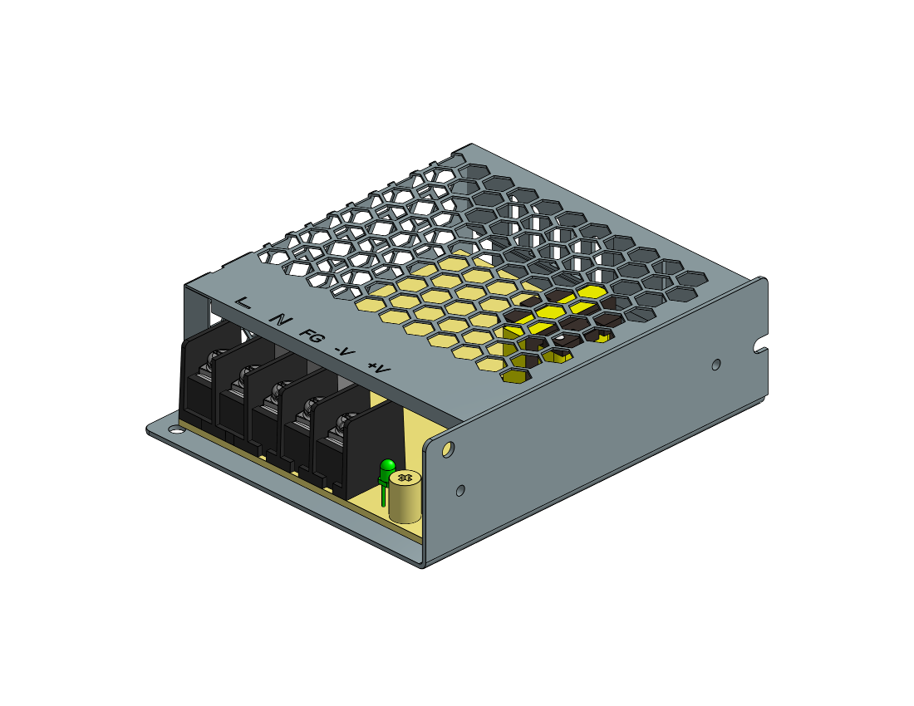
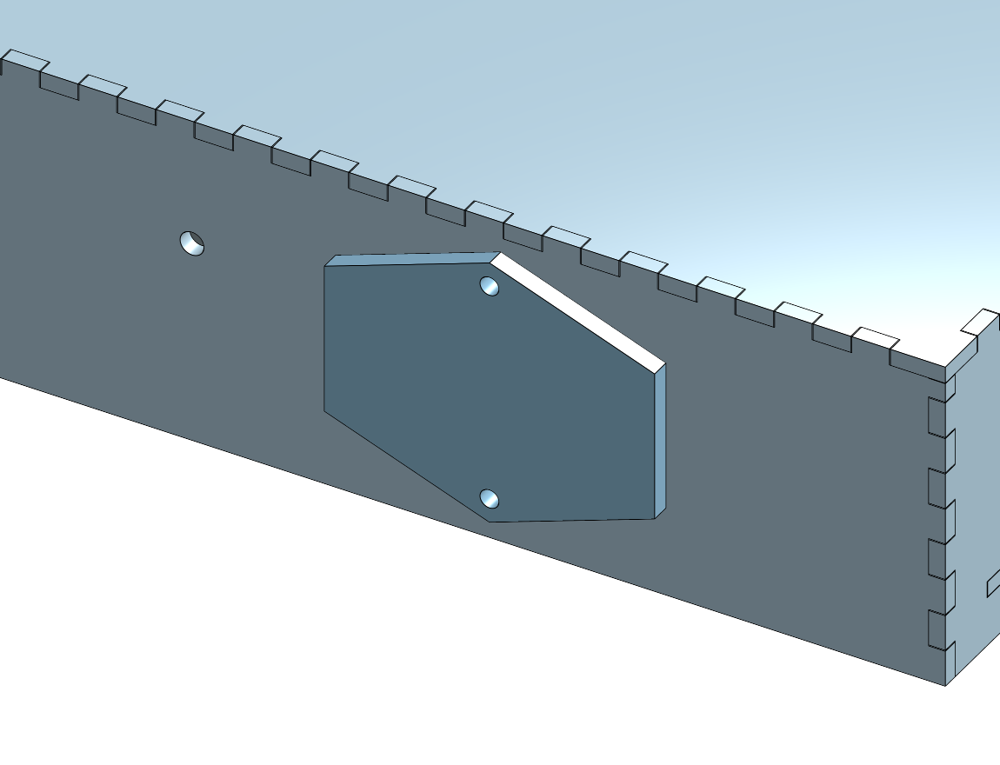

# Power Plan — Desktop

> **Design history:** the battery and USB-C power plan, then the first mains plan (§8–9). The mains reasoning and the 22 AWG bus still hold; the parts list in §§0–7 does not, and the IEC inlet is now on the right wall. Current wiring: [`../wiring.md`](../wiring.md).

> 🔁 **2026-10-12: superseded for the 2 × 2 build.** Power is now mains through
> the IEC inlet into one **Mean Well LRS-50-5** (5 V, 10 A), feeding four panels,
> a Colorlight 5A-75B and a Pi Zero 2 W, with the panel load **capped per frame
> at ~6.6 A** (~1.65 A per panel). The budget and the cap are in
> [`driver-colorlight.md`](../driver-colorlight.md) §4. The bank, PD-trigger and
> buck analysis below is kept as the record; none of it is in the build.

Companion to [`mechanical-plan.md`](mechanical-plan.md).

Original goal: **USB-C in, charge an internal bank, run from the bank, and pass
through when plugged in and full**, using a sealed COTS bank rather than
building a charger.

That instinct was right for the *combined* build. Since the lidar moved to the
[wall project](../../wall/), it's worth asking whether the battery is still wanted
at all — §0 — before spending money on one.

---

## 0. Do you actually want a battery?

You described this one as a **"USB-C desktop toy"**. If that's the frame, the
battery may have left with the lidar.

**What dropping it removes**, all at once: the pass-through-charging hunt, the
auto-shutoff-during-sleep problem, cell heat inside a closed box, the inrush
fault, ~30 mm of enclosure depth (bay [4] — the single largest contributor), the
weight, and a lithium pack in a wooden box on your desk. That is most of §3
below, deleted.

**What it costs:** the thing is tethered.

| | Mains only | With a bank |
|---|---|---|
| Supply | USB-C PD wall wart, 65 W | + bank, PD trigger stays the same |
| Enclosure depth | **~35–45 mm** | ~60–75 mm |
| Failure modes | none of §3 | all of §3 |
| Cost | ~$25 | ~$25 + $60–120 |

**Recommendation: build it mains-first** — and note that mains-first is
*simpler* than §2, not just cheaper. The PD trigger and buck exist to get past
USB's 5 V/3 A ceiling **when the source is a bank**. From the wall, a **5 V
8–10 A PSU straight into the screw terminals** does the same job with two fewer
parts and no conversion losses.

What carries over is the **device side** — screw terminals, bulk cap, wire
gauge, fusing — which is identical either way. Adding a bank later means adding
the trigger and buck *then*. So leave depth in the back for a bank, buy the
PSU now, and defer §2 until you actually want the thing to be portable.

*(An earlier draft of this said the chain was "identical either way". It isn't;
only the device side is. Corrected in [`build-prep.md`](build-prep.md) §0.)*

### If you do want the bank now

Buy on these four specs, in this order. The first two are the ones that make
banks unsuitable, and neither is on the front of the box:

1. **Pass-through charging** (charge and discharge simultaneously, sometimes
   sold as "UPS mode"). Most banks cut output when a charger is connected.
   **Must be explicitly documented** — treat silence as "no".
2. **Low-current / "small device" mode.** Banks auto-shut-off under light load
   so they don't drain in a bag, which is exactly what Patternflow's sleep mode
   looks like. Without it, the device can't be woken remotely.
3. **≥45 W USB-C PD output.** Not 5 V/3 A — see §2, that ceiling is the whole
   problem. 45 W gives 12 V or 15 V at 3 A with margin. 65 W is better.
4. **20 000 mAh (~74 Wh).** Comfortably under the 100 Wh airline limit, ~6 h
   typical runtime. Bigger mostly buys depth in bay [4].

**Where to look.** Specific SKUs churn faster than this document will, so buy on
the criteria, not on a model number I name today. That said, the category that
actually advertises specs 1 and 2 is **banks sold for always-on embedded and
IoT use** — **Voltaic Systems** (V50, V88) is the clearest example, built
explicitly for pass-through and no auto-shutoff, and priced accordingly.
Consumer brands are hit-and-miss: **INIU** markets a low-current mode, and some
**Anker** models charge while discharging, but both vary by SKU and neither
guarantees it across a range. Check the current spec sheet for the exact model,
and if pass-through isn't stated in writing, assume it isn't there.

**Measure the bank before designing the back half of the case** — its dimensions
set bay [4], per [`mechanical-plan.md`](mechanical-plan.md) §2.2.

---

## 1. Load budget

| Load | Typical | Worst case |
|---|---|---|
| 2× Waveshare P2 64×64 | ~1.5–2 A | **6 A** (2 × 3 A spec, 30 W) |
| Matrix Portal S3 | ~0.15 A | 0.25 A |
| LD2450 radar *(optional)* | ~0.07 A | 0.1 A |
| 4× seesaw encoder + NeoPixel | ~0.05 A | 0.25 A |
| **Total @ 5 V** | **~1.9 A (10 W)** | **~6.5 A (33 W)** |

> The VL53L9CX is **not** in this budget — it moved to the
> [wall project](../../wall/). That removes ~0.15 A of average draw and, more
> usefully, a pulsed two-VCSEL load that would have been fighting the panel
> supply on the same 5 V rail.

The worst case is not theoretical. Upstream measured **4.8 A at 5 V** on a
full-white pattern at max brightness across the same 8192 pixels — enough that
they note the connector gets warm and that a total-pixel-power clamp is being
added to the firmware. Our panels are the same pixel count at a finer pitch, so
expect the same order: **~5 A on full white, 6 A+ if you also want headroom.**

Typical generative patterns sit around a third of that.

---

## 2. The constraint that decides everything

**A USB port at 5 V is limited to 3 A — 15 W.** That is the USB spec ceiling
for 5 V without PD negotiation, and it is less than half our worst case.

So a sealed bank's ordinary 5 V USB output **cannot** feed this display at full
brightness. There are exactly three honest ways out:

| Option | How | Verdict |
|---|---|---|
| **A. PD trigger + buck** | Negotiate 12 V @ 3 A (36 W) from a PD bank, step down to 5 V @ ~7 A | ✅ **Recommended.** Full brightness, one cable, standard parts |
| **B. Two 5 V ports** | One USB port per panel, commoned grounds | ⚠️ Works, but relies on undocumented per-port limits and creates a ground-loop/backfeed hazard between ports |
| **C. Clamp brightness** | Firmware power limit to stay under 3 A | ✅ Legitimate, and worth doing *anyway* as a safety net — but as the *only* strategy it permanently costs you the top of the brightness range |

**Do A, and implement C as a backstop.** They're complementary: the clamp
protects the converter and the bank regardless of which supply is attached.

### Recommended chain

```
  USB-C wall charger (PD, ≥45 W)
        │
        ▼
  ┌──────────────────────────────────────┐
  │  Sealed USB-C PD power bank          │   ← the one purchasing decision
  │  • PD in AND PD out                  │      that matters
  │  • pass-through charging  ⚠ VERIFY   │
  │  • ≥36 W out, ≥20 000 mAh            │
  └──────────────────┬───────────────────┘
                     │  USB-C
                     ▼
        ┌────────────────────────┐
        │  PD trigger / decoy     │  fixed 12 V request
        │  board (12 V)           │
        └────────────┬───────────┘
                     │  12 V
                     ▼
        ┌────────────────────────┐
        │  Buck converter         │  12 V → 5.0 V, ≥8 A rated
        │  + bulk cap (1000 µF)   │  synchronous, not a linear reg
        └────────────┬───────────┘
                     │  5 V, thick wire, short run
                     ▼
        Matrix Portal S3 screw terminals ──► panels
```

Notes on this chain:

- **Rate the buck for 8 A, not 6.** Cheap modules are rated optimistically and
  derate hard with temperature — inside a sealed enclosure that matters.
  Synchronous buck, not linear: a linear regulator dropping 12→5 at 5 A would
  dissipate 35 W as heat.
- **Feed the Matrix Portal's screw terminals, not its USB-C port.** This is the
  same rule upstream states emphatically for its `J4` terminal: never run panel
  current through the DevKit's USB port. The Matrix Portal S3 provides +5 V and
  GND M3 screw terminals precisely for this.
- **Keep the 5 V run short and fat.** At 6 A, 300 mm of thin wire is a
  meaningful voltage drop and the panels will show it as a brightness gradient
  across the display. 18 AWG minimum, 16 AWG preferred.
- **Bulk capacitance at the panel end.** Upstream puts 1000 µF/16 V on the
  board for exactly this reason — the panel's row-scan draws in sharp pulses.

---

## 3. The four things that go wrong

These are the failure modes specific to running off a sealed bank, and they are
all worth knowing *before* buying one.

**1. Pass-through charging is rare, and often bad.**
Most banks will not charge and discharge simultaneously; they cut the output
when a charger is connected, which browns out the display. Of those that do,
many implement it poorly (charging the cell *through* the output path, which
runs the cell hot and shortens its life). **This is the single spec to verify
before purchase** — look for explicitly documented "pass-through charging" /
"UPS mode", and treat unmarked banks as not having it.

**2. Auto-shutoff on low draw.**
Banks are designed to turn themselves off when they see a small load, so they
don't drain in a bag. Patternflow's **sleep mode** — panel dark, HUB75 transfer
stopped, board idling on Wi-Fi — is exactly the low-draw condition that triggers
this. You'd lose the ability to wake the device remotely, which is one of the
nicer upstream features. Mitigations: pick a bank with a documented low-current
or "small device" mode, or keep a deliberate trickle load (the encoder NeoPixels
at low brightness will do it) during sleep.

**3. Heat in a sealed box.**
Charging and discharging a 20 000 mAh cell while a buck converter dissipates a
few watts, inside a closed enclosure, with an LED panel radiating in front of
it. Bay [4] in the stackup needs **ventilation**, and the bank should not be
sandwiched directly against the panel backs. Put the buck converter near the
back cover vents, not buried.

**4. Inrush on connect.**
1000 µF plus a panel's input capacitance looks like a short circuit for the
first milliseconds. Some banks and PD sources read that as a fault and refuse to
start. If the display won't come up on first connect but works when the bank is
already running, that's this — and the fix is a soft-start / inrush limiter, not
a bigger bank.

---

## 4. Runtime

At the ~2 A (10 W) typical draw, and taking ~85 % for cell-to-5 V conversion:

| Bank | Nominal energy | Usable | Typical runtime | Full-white runtime |
|---|---|---|---|---|
| 10 000 mAh | ~37 Wh | ~31 Wh | ~3 h | ~1.2 h |
| 20 000 mAh | ~74 Wh | ~63 Wh | ~6 h | ~2.5 h |
| 26 800 mAh | ~99 Wh | ~84 Wh | ~8 h | ~3.3 h |

Consistent with upstream's measured "roughly 4 h per 10 000 mAh at max
brightness". **20 000 mAh is the sweet spot** — 26 800 mAh is the practical
ceiling for air travel (100 Wh limit) and adds depth to bay [4] for runtime
you probably won't use.

---

## 5. Why not build the charger

For the record, since it's the obvious "do it properly" temptation:

A real integrated design is a USB-C PD sink controller, a multi-cell Li-ion
charger IC (BQ25703-class), a 2S or 3S pack with protection, a fuel gauge, and
a 5 V buck — plus the cell-balancing, thermal cutoff and mechanical protection
that make a lithium pack safe in a wooden or plastic box you carry around.

That is a genuinely good project and a completely different one from building a
Patternflood. **The sealed bank is the right v1** and it is not a compromise you
have to undo later: the PD trigger + buck stage stays identical if you ever
swap the bank for a custom pack. Only the thing upstream of the trigger board
changes.

---

## 6. Decisions to make

1. **Buy the bank first.** Its dimensions set bay [4], which dominates total
   enclosure depth — you cannot finalise the back half of the case without it.
   Criteria: ≥36 W PD out, ≥20 000 mAh, **documented pass-through charging**,
   documented low-current mode.
2. **PD trigger voltage: 12 V.** 9 V works and needs less step-down ratio, but
   12 V @ 3 A gives 36 W against 27 W and more margin at the buck input.
3. **Implement the firmware power clamp** regardless of supply — see
   [`firmware-delta.md`](firmware-delta.md).

---

## 7. The bank: Voltaic V50

Selected after checking candidates against §0's four criteria. **Pass-through
plus always-on plus ≥36 W turns out to be an empty set** — nothing found meets
all three, so this is a considered compromise, not a clean win.

| | Voltaic V50 | Voltaic V88 |
|---|---|---|
| Size | **118 × 82 × 26 mm**, 368 g | 218 × 137 × 22 mm |
| Capacity | 13,400 mAh / **48 Wh** | 24,000 mAh / 88.8 Wh |
| Output | USB-C PD 5V/3.6A, 9V/2.2A, 12V/1.6A → **~20 W** | DC **12V/6A = 72 W** |
| Always-on | ✅ documented, ~7 mA idle | ✅ documented |
| Pass-through | ✅ **documented** | ❌ **see below** |

> ⚠️ **The V88 does not do pass-through, whatever the retailers say.** Multiple
> listings advertise it, but the actual usage documentation states: *"Do NOT
> simultaneously charge the Voltaic V88 power bank and use it to power your
> robot."* Charge-while-running is the entire reason for a fixed USB-C inlet, so
> that rules it out despite the far better 72 W output.

### The V50's ceiling, and why it's acceptable

Waveshare rates each P2 64×64 panel at **5 V / 3 A, ≤15 W**, so the pair's rated
maximum is **30 W**. Upstream measured **4.8 A (24 W)** for real full white on the
same 8192 pixels, and about a third of that for a typical generative pattern.

The V50 delivers ~20 W, or ~18 W after the buck:

| | Draw | V50 |
|---|---|---|
| Typical pattern | ~8 W | ✅ comfortable |
| Measured full white | ~25 W | clamp to ~72 % |
| Rated maximum | 30 W | clamp to ~60 % |

So **every realistic pattern runs at full brightness**; only near-full-white
frames get clamped. The firmware power clamp
([`firmware-delta.md`](firmware-delta.md) §5) therefore moves from prudent to
**required** — it is what keeps the bank inside its output limit.

Runtime at ~11 W typical: **48 Wh × ~0.85 ≈ 3.7 h**. Under 100 Wh, so it flies.

### Mounting

The bank straps to the **inside of the removable back cover** with two velcro
straps through obround slots, so lifting the cover takes the bank with it and
there is no separate battery tray. Obround rather than rectangular because a
strap slot is loaded in tension every time it is tightened, and sharp internal
corners are where soft basswood splits.

Modelled at `bankX = -80`, offset left so the Matrix Portal gets the rest of the
bay. Verified clearances: **1 mm** to the brace backs at z −17.5, **1 mm** to the
back cover's inner face at z −45.5, 6.5 mm to the left wall.

`bayDepth` is now **34 mm** — clear bay space is `bayDepth − 6`, independent of
panel depth, so 34 gives the 28 mm the 26 mm bank needs.

### USB-C inlet, not a barrel jack

A **panel-mount USB-C passthrough** in the right wall replaces the DC barrel
jack. One external connector, and it is the same one the bank charges through,
so plugging a charger into the case charges the bank in place.

Cutout and flange screw dimensions are placeholders — **verify against the actual
part**, they vary between panel-mount USB-C extensions. Positioned at
`usbY = 0, usbZ = -30`, clear of the corner fingers and the rail mortises.

### Still to resolve

1. **Bank port orientation.** Its USB-C ports must face the open bay (+x), not
   the left wall 6.5 mm away. Check which edge they're on before finalising
   `bankX`.
2. **The cable to the buck must survive cover removal** — long enough to hinge
   the cover aside, or a connector inline.
3. **Matrix Portal vs bank.** The bank occupies x −139…−21. If the panel's HUB75
   header sits centrally or on the left panel, `bankX` has to move. Another
   thing the caliper session settles.

---

## 8. Mains, superseding §§0–7

Decision changed 2026-09-08: **mains AC in, Mean Well LRS-50-5 mounted on the
chassis.** No bank, no PD sink, no buck, no USB-C inlet. Sections 0–7 are kept
for the reasoning but the parts list in them is dead.

```
IEC C14 + switch + fuse  ──mains──►  LRS-50-5  ──5V──►  Matrix Portal terminals
```

### The parts, measured

**Mean Well LRS-50-5** (spec sheet, Case 239A):

| | |
|---|---|
| Size | **99 × 82 × 30 mm**, 210 g |
| Output | 5 V, 10 A, 50 W, efficiency 83 % |
| Mounting | **2 × M3 per side face, 74 mm apart**, ~15 mm up from the base, max penetration **L = 5 mm** |
| | 2 × M3 on the base, 55 mm apart, max penetration **L = 3.0 mm** |
| Terminals | 5-pin: **1 AC/L · 2 AC/N · 3 FG ⏚ · 4 DC −V · 5 DC +V** |
| Inrush | **45 A @ 230 VAC** |
| Derating | begins ~40 °C ambient |

> ✅ **Confirmed against Mean Well's own STEP**, now in
> [`hardware/cad/vendor/meanwell-lrs-50-5.step`](../../../hardware/cad/vendor/meanwell-lrs-50-5.step)
> and imported into the Onshape document. Side holes at **x = 10 and 84 from the
> terminal end**, **z = 15** — dead centre of the 30 mm height. The spec-sheet
> read above was right; it was the *proxy* that had drifted to 14.5 and 7
> terminals, and both are now corrected.



### ⚠️ The terminal screws face the cover, and that fixes the PSU's rotation

The thing the spec sheet does not make obvious and the solid model does: the five
terminals sit in a **step recessed into the top cover**, and their screws tighten
**perpendicular to the long axis, out through the cover face**. Wires enter along
the axis; the screwdriver comes in at right angles to it.

That turns a free choice into a constraint. The envelope is symmetric and the
side mounting holes are centred, so nothing in the geometry stops the supply
going in either way up — but **only one way up leaves the mains terminals
reachable**:

```
   cover toward the BEZEL   ✗        cover toward the BACK COVER   ✓
   ┌──────────────┐                  ┌──────────────┐
   │ ⬡⬡⬡⬡⬡ screws │                  │              │
   ├──────────────┤ bezel, glued     ├──────────────┤
   │   no access  │ shut             │ ⬡⬡⬡⬡⬡ screws │ back cover, 6 bolts
   └──────────────┘                  └──────────────┘
```

The proxy now encodes it: the terminal step is cut into the **−z** face, so the
wrong orientation shows up as the terminals pointing at the bezel rather than
passing silently. Clearance above them with the back cover off is ~19 mm — enough
for a stubby driver, not a comfortable one — so **wire the PSU before the rear
rails go in.**

**The side holes are threaded M3 and collinear** — confirmed on the part, so
ordinary M3 screws go straight in and no slot, insert or captive nut is needed.
They are modelled on the PSU proxy as blind Ø3 pockets 5 mm deep, which is the
spec sheet's **maximum penetration**, not a depth to aim for. That makes the
screw length fall out of the model rather than being guessed:

```
  3 mm  wood (side wall)
+ 5 mm  air  (psuStandoff, for airflow)
+ 5 mm  MAX penetration into the supply
= 13 mm  →  use M3 × 12, which lands 4 mm in
```

M3 × 14 penetrates 6 mm and exceeds the limit. Use a 5 mm spacer or a stack of
washers in the air gap so the case is not pulled out of flat when the screws are
tightened. The wall holes are Ø4.5 (drawn 4.3, +kerf), giving ±0.75 mm per hole
against the drawing's ±1 mm position tolerance over the 74 mm span.

**IEC320 C14 inlet with rocker switch and 5 × 20 mm fuse**, measured
2026-09-09 (listing figures were wrong and self-contradictory):

| | |
|---|---|
| Cutout | **46.75 × 27.25 mm** |
| Depth behind the face | **37.45 mm** |
| Rating | 10 A / 250 V; switch 6 A at 250 V |
| Flange screws | **40 mm centres, Ø3.5** — see below |

### The flange screw spacing, at last

`#iecScrewSpacing` was the last variable still marked UNKNOWN. The part is an
**AC-14-F16A**, and a model of it exists in the public Onshape document
[`a0851c0b`](https://cad.onshape.com/documents/a0851c0ba6a0a5e0e3d6bbcf)
(*DC POWER SUPPLY*, Simon Page). Its `AC INLET` studio carries two Ø3.5 holes on
the short axis at x = −6.3 and x = +33.7:

```
   spacing = 33.7 − (−6.3) = 40.0 mm
```

**The derivation it replaces was 2 mm short.** `#iecCutH + #iecFlangeTip`
= 27.25 + 10.75 = 38 assumed the screws sit in the middle of each lobe; the real
part puts them further out, 4.4 mm in from the lobe tip. A Ø3.4 clearance hole
would not have absorbed 2 mm — the inlet simply would not have bolted on.

> ⚠️ **This is not calipers.** That model is hand-made, and it disagrees with
> the measured part by ~1 mm elsewhere (58.2 vs 59.25 across the flange, 34.0 vs
> 40.95 deep). The cutout and depth figures above stay as measured; only the
> screw spacing is taken from it, because it is the one number no one had.
> 40 mm is also the standard AC-14 figure, which is why it is believable.
> **Confirm with a rule before cutting** — and if it is wrong, these are two
> Ø3.4 holes in a flat panel, trivially re-drilled.



The 46.75 dimension runs along **x**, in the bottom wall, with the lobed
27.25 axis in z. The lobes are what constrain it: `27.25 + 2 × 10.75 = 48.75 mm`
in a 60 mm depth leaves **5.6 mm** of flange margin at both the bezel and the
back cover, and the cutout itself leaves 16.4 mm of wood at each edge, so the
finger joints on those edges are untouched.

### Which wall, and why it is the bottom one

Originally the right-hand (+x) wall. Moved 2026-09-10, because **portrait is the
orientation this thing lives in** — stood on end, the box rests on a ±x wall, so
an inlet there is directly underneath the case and the mating plug jacks it off
the table.

```
   portrait (ideal)              landscape
  ┌─────────┐                  ┌───────────────┐
  │         │                  │    display    │
  │  disp   │                  │ ◉◉  controls  │
  │         │▮ ← inlet, a side └──┬─────▮───┬──┘
  │  ◉◉     │                     ▄▄  ↑ plug ▄▄  ← feet only
  └─────────┘                  ══════════════════   needed here
  ══════════ table
```

The bottom wall is a vertical **side** in portrait, so the cord exits
horizontally and **no feet are needed**. The price is that landscape now rests
on the inlet instead. The +y top wall is the only one that is a side in *both*
orientations, but it puts the inlet diagonally opposite the PSU terminals and
runs mains across the whole box past the Matrix Portal — worse than giving up
landscape.

**x = 100 mm is not free either.** The body needs 37.45 mm behind the wall and
the PSU occupies x −44.6…54.6 there, so the inlet has to clear it. Verified in
the model:

| Neighbour | Clearance |
|---|---|
| PSU (x ≤ 54.6) | **22.0 mm** |
| +x wall inner face (145) | 21.6 mm |
| Bottom back-cover rail (z −48) | 4.4 mm |
| Bezel rear face (z −6) | 10.4 mm |

Mirroring it to negative x would clear the PSU too, but the PSU's terminals face
+x, so that lengthens the mains run for nothing.

**The flange screw at z = −49 gets a bonus.** Directly inside the bottom wall at
that depth is the back-cover rail's outer lamination, 18 mm wide in y, so a
12 mm woodscrew bites 3 mm of wall plus ~9 mm of rail rather than 3 mm of wall
alone. The flip side is that an M3 nut cannot be fitted there — it is solid wood
immediately behind. Use the supplied woodscrews, or a threaded insert. The
z = −11 screw opens into the empty bay and takes either.

**37.45 mm of depth is the number that reshaped the enclosure.** A full-width
knob row left only 10.5 mm between the PSU and the right wall, so the module
would not have fitted at all. Clustering the knobs 2 × 2 freed 90 mm — and that
freed space is what the bottom-wall placement now uses.

### The flange, and why it sets the case depth

Measured, and it is not a plain rectangle:

| | |
|---|---|
| Overhang, short sides | **6.25 mm** beyond the cutout → 59.25 mm long extent |
| Long sides | **triangular lobe**, tip **10.75 mm** out at the middle, tapering to meet the short-side flange, screw hole in the lobe |
| Proud of the face | **3.5 mm** |
| Flange hole | Ø3.6–3.7 → M3 clearance, or the supplied woodscrews |

**The screws are on the SHORT axis.** That is what made the listing's 40 mm look
impossible — 40 mm cannot straddle the 46.75 mm cutout, but it straddles the
27.25 mm one comfortably. So the number was right and I had the axis wrong.
Derived spacing is `cutH + tip` = **38 mm** if the hole sits at the lobe's
mid-height; 40 mm puts it 6.38 mm out of a 10.75 mm lobe, also plausible. One
hole-centre-to-hole-centre measurement settles it, and it is one variable.

> **The flange is what sets the case depth.** Its short extent is
> `27.25 + 2 × 10.75 = 48.75 mm`, which did not fit a 44.5 mm case at all — it
> overhung the rear edge by 3.62 mm and the front by 0.62 mm, and rotating it
> does not help because the lobes are always perpendicular to the long side.
>
> `bayDepth` is therefore **derived, not chosen**:
> `iecCutH + 2×iecFlangeTip + 2×iecFlangeMargin − panelDepth`, giving a
> **56.75 mm** external depth. For comparison the bay itself wanted only
> ~40.6 mm and the connector keep-out ~37.5 mm. The box follows the insides.

### Thermal: comfortable

| Load | Out | % of rated | PSU dissipates |
|---|---|---|---|
| Typical pattern | 11 W | 22 % | **2.3 W** |
| Full white | 25 W | 50 % | **5.1 W** |

A 50 W supply running at a quarter to half load, well below the 40 °C derating
knee. It still needs convection though — vents low on the walls and in the back
cover, and the supply stood off the wood rather than laid on it.

Worth noting the sizing is now generous rather than marginal: 10 A against a
~5 A worst case. **The firmware power clamp becomes optional again** — the
supply, not the source, is no longer the limit.

### The 5 V bus, in 22 AWG

The LRS-50-5 has one +V screw and one −V screw, so the loads meet on a bus
rather than each landing on the supply. The wire on hand is 22 AWG, so the run
from the supply to the bus is several strands in parallel per pole:

| Run | Carries | 22 AWG per pole | Drop, 30 cm each way |
|---|---|---|---|
| **LRS-50-5 → bus** | up to 10 A (8 A planned) | **4** (3 at minimum) | 63 mV at 8 A (85 mV with 3) |
| Bus → each panel | 1.4 A capped, 2.4 A full white | 1 (2 for uncapped headroom) | 44 mV (76 mV at 2.4 A) |
| Bus → Pi 5 | ~1.6 A | 1 (2 for less drop) | 51 mV |
| Bus → Colorlight 5A-75B | ~0.8 A | 1 | 25 mV |

- **Four strands are 16 AWG.** 22 AWG is 0.33 mm², so four make 1.30 mm²,
  matching 16 AWG's 1.31, and three make 0.98 mm², a little over 18 AWG's 0.82.
  That's the "18 minimum, 16 preferred" from §2.
- **Heat sets the count as much as drop.** A 22 AWG strand bundled inside a
  closed box is good for about 2.5–3 A. Four share 10 A at 2.5 A each; three
  carry 3.3 A each, which works but runs warm.
- **Same length, one ferrule.** Cut the strands of a pole to the same length so
  they share the current evenly. Twist the four bare ends together and crimp
  them into one **1.5 mm² (16 AWG) ferrule**: black in the DIN colour code, red
  in the French one. Use the 10 mm length for the LRS terminals, which sit ~10 mm
  deep. A 2.5 mm² ferrule is half empty and won't grip. Four 22 AWG insulations
  are 3.3–3.6 mm across, right at a 1.5 mm² collar's ~3.5 mm. If they won't go
  in, use an uninsulated ferrule rather than stripping further back.
- The drops above assume 52.9 mΩ/m per strand and the LRS trimmed to ~5.15 V,
  which leaves the Pi ≥ 5.0 V under load.

## 9. Mains safety — read before wiring

Mains inside a wooden box with a removable back is fine if done deliberately.
Four things are not optional:

> ⚠️ **1. The LRS-50's mains terminals are bare screw terminals.** Pins 1–3
> are L, N and earth on an open block. The back cover comes off with six screws,
> so sooner or later it will be opened while the thing is plugged in.
>
> **Insulation is the primary control, not a barrier.** An earlier revision put
> a vertical divider and a top rail around the supply to box it in. That was
> dropped 2026-09-09 — it obstructed assembly, and it was solving the problem
> indirectly. The input block is the *only* exposed mains point in the build:
> everything else is already inside the supply's metal case, the IEC module's
> plastic body, or insulated wire. So protect that point directly —
> **a terminal boot or shroud over the input side, and heatshrink over
> insulated fork terminals** — with the IEC switch as the second layer.
>
> What the barrier *also* did was stop a loose conductor migrating into the
> low-voltage side. That job now belongs to strain relief and tie-downs, item 4
> below, which is no longer optional.

**2. Earth the supply.** IEC pin 3 → the LRS-50's FG terminal. The LRS-50 has a
metal case and expects to be earthed; the wooden enclosure is non-conductive so
nothing else needs bonding, but the supply's chassis does.

**3. Fuse for inrush, not for load.** The datasheet gives **45 A inrush**. At
115 V a 50 W supply draws under 0.5 A running, so a **1 A time-delay (T)** fuse
is about right — a fast-blow of that rating will nuisance-trip on switch-on.

**4. Separate and restrain.** Mains wiring sleeved and strain-relieved at the
IEC module, routed away from the DC side and the I²C runs. The included 18 AWG
leads are fine for the current; it's the mechanical restraint that matters in a
box that gets picked up.

Also: basswood is combustible. Nothing here gets near ignition at 2–5 W of
dissipation, but do not let the enclosure block the supply's own vents.
