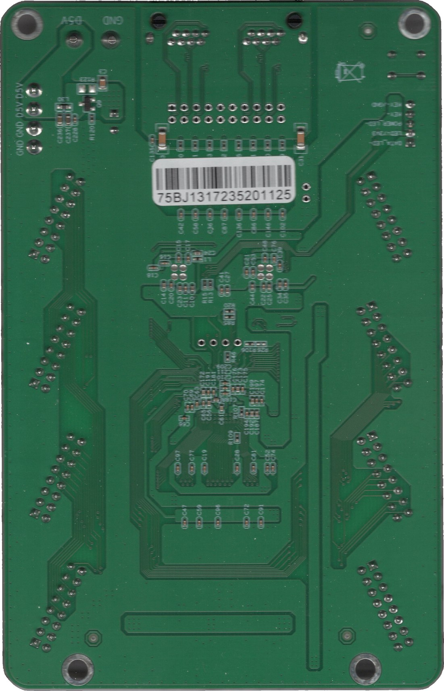

# Driving the Panels: Colorlight 5A-75B + Pi Zero 2 W

Decided 2026-10-11/12. This replaces the Adafruit Matrix Portal S3 as the
desktop build's controller, and with it the 2 × 1 landscape layout. The display
is now a **2 × 2 array of Waveshare P2 64 × 64 GOB panels**: 128 × 128 px,
256 mm square.

The reasoning for the Pi + Colorlight split was laid out long before it was
taken, in the wall project's [`compute-options.md`](../wall/compute-options.md)
(option D). What tipped it here was that the P2 panels are physically small, so
more of them is the point. That made panel count, and a driver that scales, the
pressure — not compute.

---

## 1. What this gives up

Said plainly, because [`compute-options.md`](../wall/compute-options.md) §3
spells out the cost: this build **no longer runs upstream Patternflow
firmware**. The `.pfm` loader, the frozen ABI, the web console and the compiled
community pattern library are all ESP32 binaries. A Pi host renders its own
frames. The patterns' JavaScript source form is the bridge back to that
library, if one is wanted (§5).

[`firmware-delta.md`](firmware-delta.md) describes the abandoned ESP32 fork and
is kept for history.

---

## 2. The panels are the easy kind

Chip markings read off one panel, 2026-10-11:

| Marking | Part | Meaning for the driver |
|---|---|---|
| `6124HJ C003173` | FM6124-family column driver | Plain shift-register driver, **no init sequence** — not an FM6126A-style "needs a config write" chip, and not S-PWM |
| `RUC7258G PAE45012` | Ruichips RUC7258 | 8-channel row driver with an internal 3-to-8 decoder and anti-ghost blanking; two cascade for 16 rows, so plain **A–E binary addressing** at 1/32 scan |
| `MW245BC` | MW74HC245 | Signal buffer, no effect |

Every HUB75 driver handles this combination. **Expect an hour of LEDVision
"smart settings"** at bring-up anyway: a user with a 64 × 32 RUC7258 panel
reported only a garbled top half on a 5A-75B
([ESP32-HUB75 discussion #501](https://github.com/mrcodetastic/ESP32-HUB75-MatrixPanel-DMA/discussions/501)),
which is the classic symptom of a wrong scan or data-group setting, not of a
chip that cannot be driven.

---

## 3. Parts and topology

```
   mains ─► IEC (right wall) ─► LRS-50-5 ─┬─ 5 V ─► 4 × panel power (star)
                                          ├─ 5 V ─► Colorlight 5A-75B
                                          └─ 5 V ─► Pi Zero 2 W (own leads)

   Pi Zero 2 W ─ micro-USB OTG ─► USB gigabit adapter ─ Cat6 ─► 5A-75B
                                                        HUB75 ×4 (J1–J4)
                                                          one panel each
   Pi Zero 2 W ─ I²C (STEMMA QT) ─► 4 × Adafruit 4991 encoders
   Pi Zero 2 W ─ Wi-Fi ─► your network
```

- **Colorlight 5A-75B** — Lattice ECP5, two gigabit PHYs, eight HUB75 outputs.
  **One panel per output**, J1–J4: no chain mapping, short equal ribbons, and
  J5–J8 left for the two spare panels.
- **Raspberry Pi Zero 2 W** — the cheapest board that does the job, and its
  512 MB is soldered on, so DRAM pricing does not touch it. It has **no
  Ethernet**, and that is the one trap:
- **USB gigabit adapter (RTL8153 or AX88179 class)** — the 5A-75B **will not
  link at 100 Mbit**
  ([FPP forum](https://falconchristmas.com/forum/index.php?topic=6871.0)), so
  the common 100 Mbit dongles fail. A gigabit adapter on the Zero's USB 2.0
  links at 1000 and moves ~300 Mbit, against the ~24 Mbit/s that 16 384 px at
  60 fps needs. A Zero 2 W driving a 192 × 128 matrix (1.5 × this one) through a
  5A-75B is reported working
  ([FPP forum](https://falconchristmas.com/forum/index.php?topic=15657.0)).
- **Fallback if the Zero falls short:** a Pi 3B+, whose built-in Ethernet is
  gigabit behind USB 2.0. The board envelope is variables (`#piW`, `#piH`, …),
  so the swap is a variable change.

---

## 4. Power: one LRS-50-5, capped

| Load | Draw |
|---|---|
| LRS-50-5 rating | 10 A; plan on **8 A continuous** |
| Colorlight 5A-75B | ~0.8 A (the two PHYs are the hungry part) |
| Pi Zero 2 W + adapter | ~0.6 A |
| **Left for the panels** | **~6.6 A ≈ 1.65 A per panel** |
| Panel at full white | 2.4 A measured (upstream, on an ESP32 driver); 3 A Waveshare supply rating |
| Typical generative pattern | ~0.8 A per panel |

So the panels need a cap, but it rarely engages:

- **Cap per frame in the renderer, not with a global brightness ceiling.**
  Estimate each frame's current from the post-gamma values actually sent, and
  scale that frame down only when it exceeds the budget. Upstream's firmware
  is adding the same total-power clamp. The PSU's overload hiccup stays as
  the backstop.
- **Calibrate on the real driver first.** The 2.4 A figure is from an ESP32
  DMA driver; the Colorlight may run a higher output duty. Measure one panel at
  full white, and full red, green and blue separately for per-channel weights.

The Pi takes its 5 V from its own pair off the PSU terminals, not through a
panel's harness — the same arrangement as Adafruit's RGB matrix bonnet, which
back-powers the Pi from the panel supply. Set the LRS trim to ~5.15 V so the Zero
sees ≥ 5.0 V under load.

---

## 5. Software path

1. **Bring-up:** LEDVision (Windows-only; a VM with a bridged NIC works) to
   configure the card for these panels — 64 × 64, 1/32 scan, FM6124, 138-type
   decoding — and *save to receiver* on both the screen-parameter and mapping
   tabs.
2. **First pixels from the Pi:** Falcon Player (FPP) supports Colorlight
   receivers over Ethernet on a Pi. That proves the Zero + adapter + card chain
   before anything is written.
3. **The instrument:** a renderer on the Pi that reads the four encoders over
   I²C, runs patterns, applies the per-frame cap, and streams frames to the card
   — through FPP, or directly once the protocol is in hand. Whether the Live
   Editor's **JavaScript** patterns can run here (QuickJS) is the question that
   decides how much of the community library comes along; on a Zero, budget
   carefully for 16 384 px a frame.
4. **Read-only rootfs** before the box is closed — it will be switched off at
   the wall.

---

## 6. Where it lives in the box

The electronics hang off the **rear face of the middle panel brace**, component
side facing **back** (enclosure model, `Bay obstructions` for the boards,
`Enclosure shell` for their bosses). Nothing is fastened to the back cover and
no cable runs to it: it lifts off clean, and once it is off every board, port
and the Pi's microSD are in reach.

| | Centre (x, y) | Model | Mounting |
|---|---|---|---|
| 5A-75B | (30, 5.5), long axis **horizontal**, RJ45 end toward −x | **measured** — see below | 4 × M3 x 8 into plywood bosses on the brace |
| Pi Zero 2 W | (−107, 22), connector edge down | official drawing, 65 × 30 | 4 × M3 x 8 into bosses — **open its 2.75 mm holes to 3.2**, or use M2.5 for the Pi alone |
| Gigabit adapter | (−107, −22) | envelope until one is bought | strapped to the brace |

Horizontal puts the card's two rows of four HUB75 headers facing the top and
bottom panel rows. Each panel's **IN is on the left seen from behind** (+x seen
from the front), and the nearest header to each IN is 33–45 mm away. The card
sits right of centre so its RJ45 face (x −45.4) leaves 29 mm for the patch-cable
plug before the Pi.

**No standoffs.** Every board mounts with the box's one fastener, an M3, into a
nut trapped in the sheet — the same trick as the back-cover rails. Each board
hole gets a 10 mm square stack glued to the brace: a hex-pocket layer holding the
nut against the brace, and a clearance layer outside it that the board sits on
and the nut pulls against. The brace has a clearance hole under each, so the
screw tip never bottoms and never reaches the panel: M3 x 8 ends 0.3 mm into the
brace, M3 x 10 2.3 mm. Two sheets put every board 6 mm off the brace, clear of
its own through-hole pins (`#bossLayers`).

The middle brace grows from y [−40, 40] to [−40, 51.4] to carry the card's
upper bosses — as far as it can go and still miss the top row's HUB75 cable
keep-outs, by 2.5 mm. Two consequences:

- **The boards cover two panel screws** (middle brace, y ±20 near x ±7): take
  the boards off before taking a panel off.
- Clearances with everything as measured: boards ≥ 3.0 mm from any panel
  connector keep-out, bosses ≥ 2.5 mm, the back cover 17 mm behind the tallest
  part (the card's terminal block).

### The 5A-75B, measured

From 600 dpi scans of both faces, 2026-10-12 — outline and holes off the back,
which lay flat; component outlines off the front, registered through the holes.



| | Component side up, origin lower-left, RJ45 edge at top (mm) |
|---|---|
| PCB | **91.76 × 143.67** |
| Mounting holes | Ø4.23 plated, at (5.11, 139.08), (86.51, 139.35), (16.07, 3.81), (76.44, 3.96) — the bottom pair is inset ~16 mm |
| HUB75 J1–J8 | 2 × 8 shrouded, in two columns at x ≈ 11.9 and 80.3, rows at y ≈ 98.6, 71.8, 44.4, 17.1; **angled ±25° off vertical**, mirrored |
| RJ45 | dual, ganged, x 29.5–63.5, overhangs the top edge by ~3.5 |
| 5 V in | 2-way barrier terminal, x 66–86.5 at the top edge (silk: D5V / GND); also a 4-pin header, right edge (GND GND D5V D5V) |

Heights, calipered 2026-10-12: PCB **1.7**; above it RJ45 **13.8**, HUB75
shrouds **9**, terminal block **14.8** (the tallest), big JST **10.6**, small
JST **6.38**. The Pi Zero's PCB is taken as 2 mm, unmeasured.

Because the boards face back, each HUB75 ribbon makes a short U: out of the
card's header toward the cover, round the card's edge, and forward into the
panel's IN.
