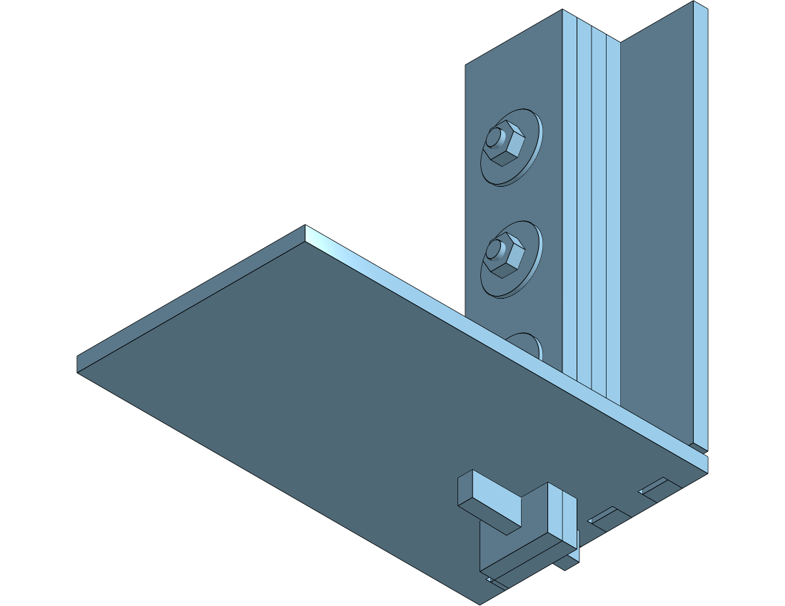
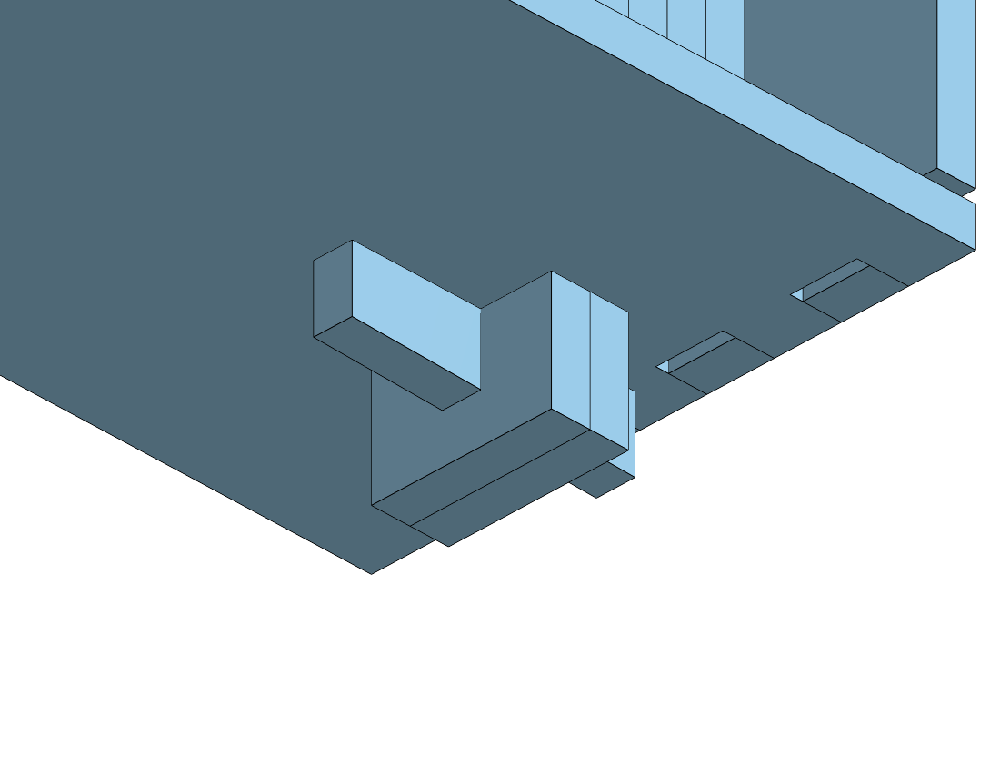
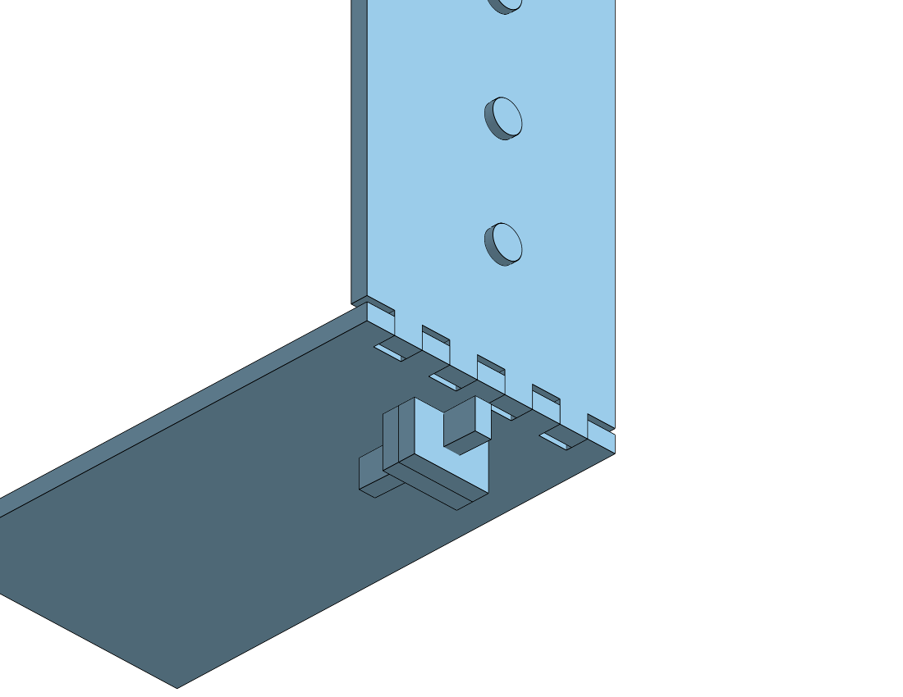

# Glueless Assembly — Fastener Concepts

**Status: concepts for review. Concept B is modelled as a study part; nothing is
in the enclosure yet.**

The enclosure as designed in [`enclosure-lasercut.md`](enclosure-lasercut.md) is a
glued finger-jointed box with one demountable part (the back cover, on captive
M3 nuts). This doc asks the other question: **can the whole box be held together
with nothing but laser-cut 3 mm basswood and M3 hardware?**

Constraint set, as stated:

- Laser-cut parts only — no machining, no counterbores, no threaded inserts.
- M3 bolts, washers, lock washers, nuts.
- No glue anywhere, including the laminations. **An ideal, not a hard
  constraint** — §6.5 argues for spending the one exception on the front face.
- Must stay demountable, indefinitely.

Short answer: **yes, and the box is already most of the way there** — but not by
the route that looks obvious. Two pieces of arithmetic below rule out most of the
standard laser-cut joinery vocabulary at 3 mm, and what survives is a different
kind of assembly rather than a bolted version of the same one.

---

## 1. Two facts that kill the obvious answers

### 1.1 A bolt can only ever join two PARALLEL plates

A laser drills along one axis only: the sheet's own normal. So a hole in a part
always has its axis perpendicular to that part. For one bolt to pass through two
parts, it must be normal to both — which means **the two parts must be parallel.**
Two perpendicular walls can never be bolted directly to each other, at any
thickness. Every corner needs an intermediary that is parallel to one of them.

That also kills the **T-slot** (tab-and-captive-nut), the canonical glueless
laser-cut joint, but for a second and separate reason. A captive nut has to be
held with its **5.5 mm across-flats lying in the sheet plane** and its 2.4 mm
thickness across the sheet — nut axis and sheet normal are the same line:

```
   sheet, 3 mm                       nut needs 5.5 mm
   ┌──────────────┐                  ┌────────┐
   │   ⬡  ← 5.5   │  in plane: ✓     │   ⬡    │  across thickness: ✗
   └──────────────┘  2.4 across      └────────┘  3 mm is not 5.5
```

A T-slot puts the nut in the **edge** of the tabbed panel, so the 5.5 mm has to
fit inside that panel's thickness. It does in the 6 mm ply every T-slot box is
made from. It does not in 3 mm. **T-slot joints need ≥ 6 mm stock, full stop.**

**Consequence:** a nut pocket costs a whole lamination and is only worth it when
the bolt is short. Where a bolt can pass right through and reach open air, a
**plain nut on the far face is strictly better** — it needs no pocket and it ties
every lamination it passes through, not just the two either side of the nut.

### 1.2 You cannot develop preload against basswood

Basswood crushes perpendicular to the grain at roughly **2.4 MPa** at the
proportional limit. Bearing area under an M3 washer:

| Washer | OD | Bearing area | Embeds above |
|---|---|---|---|
| DIN 125 (standard M3) | 7 mm | 29 mm² | **~70 N** |
| DIN 9021 (fender M3) | 9 mm | 55 mm² | ~130 N |
| Ø12 penny washer | 12 mm | 104 mm² | ~250 N |
| Ø16 penny washer | 16 mm | 190 mm² | ~460 N |

An M3 bolt nipped up by hand with a short driver reaches **400–600 N** without
feeling tight. A torque wrench at 1 Nm gives ~1.5 kN. **Every one of those
crushes the wood**, and then the wood creeps and the preload decays anyway.

So: a bolted basswood joint has **no usable friction capacity**, and any design
whose stiffness depends on clamp force is designing on sand.

> **This is the one finding here that is a material property rather than a
> geometric one, and it is therefore the one a different stock can fix.** Baltic
> birch ply moves the Ø12 figure to ~620 N and hard maple to ~1050 N — on maple,
> a hand-snug M3 genuinely stays clamped. See
> [`enclosure-lasercut.md`](enclosure-lasercut.md) §13.

---

## 2. The reframing that makes this work

> **Glue makes a monolith. Bolts make a retained assembly. Don't try to replace
> the glue's clamp force — replace its *job*.**

Break down what the glue in a finger-jointed box actually does:

| Glue's job | Carried by | Needs hardware? |
|---|---|---|
| Resist racking (shear in the joint plane) | The finger interlock itself | **No** |
| Locate the panels | The finger interlock itself | **No** |
| Stop fingers walking out (tension normal to the joint) | *glue only* | **Yes** |
| Hold laminations together in shear | *glue only* | **Yes** |
| Resist torsion of the whole box | Front + back **diaphragms** | **No — already built** |

Only two rows need hardware, and the loads in both are small. The box is ~1.5 kg
of wood plus ~0.9 kg of panels and PSU; nothing inside it pulls a corner apart.
**The bolt is a retainer, not a clamp.** Torque it snug, use a nyloc so it stays
snug, and stop worrying about preload — §1.2 stops being a problem the moment
you stop asking the joint for friction.

### The two diaphragms are the real structure

This is the argument that glueless is viable *here specifically*:

```
    z=0                                              z=-60
     ║                                                 ║
     ║  front face, 2 laminations, 296 x 244           ║  back cover
     ║  minus a 257 x 129 aperture                     ║  289 x 237, 6 bolts
     ║                                                 ║
     ╚══ side / top / bottom walls, dry finger joints ═╝
```

A box with a stiff plate bolted across each end is torsionally stiff regardless
of how its corners are joined — the plates take the torque as in-plane shear, and
in-plane shear is what a 3 mm sheet is best at. The back cover is **already** a
6-bolt diaphragm. The front is already doubled and full-perimeter. So the
torsion case, which is the one a dry box normally loses, is the one case this
design had already solved for other reasons.

Caveat: the front face is not a *full* diaphragm — it has a 257 × 129 hole in it,
leaving 20 mm rails top and sides and a 96 mm control band below. A 20 mm rail in
3 mm basswood is a weak shear path. **This is the thing to test, not to assume.**

---

## 3. The concepts

Five schemes, cheapest-change first. They are not exclusive: C is a supplement
to any of them, and B ends up borrowing E's key.

### Concept A — Dry press fit, diaphragms only

**Change to the model: none.** Cut what is already drawn, skip the glue bottle.

The finger joints are drawn for a **zero-clearance press fit** (kerf compensated
both ways, `enclosure.fs` §"Finger joints"). Press-fit basswood fingers hold
genuinely well dry — enough to carry the box around. The front face and back
cover bolt on and provide the torsion path.

| | |
|---|---|
| Hardware | 6 × M3 (back cover, already in the model) + 4 encoder nuts |
| New parts | none |
| Demountable | yes, but the corners will loosen with repeated cycles |
| Risk | **humidity.** A press fit that is perfect in winter is loose in summer, and basswood moves ~3 % across the grain over the seasonal humidity range — that is 0.1 mm on a 3 mm finger, i.e. half the kerf budget |

**Verdict: the honest baseline, not the answer.** Worth cutting first because it
costs nothing and tells you how tight the joints actually are. If it feels solid
dry, every other scheme gets easier.

### Concept B — Laminated corner post, bolted and tusked ★ recommended

**Modelled at full scale. Renders and dimensions below are from the CAD, not a
sketch:** [`concept-b-corner-post.fs`](../../hardware/cad/featurescript/concept-b-corner-post.fs),
Part Studio *Concept B — corner post*, on the enclosure's own datum.



A post runs the full height of each corner, parallel to the side wall. §1.1 says
you can only bolt parallel plates, so **the post takes bolts on the side-wall
face and an interlock on the bottom-wall face** — those are the only two options
available, and each wall gets the one its orientation allows.

```
   plan, one corner                     section through one bolt
   x=133      139   142  145  148
   ├──┬──┬──┬──┤     │    │              side wall  ███ 3 mm      x 145..148
   │P1│P2│P3│P4│ side wall               ─────────► ███ ▓▓▓▓▓▓▓▓▓▓▓▓  M3 x 20
   │▓▓│▓▓│  │  │                                        P4 P3 P2 P1
   └──┴──┴──┴──┘                                                  ⬡ ─ plain nut
    └tenon┘  └── bolts through here                               ○ ─ Ø12 washer
      6 mm       into a plain nut inboard                     (inboard face, open)
```

**Four laminations, 12 × 20 mm in section.** The bolts pass through the side wall
and all four plates and take a **plain nut on the inboard face** — no hex pocket
anywhere. One bolt therefore clamps every lamination, which is §1.1's corollary
and solves Concept C for the post at the same time.

**The bottom end is a through-tenon locked with a tusk key** — an interlock, not
a fastener, because no bolt can reach across that corner:



The key wedges between the bottom wall's **outer face** and the lower edge of a
slot cut through the tenon. The slot's upper edge sits `keyDraw` = 0.3 mm *below*
the wall face, so driving the taper home pulls the post's shoulder up tight
against the wall's inner face. That 0.3 mm is the entire mechanism, and it is why
this is a joint rather than a peg. Both faces of the key are straight cuts in the
plate outline — nothing here needs a second setup.

**The tenon is made from the two INBOARD laminations, not all four.** This is
[`enclosure-lasercut.md`](enclosure-lasercut.md) §7b applied again: the mortise
must not sit within 3t of the wall's edge. Tenoning all four plates would put the
mortise 3 mm from the bottom wall's outer edge — straight into the finger notches.
Using P1+P2 only puts it **9 mm** clear:



| | Modelled | Check |
|---|---|---|
| Post section | 12 × 20 mm, 4 × 3 mm | |
| Post z band | **−45 … −25** | clears rails (−57…−48), braces (~−14.5), Matrix Portal (x 21…99) |
| Tenon | 6 × 14 mm, 9 mm proud | mortise **9 mm** from the wall edge ✓ |
| Tusk key | 3 × 5 mm, 0.3 mm draw | |
| Bolts | M3 × 20, plain nut + Ø12 washer | 3 + 12 mm of wood, ~5 mm of thread left |
| Bolts per post | ~5 over 238 mm | |
| Sheet cost | 16 plates 238 × 20 mm ≈ **0.08 m²** | plus 8 keys |
| Hardware | **20 × M3 × 20, 20 nuts, 20 washers** | plus the 6 back-cover screws |

**Clearance against what is already in the box**, all four corners, from the
current model:

| Corner | Nearest obstruction | Gap to a 12 mm post |
|---|---|---|
| bottom-left `(−145, −157)` | PSU begins at x = −44.6 | 88 mm |
| bottom-right `(145, −157)` | IEC flange ends at x = 129.6 | **3.4 mm** — fits, but that is the one to draw first |
| top-left `(−145, 81)` | nothing | free |
| top-right `(145, 81)` | Matrix Portal ends at x = 98.8 | 34 mm |

**What it costs:** the tusk keys protrude below the ±y walls. That is fine in the
orientation already chosen — portrait stands on a ±x wall, so the ±y walls are
vertical sides — but it does finally close the door on landscape, which the IEC
inlet had already mostly closed. Visually the protruding keys read as a
deliberate detail rather than an accident, which is a matter of taste.

**Verdict: this is the one to model into the enclosure.** Every cut is in-plane,
the nut pockets that would have eaten laminations are gone, and the one joint
that cannot be bolted is solved by a joint that does not need to be.

### Concept C — Bolt the laminations (required by every scheme)

Easy to forget: **"no glue" also outlaws the doublers.** The design currently
face-glues laminations in four places, and each needs a mechanical answer:

| Lamination | Layers | Mechanical fix | Free? |
|---|---|---|---|
| Front face | 2 | **4 encoder bushing nuts already clamp it** at the knob cluster, plus 4 × M3 in the bezel margin | mostly |
| Panel cross-braces | 2 | **the panel mounting bolts already clamp it** — they pass through both layers into the panel posts | **yes, free** |
| Rear rails A/B/C | 3 | **the back cover bolts already clamp them** — that is what they are for | **yes, free** |
| Corner posts (Concept B) | 4 | **the post's own through-bolts clamp it** — one bolt, all four plates | **yes, free** |

Four of the five are already paid for by hardware the design needs anyway.
Only the front face needs bolts added, and only in the 20 mm bezel margin.

> ⚠️ **A bolted cross-grain lamination is not plywood.** The cross-grain trick in
> [`enclosure-lasercut.md`](enclosure-lasercut.md) §1 works because glue makes the
> two layers act as one section. Bolted at intervals, the layers can slip between
> bolts, and the narrow rails above and below the aperture — the exact place the
> cross-grain trick was protecting — get the least of the benefit. **Bolt spacing
> on the front face wants to be ~60 mm, not ~150.**

### Concept D — Front-to-back tension rods

Four long M3 bolts running the full depth at the corners, through the back cover
and into captive nuts in the front face's inner lamination, putting the whole
stack of walls into compression.

```
        front (2 layers)          back cover
            ║                          ║
   nut ▓▓───╫──────────────────────────╫───[bolt head + washer]
       ↑    ║   side wall in           ║
   captive  ║   compression, 60 mm     ║
```

Very few parts, very quick to assemble, and the visible hardware is 4 heads on
the back cover. But:

- §1.2 says the compression is worth ~250 N at best before the washer embeds,
  over a 60 mm column of end grain that will creep. **It will go slack.**
- The rods land in the corners, which is where the finger joints are.
- The front nut pocket needs 3 laminations; the front is 2, so `#frontLayers`
  goes to 3 and the EC11 bushing thread length (~7 mm) no longer clears 9 mm of
  wood plus a nut. **This breaks the encoders.**

**Verdict: rejected.** The last bullet is fatal on its own.

### Concept E — Wedged through-tenons, zero hardware

The traditional answer, and it needs no M3 anything: the tenon passes through the
wall and out the far side, a tapered slot in the protruding tenon takes a wooden
wedge, and driving the wedge pulls the joint tight.

**Rejected as the whole scheme**, for one reason: the wedge would be loaded
across a 3 mm tenon in a soft, straight-grained wood, and basswood at that scale
snaps. A box held together by twenty of them is a box that sheds a wedge a month.

**But adopted as a detail inside Concept B**, where both of those objections
disappear: the tenon there is *laminated* to 6 mm, and the key is not the only
thing holding that corner — the side wall is bolted, so the key is a retainer on
one axis rather than the entire structure. §2's point again: a fastener that
carries no preload and no shear can be much weaker than the joint it retains.

That is the general lesson. **Wedges fail as a structural system at this
thickness and succeed as a local interlock where a bolt physically cannot go.**

---

## 4. Hardware recommendations

Assuming Concept B.

| Item | Spec | Count | Why |
|---|---|---|---|
| Bolts | **M3 × 20 button head**, socket drive | 20 | 3 mm wall + 12 mm post = 15 mm of wood; 20 mm leaves ~5 mm of thread for the nut. Button heads sit flat on soft wood and there is no counterbore to hide a cap head in |
| Washer, under the head | **Ø9 DIN 9021 minimum, Ø12 preferred** | 20 | §1.2 — a standard Ø7 M3 washer embeds at 70 N, which is less than finger-tight |
| Washer, under the nut | **Ø12, same** | 20 | the inboard face is bare wood here, so this one bears directly and needs the area more than the head does |
| Nut | **M3 nyloc (DIN 985)** | 20 | **not a split lock washer** — see below |
| Tusk keys | 3 mm offcut, 5 × 21 mm | 8 | laser-cut with everything else; cut spares, they are free |
| Back cover | unchanged, 6 × M3 into the existing rails | 6 | already modelled |

Nothing in that list is a captive nut, which is the pleasant surprise of §1.1's
corollary: the only captive nuts left in the whole box are the six that were
already there for the back cover.

### Why not lock washers

They were on the list, and they are the wrong part here. A split lock
washer works by storing elastic energy in the split ring — it maintains preload
as the joint relaxes. That assumes the *joint* relaxes by a few microns of
thread settling. A basswood joint relaxes by **tenths of a millimetre** of
crushing and creep, which is far past the washer's travel; it flattens out and
contributes nothing. Worse, its sharp cut ends dig into the basswood and start
the crushing.

**Prevailing-torque locking (nyloc) is independent of preload**, which is exactly
the property you want when §2 says there is no preload to speak of. Serrated
flange nuts also lock without preload, but they bite into the wood and chew it on
removal — fine if nothing ever comes apart, wrong for a box whose whole premise
is demountability.

---

## 5. What to cut to decide this

One test coupon settles it, and the part studio already draws it — set
`frag` to 80 mm and export the four plates, the key and the two wall fragments.
That is the exact geometry in the renders above, at full size:

```
   ┌──────────────┐
   │  side wall   │   80 mm of side wall + 80 mm of bottom wall
   │   fragment   │   one 4-lamination post, 12 x 20 mm
   │              │   3 x M3 x 20 + nyloc + Ø12 washers
   └───┬──────────┘   one tusk key
       │  bottom wall
       │  ╨  tenon + key
```

Cut it three ways and try to rack each by hand:

1. **Dry fingers only** — Concept A's baseline. How much does it move?
2. **Dry fingers + post + 3 bolts + key** — Concept B. Does the movement stop?
3. **Glued fingers** — the control. How much better is glue, really?

If (2) is close to (3), the whole box goes glueless. If (2) is much closer to
(1), the diaphragm argument in §2 is doing more work than the corners are, and
the front face's 20 mm bezel rails become the thing to reinforce instead.

**Four numbers this doc derives rather than knows**, all readable off that one
coupon:

- how far a Ø12 washer embeds at "snug", and what "snug" turns out to be in Nm;
- whether 0.3 mm of key draw is enough to pull the shoulder tight, or too much
  to drive without splitting the tenon;
- whether a 6 × 14 mm tenon in 3 mm basswood survives being knocked apart and
  reassembled ten times;
- whether the 9 mm of wall between the mortise and the finger notches is really
  enough, which is the same question §7b of the enclosure doc answered by
  arithmetic and has never answered with a broken part.

---

## 6. Open questions

1. **How much does the front aperture cost the diaphragm?** §2 assumes the front
   face is a shear panel; a 257 × 129 hole in a 296 × 244 plate makes it a frame,
   not a plate. The 96 mm control band below the aperture is solid and probably
   carries most of it, which would make the box stiff at the bottom and floppy at
   the top. Worth a quick FEA or the coupon test.
2. **Does the back cover need more than 6 bolts** once it is the primary torsion
   path rather than a lid? `#screwsPerRail` is 3; going to 4 is a one-variable
   change, and the back cover split (still pending) may force a rethink anyway.
3. **Seasonal movement.** Concept A's risk applies to B as well, just less: the
   post bolts hold the corner closed but nothing stops a finger joint gapping
   as the wood shrinks. Slotted holes in the post, in the grain direction,
   would let it move. Probably over-thinking a desktop object in a heated room.
4. **Post length: one piece or two?** The posts are drawn as full-height, 238 mm
   of 12 × 20 mm section. Splitting each into two shorter posts near the corners
   would halve the sheet area and lose very little, since the middle of a corner
   is the part doing least work. Worth deciding before committing sheet.
5. **Which laminations still get glued?** "No glue" is the ideal here, not a hard
   constraint, and §3 Concept C shows the cost is not evenly spread. The corner
   posts, rails and braces are all clamped for free by hardware the design needs
   anyway — those are genuinely glue-free. The **front face** is the one that
   pays: bolted at 60 mm it is not plywood between the bolts (§C), and the narrow
   bezel rails around the aperture are exactly where the cross-grain lamination
   was earning its keep. **Gluing only the front face's two layers** buys back
   the whole cross-grain argument, costs nothing in demountability — that
   lamination never needs to come apart — and leaves every joint that does come
   apart on hardware. That looks like the right place to spend the one
   compromise.

   **Unless the stock changes.** That whole answer is an artefact of solid
   basswood having a grain direction. On plywood the front face is already
   cross-plied and needs no glue at all, which is what makes a fully glueless
   box reachable — see [`enclosure-lasercut.md`](enclosure-lasercut.md) §13.3.
