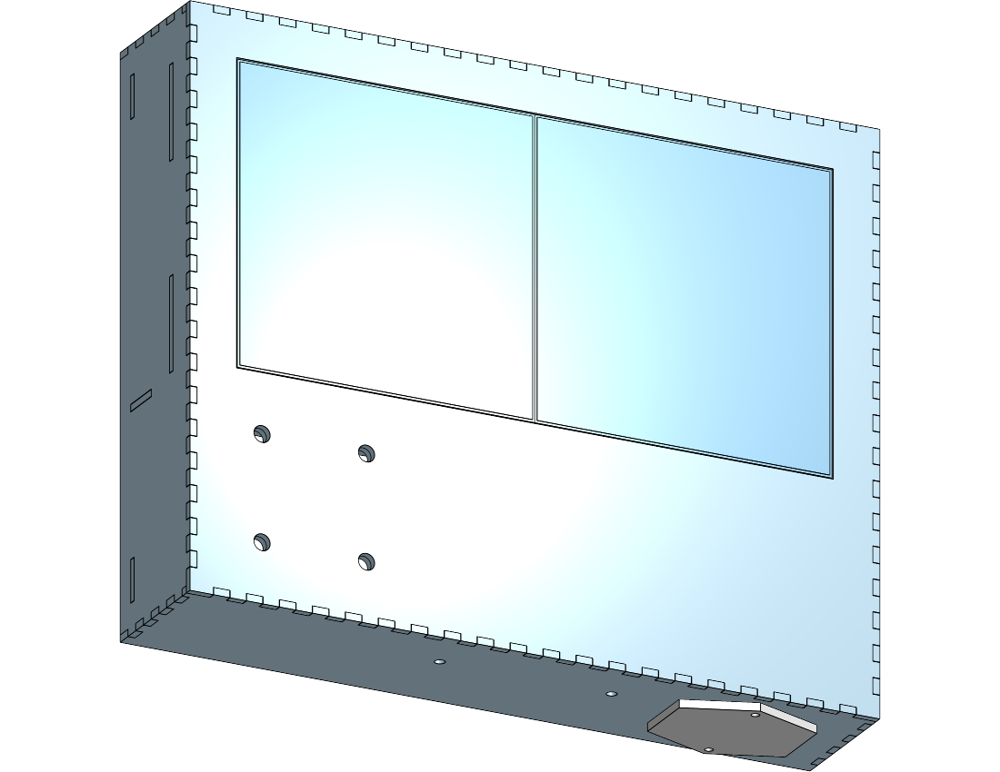
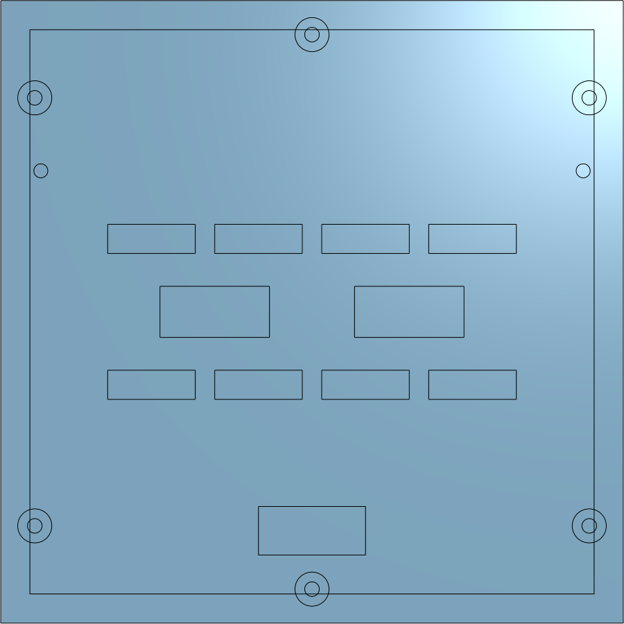
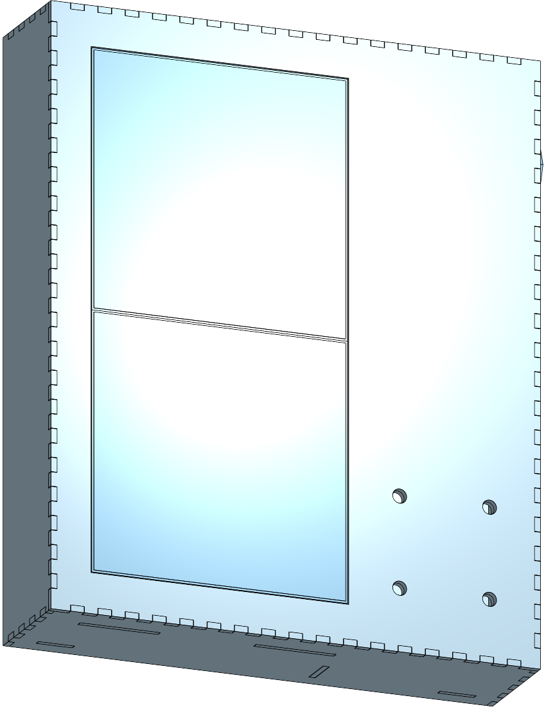

# Mechanical & Enclosure Plan

Fork of [engmung/patternflow](https://github.com/engmung/patternflow) (pristine clone in `upstream/`, at `87700bd`, v3.9.5).

This plan covers geometry, stackup, mounting and fabrication. Power is in
[`power-plan.md`](power-plan.md). Firmware deltas are in
[`firmware-delta.md`](firmware-delta.md).

---

## 1. What changed vs. upstream

Upstream is a custom ESP32-S3 DevKit carrier PCB, four PCB-mounted EC11
encoders, and one 128×64 P2.5 panel (320×160 mm) in a 3D-printed case sized to
that panel. This build keeps the *pixel geometry* and replaces almost
everything else.

| | Upstream v3.9 | This build |
|---|---|---|
| Controller | ESP32-S3 DevKit N16R8 on custom PCB | **Adafruit Matrix Portal S3** (no PCB) |
| Flash / PSRAM | 16 MB / 8 MB **octal** | 8 MB / 2 MB **quad** |
| Panel | 1× 128×64 P2.5, 320×160 mm | **2× Waveshare P2 64×64 GOB**, 256×128 mm |
| Resolution | 128 × 64 px | **128 × 64 px — identical** |
| Encoders | 4× EC11 soldered to PCB, on GPIO | **4× Adafruit 4991 seesaw breakouts on I²C** |
| Power in | Screw terminal, sacrificial USB cable | **USB-C → internal sealed bank** |
| Extra sensing | none | **LD2450 radar + VL53L9CX 3D lidar** |

The single most important consequence: **the upstream enclosure does not
fit and cannot be adapted.** It is dimensioned around a 320×160 mm panel and
a board that no longer exists in this design. `upstream/hardware/case/` is
reference and precedent, not a starting STL.

The second consequence is a happy one: **there is no custom PCB in this
build.** The Matrix Portal S3 plugs directly onto a panel's HUB75 header, and
every control and sensor arrives on I²C or UART over a cable. That removes
the board-to-front-panel alignment problem that drives most of upstream's
enclosure complexity (encoder nut access, PCB standoffs, board outline
tolerance). The front panel now only has to hold four encoders and one open
sensor aperture.

### Deliberately unused BOM

Two 64×64 panels are held spare. The 1"/20 mm knob duplication is treated as
"design for both" below. Not every line of the BOM needs to land in v1.

---

## 2. Geometry

### 2.1 Active area

Two Waveshare 64×64 GOB panels, chained horizontally.

### 2.1 Pitch: P2, measured

> **"64 × 64" is pixels, not millimetres.** The physical size is pitch × pixels,
> and the pixel count is identical across the whole family:
>
> | | Pitch | Panel | Pair | Pixels |
> |---|---|---|---|---|
> | **P2** *(built — RGB-Matrix-P2-64x64-B)* | 2 mm | 128 × 128 | **256 × 128 mm** | 128 × 64 |
> | P2.5 | 2.5 mm | 160 × 160 | 320 × 160 mm | 128 × 64 |
> | P3 | 3 mm | 190 × 190 | 380 × 190 mm | 128 × 64 |
>
> **The pixel geometry never changes**, which is the whole point of the fork —
> 128 × 64 is upstream Patternflow's exact grid, so every community pattern runs
> unmodified whichever pitch arrives. Pitch is a purely mechanical choice, and
> it is also the right lever if this ever wants to be bigger: two P3 or P4
> panels change the box and nothing else, where more panels change the pixel
> grid and the loader rejects every existing `.pfm` (`pf_abi.h`).

> ✅ **2026-10-03: the panels are on the bench, and the model is now at P2.**
> It was built at P2.5 from 2026-09-12 because a measured vendor model existed
> for that pitch and P2 was four guesses. Every number below is now calipers.

Current external size is **297 × 245 × 60 mm** — landscape as modelled, and
**245 wide × 297 tall** stood on end, which is how it lives (see *Portrait*
below).



### The measured panel

Waveshare **RGB-Matrix-P2-64x64-B**, measured from the back with the origin at
the top-left corner, converted here to panel-centre coordinates (+y up):

| | Measured | Model | Variable |
|---|---|---|---|
| Front face | 128 × 128 | — | `#panelBody` = 128 |
| Back face | 127 × 127 | 0.5 mm draft per side, not modelled | — |
| Pair, butted | 256 × 128 | 2 × 128, **zero gap** | `#panelGap` = 0 |
| Depth, face to back of frame | 14.5 | — | `#panelDepth` |
| Depth incl. registration pins | 17.8 | pins 3.3 proud | `#pinProj` |
| Threaded inserts, sides | M3; 6.5 in, 19.5 from top & bottom | (±57, ±44) | `#postXOffset`, `#braceYOffset` |
| Threaded inserts, mid-edge | M3; 6.5 in, centred top & bottom | (0, ±57) | `#midPostYOffset` |
| Registration pins | Ø2.83–2.87 (nominal Ø3 hole), 7.75 in, 34.5 down | (±55.75, +29) | `#pinXOffset`, `#pinYOffset`, `#pinDia` |



Two things came out of it that the model had wrong:

- **The front face is exactly the pitch, so there is no seam gap.** The P3
  measured body 190 on a 192 pitch, and the model generalised that into "the body
  is undersize". On this panel the edge pixel sits a full half-pitch (1 mm) in
  from the edge instead, and 1 + 0 + 1 is still one pitch, so the grid stays
  continuous across a tight butt. The rule that holds is **border + gap + border
  = pitch**; how it splits is a property of the panel, not the pitch.
- **The back is 1 mm smaller than the front.** Neighbours touch only along the
  front edge, which is the edge that matters, and the draft gives the butt joint
  somewhere to close.

### Panel orientation is set by upstream's portrait mapping

The box stands on end, and upstream already handles that: a pattern that
declares a 64 × 128 grid is rotated onto the 128 × 64 panel by
`core_canvas.h`, logical `(x, y)` → panel `(127 − y, x)`. So **with no firmware
change**, the device must be exactly "a 128 × 64 panel stood on its end":

- Model frame: both panels **upright** (pixel row 0 at +y), side by side, chain
  running **left → right** — panel at −x is first.
- Stood on end: **+x is up**, so the box rests on its **−x wall**. The knob
  cluster ends up lower-right of the display, and the IEC inlet on the right-hand
  side near the top.
- The Matrix Portal can sit anywhere — it is ribbon-connected — but its ribbon
  goes to the **−x panel's HUB75 IN**, then −x OUT → +x IN. Get that backwards
  and every portrait pattern comes out upside down.



> ✅ **Confirmed 2026-10-04:** the edge measured as "top" is the panel's marked
> top edge, so the pins sit near it at **+29** and land in the upper brace. One
> cheap check is left for first light: pixel (0, 0) should light at that top
> edge, on the left as seen from the front. If it lights at the bottom, the
> marking lies and `#pinYOffset` goes to −29 — the lower brace is the same width
> and picks the pins up.

```
                    256 mm
   ┌──────────────────┬──────────────────┐
   │                  │                  │
   │   Panel A        │   Panel B        │   128 mm
   │   64 × 64 px     │   64 × 64 px     │
   │   128 × 128 mm   │   128 × 128 mm   │
   └──────────────────┴──────────────────┘
   HUB75 IN ──────► OUT ──► IN

            = 128 × 64 px, 8192 px, P2 pitch
```

This is a **straight HUB75 chain**, not a 2×2 tile, and it needs upstream's
stock `PANEL_RES_W 128 / PANEL_RES_H 64 / PANEL_CHAIN 1` **unchanged** — two
chained shift-register panels are electrically one 128-wide panel. No
`VirtualMatrixPanel` mapping, no serpentine transform, and **every upstream
pattern runs unmodified** because the pixel grid is bit-identical to stock.
That is the whole reason this layout is the right v1. (Why `PANEL_CHAIN 2`
would be wrong: [`firmware-delta.md`](firmware-delta.md) §1.)

Physically it is *smaller* than upstream: 256×128 mm vs 320×160 mm, because P2
is a finer pitch than P2.5. Denser, brighter-looking, and easier to enclose.

> ✅ **Verified 2026-10-03:** two panels butted measure **256 × 128** — zero
> seam, the plastic adds nothing. The aperture is 257 × 129 (`#apertureGap`
> 0.5 mm all round, so the panels pass through and finish flush).

### 2.2 Stackup (front to back)

```
   front
    │
    ├─ [0]  Bezel / front face .................. 3–6 mm
    │        aperture 256 × 128 mm (+fit allowance)
    │        4× encoder bores, 2× sensor apertures
    │
    ├─ [1]  GOB panel face ...................... 0 mm standoff
    │        resin-filled, already flat & diffused
    │        → NO separate diffuser needed
    │
    ├─ [2]  Panel bodies ........................ 14.5 mm  ✅ measured
    │        2× 128×128 mm, 6 × M3 inserts + 2 pins on back
    │
    ├─ [3]  Electronics bay ..................... 15–20 mm
    │        Matrix Portal S3 (rides on panel A HUB75 hdr)
    │        panel A→B ribbon, 5 V distribution
    │        4× encoder breakouts + STEMMA QT chain
    │
    ├─ [4]  Power bay ........................... 25–30 mm  ⚠ SET BY BANK
    │        sealed USB-C bank, see power-plan.md
    │
    └─ [5]  Back cover .......................... 3–4 mm
             vents, USB-C port cutout, wall-mount keyholes

   Total depth ≈ 60–75 mm, dominated by [4].
```

**GOB is doing real work here.** Glue-on-board panels have an epoxy-filled
face, so they are flat, physically tough, and already diffuse the individual
LEDs. Upstream needs recesses for the panel's alignment bumps and has an
open issue history about trimming them ([#19]); a GOB panel presents a flat
front. Plan for the bezel to sit **directly on the panel face** with no air
gap and no acrylic diffuser. Fewer parts, better contrast, thinner stack.

[#19]: https://github.com/engmung/Patternflow/issues/19

### 2.3 Front panel layout

The controls no longer share a PCB with anything, so knob placement is free.
Two candidate arrangements:

```
                         ◎ ◄── VL53L9CX lidar: TOP EDGE, angled fwd/up
  (a) Controls below display ╲       (b) Controls right of display
  ┌───────────────────────────┐╲     ┌─────────────────────┬───────┐
  │                           │ ╲    │                     │  (1)  │
  │       256 × 128 mm        │ gesture   256 × 128 mm     │  (2)  │
  │         DISPLAY           │ volume      DISPLAY        │  (3)  │
  │                           │      │                     │  (4)  │
  ├───────────────────────────┤      ├─────────────────────┼───────┤
  │   (1)   (2)   (3)   (4) ◉ │      │                     │  ◉    │
  └───────────────────────────┘      └─────────────────────┴───────┘
   ~300 × 190 mm overall              ~330 × 165 mm overall
   landscape, reads as an instrument  wider, control column

   ◉ = LD2450 radar — no aperture, sees through the enclosure wall
   ◎ = VL53L9CX lidar — OPEN aperture, top edge. See lidar-plan.md §5
```

**Recommendation: (a).** It matches upstream's visual language (knobs in a row
under the display), keeps the object landscape and wall-hangable, and puts the
knobs where a hand naturally rests. (b) only wins if you want the sensors to
have a clear side-look, which they don't need.

**Knob spacing.** You have both 20 mm and 1" (25.4 mm) knobs. Design the bore
pitch for the larger one plus finger clearance: **40 mm centre-to-centre
minimum, 45 mm preferred.** At 45 mm pitch, four knobs span 135 mm — comfortable
inside a 256 mm wide face, and either knob set drops in without a redesign.
That resolves the duplicate-knob question by not resolving it.

**Encoder bore.** Adafruit PID 377 is a standard EC11 with a threaded bushing.
Bore Ø7 mm, with a flat or anti-rotation notch if the panel material is thin.
Critical dimension to check with calipers before drilling anything:

```
   knob                    ┌──────┐
   set screw ───────────►  │      │
                    ┌──────┴──────┴──────┐
   panel  ══════════╡   bushing + nut    ╞══════════
   thickness t      └────────┬───────────┘
                             │  ← shaft must clear
                    ┌────────┴───────────┐
                    │  4991 breakout PCB │  ~25.7 × 22.1 mm ⚠ VERIFY
                    └────────────────────┘
```

The bushing's threaded length sets the **maximum front panel thickness**. On a
standard EC11 that is around 5–7 mm, which is why the bezel above is specced
at 3–6 mm. If you go thicker (a 10 mm hardwood face, say), you must counterbore
from the back. **Measure the bushing thread length before choosing bezel stock.**

The 4991 breakout hangs off the encoder body — it is not separately mounted.
Confirm the four breakouts don't collide at 45 mm pitch: the board is wider
than the encoder, so at 40 mm pitch they may overlap. This is the specific
reason to prefer 45 mm.

### 2.4 Sensor mounting

These two sensors have **opposite** enclosure requirements and neither
tolerates being an afterthought.

**LD2450 (24 GHz FMCW radar), UART:**
- Sees *through* plastic. Must **not** be behind metal, and must not look
  through the LED panel.
- Mount behind a thin, unbroken plastic **radome**: ≤3 mm, no fill voids, no
  carbon-loaded or metallic-pigment filament. Plain PLA/ABS/PC is fine.
- Keep it **away from the LED panel's steel frame and away from the buck
  converter** — a switching converter at a few amps is a strong 24 GHz-band
  noise neighbour. Target ≥30 mm separation and don't route the 5 V high-current
  run past it.
- It is a *presence and trajectory* sensor with a ~6 m, ±60° fan. It wants to
  look out into the room, level, unobstructed. Front face, upper or lower edge.

**VL53L9CX (3D dToF lidar), I²C:**

> ⚠️ This is a **depth camera**, not a proximity sensor — 2268 zones, 5 cm–9 m,
> 55°×42°, up to 100 Hz. It is the one genuinely new feature in the build and
> it has its own document: **[`lidar-plan.md`](../wall/lidar-plan.md)**. What follows is
> the mechanical summary; §5 there is the full version.

- Optical. Needs a genuinely **open aperture**. Cover-glass crosstalk — VCSEL
  light reflecting off the inside of a window straight into the receiver — is
  *the* classic failure mode for ST multizone parts, and ordinary acrylic or
  anything printed "clear" will cause it.
- **Light-tight collar** between the emitter and receiver paths, matte black, so
  the two cannot see each other through the housing wall.
- **Top edge, angled forward and up** — not the front face. At 55°×42° a
  front-facing sensor mostly sees the player's torso at playing distance, and an
  instrument that reacts to your chest while you're working the knobs feels
  possessed. A top-edge mount defines a gesture volume a hand is raised into on
  purpose.
- Don't let it graze the LED panel's own face; that returns spurious near-field
  zones.

Neither sensor exists in upstream firmware. Mechanically, reserve the space and
the apertures now even if the firmware integration lands later — retrofitting an
aperture into a finished bezel is the one change that ruins a front panel.

### 2.5 Panel and board mounting

- **Panels:** both hang from two shared **cross-braces** that span the box
  (the carrier plate, in wood — [`enclosure-lasercut.md`](enclosure-lasercut.md)
  §5). Do not rely on the bezel to hold panel alignment: the seam between the
  two panels is the most visible feature of the whole build, and it needs a
  rigid common datum. Each panel gets **four M3 screws** into its side inserts
  for clamping, and its **two registration pins** drop into holes in the upper
  brace for location — exact in y, so rows line up across the seam, with
  1.5 mm of travel in x so the panels can still be pushed together by hand.
- **Matrix Portal S3:** plugs directly onto panel A's HUB75 header and is
  supported by it. Add one standoff or a printed clip so a tugged USB-C cable
  loads the enclosure, not the connector.
- **Panel A → Panel B:** short HUB75 ribbon. Keep it short and clear of the
  radar.
- **Strain relief the USB-C entry.** It is the only user-touched connector and
  it is on a board that is only held by a 16-pin header.

---

## 3. Fabrication

> ✅ **Decided: laser-cut 3 mm Baltic birch ply, finger-jointed, doubled where
> it matters.** (Basswood originally; changed 2026-09-12 — the material survey
> is [`enclosure-lasercut.md`](enclosure-lasercut.md) §13.) The full design is in
> [`enclosure-lasercut.md`](enclosure-lasercut.md). The survey below is kept for
> the reasoning; note that the "hybrid" row is essentially what was chosen, with
> wood laminations in place of printed internals.

Three routes were considered:

| Route | Fit | Notes |
|---|---|---|
| **FDM print** | Follows upstream precedent | 300×190 mm face **exceeds a 256 mm bed** — needs splitting and bonding exactly as upstream's `bed_256mm/` does. Radar-transparent, which is convenient. |
| **Laser/CNC flat face + printed frame** | Cleanest visible face | No bonded seam across the front. Acrylic or ply bezel, printed internals. Note the acrylic caveat for the ToF aperture — cut an open hole. |
| **Hybrid** *(suggested)* | Best of both | Flat cut bezel (rigid, no seam, exact aperture), printed panel carrier / encoder mounts / battery bay, printed back cover. |

Upstream's `hardware/case/source/patternflow_case.blend` (Blender 5.2 LTS, in
Git LFS — pull from release assets, not the repo zip) is useful as a reference
for the knob plates and snap-fit back cover geometry even though the body
dimensions don't carry over.

---

## 4. Open items to resolve with calipers

Ordered by how expensive they are to get wrong:

1. **EC11 bushing thread length** → sets max bezel thickness. Blocks bezel stock choice.
2. ~~**Actual two-panel butted width**~~ → ✅ 256 × 128, zero seam (§2.1).
3. ~~**Panel body depth incl. connectors**~~ → ✅ 14.5, 17.8 over the pins (§2.1).
4. **4991 breakout outline** → confirms 45 mm knob pitch has no collision.
5. **Chosen power bank dimensions** → sets bay [4], which dominates total depth. See [`power-plan.md`](power-plan.md).

Items 1–4 are all measurable the moment the parts are on the bench. Item 5 is a
purchasing decision, not a measurement — and it's the one that sets how thick
this object ends up being.
