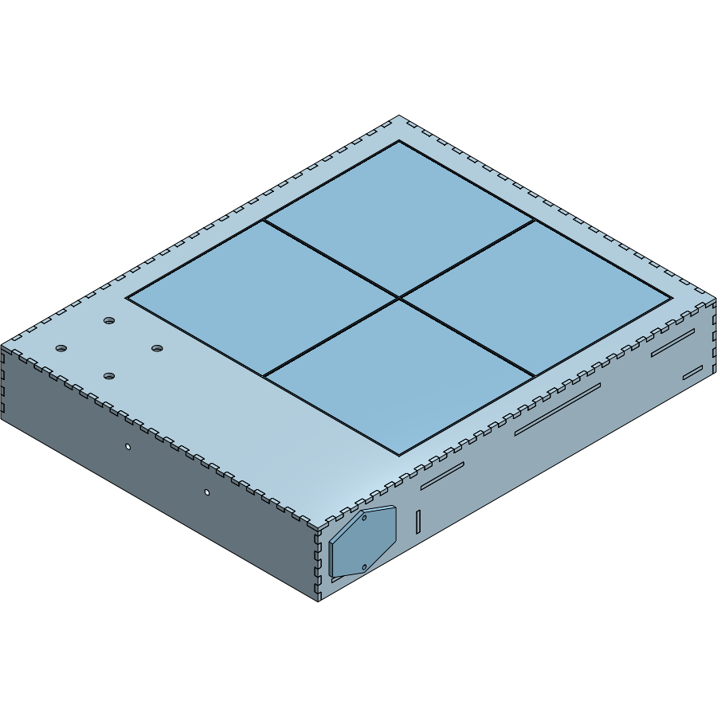

# Mechanical & Enclosure Plan

Fork of [engmung/patternflow](https://github.com/engmung/patternflow) (pristine clone in `upstream/`, at `87700bd`, v3.9.5).

This plan covers geometry, stackup, mounting and fabrication. Power is in
[`power-plan.md`](power-plan.md). The controller is in
[`driver-colorlight.md`](driver-colorlight.md).

> 🔁 **2026-10-12: redesigned as a 2 × 2 array on a Colorlight 5A-75B + Pi
> Zero 2 W.** The Matrix Portal S3 and the 2 × 1 landscape layout are gone, and
> with them the "every upstream pattern runs unmodified" property — see
> [`driver-colorlight.md`](driver-colorlight.md) §1. Sections below are
> updated where the change reaches them. The upstream comparison in §1 and the
> sensor notes in §2.4 are kept as the record of how the build got here.

---

## 1. What changed vs. upstream

Upstream is a custom ESP32-S3 DevKit carrier PCB, four PCB-mounted EC11
encoders, and one 128×64 P2.5 panel (320×160 mm) in a 3D-printed case sized to
that panel. This build keeps the *pixel geometry* and replaces almost
everything else.

| | Upstream v3.9 | This build |
|---|---|---|
| Controller | ESP32-S3 DevKit N16R8 on custom PCB | **Colorlight 5A-75B + Raspberry Pi Zero 2 W** (was Matrix Portal S3) |
| Panel | 1× 128×64 P2.5, 320×160 mm | **4× Waveshare P2 64×64 GOB, 2 × 2**, 256 × 256 mm |
| Resolution | 128 × 64 px | **128 × 128 px** (was 128 × 64, upstream's grid) |
| Encoders | 4× EC11 soldered to PCB, on GPIO | **4× Adafruit 4991 seesaw breakouts on I²C** (to the Pi) |
| Power in | Screw terminal, sacrificial USB cable | **IEC mains → Mean Well LRS-50-5**, capped panel load |
| Extra sensing | none | none in v1 (the lidar moved to the [wall project](../wall/)) |

The single most important consequence: **the upstream enclosure does not
fit and cannot be adapted.** It is dimensioned around a 320×160 mm panel and
a board that no longer exists in this design. `upstream/hardware/case/` is
reference and precedent, not a starting STL.

The second consequence is a happy one: **there is no custom PCB in this
build.** The Colorlight card and the Pi are off-the-shelf boards on the back
cover, ribbon- and cable-connected, and every control arrives on I²C over a
cable. That removes the board-to-front-panel alignment problem that drives
most of upstream's enclosure complexity (encoder nut access, PCB standoffs,
board outline tolerance). The front panel only has to hold four encoders.

### Deliberately unused BOM

Two 64×64 panels are held spare (six owned, four used; the 5A-75B has outputs
J5–J8 free for them). The 1"/20 mm knob duplication is treated as
"design for both" below. Not every line of the BOM needs to land in v1.

---

## 2. Geometry

### 2.1 Active area

Four Waveshare 64×64 GOB panels in a 2 × 2 grid: 128 × 128 px, 256 × 256 mm.

### 2.1 Pitch: P2, measured

> **"64 × 64" is pixels, not millimetres.** The physical size is pitch × pixels,
> and the pixel count is identical across the whole family:
>
> | | Pitch | Panel | Pair | Pixels |
> |---|---|---|---|---|
> | **P2** *(built — RGB-Matrix-P2-64x64-B)* | 2 mm | 128 × 128 | **256 × 128 mm** | 128 × 64 |
> | P2.5 | 2.5 mm | 160 × 160 | 320 × 160 mm | 128 × 64 |
> | P3 | 3 mm | 190 × 190 | 380 × 190 mm | 128 × 64 |
>
> **The pixel geometry never changes**, which is the whole point of the fork —
> 128 × 64 is upstream Patternflow's exact grid, so every community pattern runs
> unmodified whichever pitch arrives. Pitch is a purely mechanical choice, and
> it is also the right lever if this ever wants to be bigger: two P3 or P4
> panels change the box and nothing else, where more panels change the pixel
> grid and the loader rejects every existing `.pfm` (`pf_abi.h`).
>
> *(2026-10-12: that is the trade this build has now made — four panels, a
> 128 × 128 grid, and a Pi host instead of the `.pfm` loader. See
> [`driver-colorlight.md`](driver-colorlight.md) §1.)*

> ✅ **2026-10-03: the panels are on the bench, and the model is now at P2.**
> It was built at P2.5 from 2026-09-12 because a measured vendor model existed
> for that pitch and P2 was four guesses. Every number below is now calipers.

Current external size is **293 wide × 373 tall × 60 deep**, standing upright on
its bottom wall: display on top, the knob and PSU band below. (The 2 × 1 box
was 297 × 245 × 60 and lived on its side. The side margin went 20 → 18 mm on
2026-10-12 so the widest part fits the laser and 12"-wide stock with room to
spare — [`enclosure-lasercut.md`](enclosure-lasercut.md) §13.)



> ⚠️ **It is 373 mm tall on a 60 mm footprint** — about 6 : 1. The PSU sits low,
> which helps, but it will tip if knocked. Feet that splay to the rear, or a
> kickstand on the back cover, are an open item (§4).

### The measured panel

Waveshare **RGB-Matrix-P2-64x64-B**, measured from the back with the origin at
the top-left corner, converted here to panel-centre coordinates (+y up):

| | Measured | Model | Variable |
|---|---|---|---|
| Front face | 128 × 128 | — | `#panelBody` = 128 |
| Back face | 127 × 127 | 0.5 mm draft per side, not modelled | — |
| Pair, butted | 256 × 128 | 2 × 128, **zero gap** | `#panelGap` = 0 |
| Array | 2 × 2 | 256 × 256, zero gap both ways | `#panelCols`, `#panelRows` |
| Depth, face to back of frame | 14.5 | — | `#panelDepth` |
| Depth incl. registration pins | 17.8 | pins 3.3 proud | `#pinProj` |
| Threaded inserts, sides | M3; 6.5 in, 19.5 from top & bottom | (±57, ±44) | `#postXOffset`, `#braceYOffset` |
| Threaded inserts, mid-edge | M3; 6.5 in by calipers — 6.7 in, 113.3 apart by flatbed scan (enclosure-lasercut §Flatbed cross-check) | (0, ±56.65) | `#midPostYOffset` |
| Registration pins | Ø2.83–2.87 (nominal Ø3 hole), 7.75 in, 34.5 down | (±55.75, +29) | `#pinXOffset`, `#pinYOffset`, `#pinDia` |
| HUB75 IN / OUT | two **vertical** 2 × 8 shrouds, 8.8 × 29.5, scan 2026-10-12 | (±35.9, +5.6) | `#hubX`, `#hubY`, `#hubW`, `#hubL`; height `#hubH` ⚠ |
| 5 V input | 4-pin 3.96 mm (VH-style), 7.5 × 17.5 | (−10.1, +5.3) | `#pwrX`, `#pwrY`, `#pwrW`, `#pwrL`; height `#pwrH` ⚠ |

The connectors' keep-outs (the mated plug and the turn of its cable, behind the
panel's rear face — `#plugProj`, `#pwrPlugProj`) clear the braces by 2.55 mm
(HUB75) and 8.85 mm (5 V) in y. Those depths are placeholders until a plugged
connector is calipered.


Two things came out of it that the model had wrong:

- **The front face is exactly the pitch, so there is no seam gap.** The P3
  measured body 190 on a 192 pitch, and the model generalised that into "the body
  is undersize". On this panel the edge pixel sits a full half-pitch (1 mm) in
  from the edge instead, and 1 + 0 + 1 is still one pitch, so the grid stays
  continuous across a tight butt. The rule that holds is **border + gap + border
  = pitch**; how it splits is a property of the panel, not the pitch.
- **The back is 1 mm smaller than the front.** Neighbours touch only along the
  front edge, which is the edge that matters, and the draft gives the butt joint
  somewhere to close.

### Panel layout and wiring

All four panels sit **the same way up** — pixel row 0 and the registration pins
at +y — numbered in reading order:

```
                    256 mm
   ┌──────────────────┬──────────────────┐
   │   Panel 1        │   Panel 2        │
   │   ◦ pins ◦       │   ◦ pins ◦       │   128 mm
   │   J1             │   J2             │
   ├──────────────────┼──────────────────┤
   │   Panel 3        │   Panel 4        │
   │   ◦ pins ◦       │   ◦ pins ◦       │   128 mm
   │   J3             │   J4             │
   └──────────────────┴──────────────────┘
          each panel on its own 5A-75B HUB75 output
            = 128 × 128 px, 16 384 px, P2 pitch
```

There is **no HUB75 chain** and no portrait mapping any more. Each panel has its
own output on the Colorlight, and the card's mapping (set once in LEDVision)
places each output's 64 × 64 in the 128 × 128 canvas. Orientation is therefore a
software setting, not a wiring constraint, and the box simply stands on its
bottom wall.

The pins are still the y datum: each panel row's pins land in a brace (§2.5).
The 2026-10-04 check carries over: pixel (0, 0) of each panel should light at
its pin edge.

> ✅ **Verified 2026-10-03:** two panels butted measure **256 × 128**, zero
> seam. With no draft on the front faces, the 2 × 2 is 256 × 256 and the
> aperture 257 × 257 (`#apertureGap` 0.5 mm all round).

### 2.2 Stackup (front to back)

```
   front
    │
    ├─ [0]  Bezel / front face .................. 3–6 mm
    │        aperture 256 × 256 mm (+fit allowance)
    │        4× encoder bores
    │
    ├─ [1]  GOB panel face ...................... 0 mm standoff
    │        resin-filled, already flat & diffused
    │        → NO separate diffuser needed
    │
    ├─ [2]  Panel bodies ........................ 14.5 mm  ✅ measured
    │        4× 128×128 mm, 6 × M3 inserts + 2 pins on back
    │
    ├─ [3]  Braces + connector keep-outs ........ 3 + 20 mm
    │        three cross-braces, four HUB75 ribbons turning
    │
    ├─ [4]  Electronics on the back cover ....... ≤ 20 mm
    │        Colorlight 5A-75B, Pi Zero 2 W, USB gigabit adapter
    │        (the PSU is in the control band below, not here)
    │
    └─ [5]  Back cover + rails .................. 3 + 9 mm
             removable, carries the boards

   Total depth 60 mm external, set by the PSU stack in the control band.
```

**GOB is doing real work here.** Glue-on-board panels have an epoxy-filled
face, so they are flat, physically tough, and already diffuse the individual
LEDs. Upstream needs recesses for the panel's alignment bumps and has an
open issue history about trimming them ([#19]); a GOB panel presents a flat
front. Plan for the bezel to sit **directly on the panel face** with no air
gap and no acrylic diffuser. Fewer parts, better contrast, thinner stack.

[#19]: https://github.com/engmung/Patternflow/issues/19

### 2.3 Front panel layout

The controls no longer share a PCB with anything, so knob placement is free.
Two candidate arrangements:

```
                         ◎ ◄── VL53L9CX lidar: TOP EDGE, angled fwd/up
  (a) Controls below display ╲       (b) Controls right of display
  ┌───────────────────────────┐╲     ┌─────────────────────┬───────┐
  │                           │ ╲    │                     │  (1)  │
  │       256 × 128 mm        │ gesture   256 × 128 mm     │  (2)  │
  │         DISPLAY           │ volume      DISPLAY        │  (3)  │
  │                           │      │                     │  (4)  │
  ├───────────────────────────┤      ├─────────────────────┼───────┤
  │   (1)   (2)   (3)   (4) ◉ │      │                     │  ◉    │
  └───────────────────────────┘      └─────────────────────┴───────┘
   ~300 × 190 mm overall              ~330 × 165 mm overall
   landscape, reads as an instrument  wider, control column

   ◉ = LD2450 radar — no aperture, sees through the enclosure wall
   ◎ = VL53L9CX lidar — OPEN aperture, top edge. See lidar-plan.md §5
```

**Recommendation: (a).** It matches upstream's visual language (knobs in a row
under the display), keeps the object landscape and wall-hangable, and puts the
knobs where a hand naturally rests. (b) only wins if you want the sensors to
have a clear side-look, which they don't need.

**Knob spacing.** You have both 20 mm and 1" (25.4 mm) knobs. Design the bore
pitch for the larger one plus finger clearance: **40 mm centre-to-centre
minimum, 45 mm preferred.** At 45 mm pitch, four knobs span 135 mm — comfortable
inside a 256 mm wide face, and either knob set drops in without a redesign.
That resolves the duplicate-knob question by not resolving it.

**Encoder bore.** Adafruit PID 377 is a standard EC11 with a threaded bushing.
Bore Ø7 mm, with a flat or anti-rotation notch if the panel material is thin.
Critical dimension to check with calipers before drilling anything:

```
   knob                    ┌──────┐
   set screw ───────────►  │      │
                    ┌──────┴──────┴──────┐
   panel  ══════════╡   bushing + nut    ╞══════════
   thickness t      └────────┬───────────┘
                             │  ← shaft must clear
                    ┌────────┴───────────┐
                    │  4991 breakout PCB │  ~25.7 × 22.1 mm ⚠ VERIFY
                    └────────────────────┘
```

The bushing's threaded length sets the **maximum front panel thickness**. On a
standard EC11 that is around 5–7 mm, which is why the bezel above is specced
at 3–6 mm. If you go thicker (a 10 mm hardwood face, say), you must counterbore
from the back. **Measure the bushing thread length before choosing bezel stock.**

The 4991 breakout hangs off the encoder body — it is not separately mounted.
Confirm the four breakouts don't collide at 45 mm pitch: the board is wider
than the encoder, so at 40 mm pitch they may overlap. This is the specific
reason to prefer 45 mm.

### 2.4 Sensor mounting

These two sensors have **opposite** enclosure requirements and neither
tolerates being an afterthought.

**LD2450 (24 GHz FMCW radar), UART:**
- Sees *through* plastic. Must **not** be behind metal, and must not look
  through the LED panel.
- Mount behind a thin, unbroken plastic **radome**: ≤3 mm, no fill voids, no
  carbon-loaded or metallic-pigment filament. Plain PLA/ABS/PC is fine.
- Keep it **away from the LED panel's steel frame and away from the buck
  converter** — a switching converter at a few amps is a strong 24 GHz-band
  noise neighbour. Target ≥30 mm separation and don't route the 5 V high-current
  run past it.
- It is a *presence and trajectory* sensor with a ~6 m, ±60° fan. It wants to
  look out into the room, level, unobstructed. Front face, upper or lower edge.

**VL53L9CX (3D dToF lidar), I²C:**

> ⚠️ This is a **depth camera**, not a proximity sensor — 2268 zones, 5 cm–9 m,
> 55°×42°, up to 100 Hz. It is the one genuinely new feature in the build and
> it has its own document: **[`lidar-plan.md`](../wall/lidar-plan.md)**. What follows is
> the mechanical summary; §5 there is the full version.

- Optical. Needs a genuinely **open aperture**. Cover-glass crosstalk — VCSEL
  light reflecting off the inside of a window straight into the receiver — is
  *the* classic failure mode for ST multizone parts, and ordinary acrylic or
  anything printed "clear" will cause it.
- **Light-tight collar** between the emitter and receiver paths, matte black, so
  the two cannot see each other through the housing wall.
- **Top edge, angled forward and up** — not the front face. At 55°×42° a
  front-facing sensor mostly sees the player's torso at playing distance, and an
  instrument that reacts to your chest while you're working the knobs feels
  possessed. A top-edge mount defines a gesture volume a hand is raised into on
  purpose.
- Don't let it graze the LED panel's own face; that returns spurious near-field
  zones.

Neither sensor exists in upstream firmware. Mechanically, reserve the space and
the apertures now even if the firmware integration lands later — retrofitting an
aperture into a finished bezel is the one change that ruins a front panel.

### 2.5 Panel and board mounting

- **Panels:** all four hang from shared **cross-braces** that span the box
  (the carrier plate, in wood — [`enclosure-lasercut.md`](enclosure-lasercut.md)
  §5). Do not rely on the bezel to hold panel alignment: the seams are the most
  visible feature of the whole build, and they need a rigid common datum. Each
  panel gets **four M3 screws** into its side inserts for clamping, and its
  **two registration pins** drop into holes in a brace for location — exact in
  y, so rows line up across the vertical seam, with 1.5 mm of travel in x so the
  panels can still be pushed together by hand. The horizontal seam is set by
  the two rows' pins landing in braces cut from one sheet.
- **Braces:** one per row of side inserts, at each panel row's centre ± 44.
  In the 2 × 2 the lower brace of the top row and the upper brace of the bottom
  row meet at y = 0, so they are **merged into one 80 mm middle brace**. Three
  braces in all, [88, 128], [−40, 40], [−128, −88], each a through-tenon into
  both side walls. Each row's pins land in a brace with 3.5 mm of wood beyond
  the pin hole.
- **Electronics:** on standoffs off the inside of the back cover — see
  [`driver-colorlight.md`](driver-colorlight.md) §6. Leave enough slack in the
  four ribbons, the Cat6 patch and the 5 V leads for the cover to come off.
- **Mains:** the IEC inlet is in the **right wall**, low, beside the PSU
  terminals; the box stands on its bottom wall so the inlet cannot go there.

---

## 3. Fabrication

> ✅ **Decided: laser-cut 3 mm Baltic birch ply, finger-jointed, doubled where
> it matters.** (Basswood originally; changed 2026-09-12 — the material survey
> is [`enclosure-lasercut.md`](enclosure-lasercut.md) §13.) The full design is in
> [`enclosure-lasercut.md`](enclosure-lasercut.md). The survey below is kept for
> the reasoning; note that the "hybrid" row is essentially what was chosen, with
> wood laminations in place of printed internals.

Three routes were considered:

| Route | Fit | Notes |
|---|---|---|
| **FDM print** | Follows upstream precedent | 300×190 mm face **exceeds a 256 mm bed** — needs splitting and bonding exactly as upstream's `bed_256mm/` does. Radar-transparent, which is convenient. |
| **Laser/CNC flat face + printed frame** | Cleanest visible face | No bonded seam across the front. Acrylic or ply bezel, printed internals. Note the acrylic caveat for the ToF aperture — cut an open hole. |
| **Hybrid** *(suggested)* | Best of both | Flat cut bezel (rigid, no seam, exact aperture), printed panel carrier / encoder mounts / battery bay, printed back cover. |

Upstream's `hardware/case/source/patternflow_case.blend` (Blender 5.2 LTS, in
Git LFS — pull from release assets, not the repo zip) is useful as a reference
for the knob plates and snap-fit back cover geometry even though the body
dimensions don't carry over.

---

## 4. Open items to resolve with calipers

Ordered by how expensive they are to get wrong:

1. **EC11 bushing thread length** → sets max bezel thickness. Blocks bezel stock choice.
1a. ~~Colorlight 5A-75B outline and holes~~ → ✅ measured off scans, 2026-10-12 ([`driver-colorlight.md`](driver-colorlight.md) §6). **Still to caliper: component heights** — RJ45, HUB75 shrouds, terminal, JSTs, PCB.
1b. **Panel connector heights** → HUB75 shroud and 5 V header top relative to the frame's rear face, and how far a *plugged* ribbon and power lead reach behind it (`#hubH`, `#pwrH`, `#plugProj`, `#pwrPlugProj`).
2. ~~**Actual two-panel butted width**~~ → ✅ 256 × 128, zero seam (§2.1).
3. ~~**Panel body depth incl. connectors**~~ → ✅ 14.5, 17.8 over the pins (§2.1).
4. **4991 breakout outline** → confirms 45 mm knob pitch has no collision.
5. ~~**Chosen power bank dimensions**~~ → no bank: mains through the LRS-50-5.
6. **Stability** → 373 tall on 60 deep. Feet or a rear kickstand, before it
   lives on a desk.
7. **USB gigabit adapter envelope** → `#nicW/H/T` are typical; measure the one
   bought.

Items 1, 1a, 4 and 7 are calipers on parts in hand. Item 6 is a design choice.
