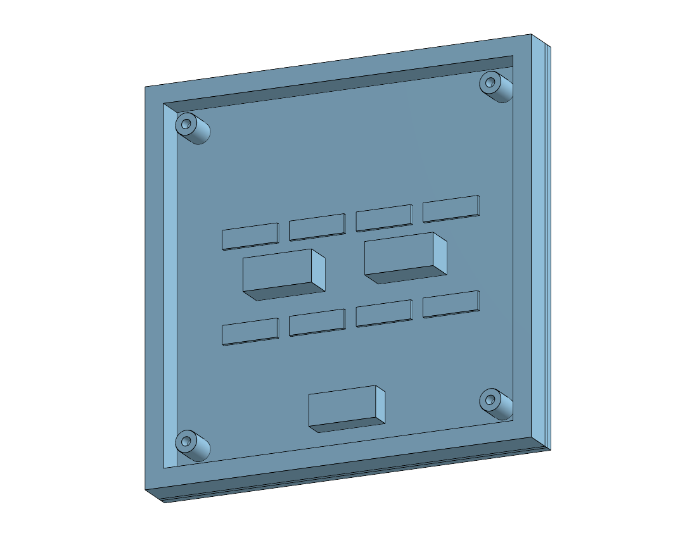
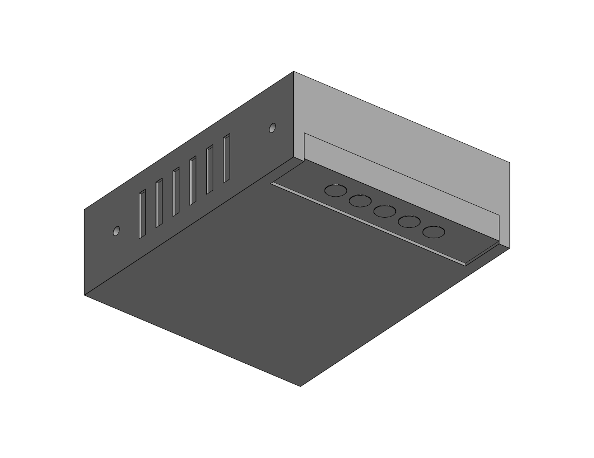
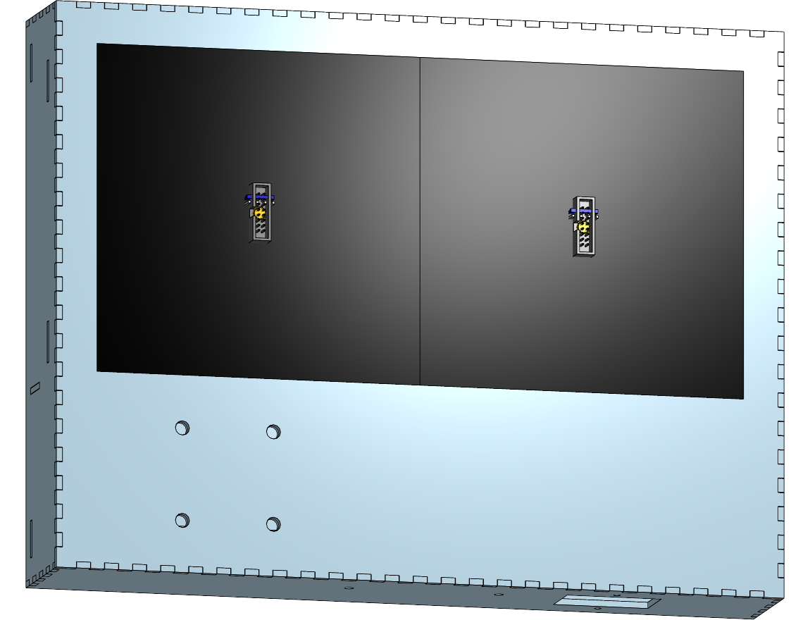

# Modelling & Rendering in Onshape

> **Design reference.** How the Onshape model is built and how the cut files, test cuts and art are exported from it. You need this only to change the design; the cut files in [`../../hardware/laser/`](../../hardware/laser/MANIFEST.md) are ready to cut.

How to get the hardware into Onshape and design the enclosure around it.
Companion to [`enclosure-lasercut.md`](enclosure-lasercut.md), which has the
design itself.

---

## 1. What you need to model, and what you don't

For a laser-cut enclosure you need **envelopes and mounting features**, not
detail. A photorealistic receiver card doesn't make the box fit better; knowing
that its HUB75 socket sits X mm off the panel face does.

| Part | Source | Fidelity needed |
|---|---|---|
| **Colorlight 5A-75B, Pi Zero 2 W, USB gigabit adapter** | ✋ envelopes in `Bay obstructions` | outline + height off the back cover; the 5A-75B is a placeholder until calipered |
| ~~Matrix Portal S3~~ | vendor STEP still in repo | no longer in the build (2026-10-12) |
| **4991 encoder breakout** | ✅ vendor STEP, in repo | as-supplied |
| **Waveshare P2 64×64 GOB** | ✋ model it | box + rear post positions |
| **EC11 encoder (PID 377)** | ✋ model it | bushing Ø/thread, shaft, body |
| **Knobs (5528 / 2056)** | ✋ model it | Ø and height only |
| STEMMA QT cables | ✋ skip | route by eye, leave slack |

Two-thirds of this is proxies you draw in ten minutes. That's the right call —
proxies are lighter, they rebuild faster, and you control the dimensions that
matter.

## 2. Vendor models, already downloaded

```
hardware/cad/vendor/
  adafruit-5778-matrix-portal-s3.step      3.9 MB
  adafruit-4991-qt-rotary-encoder.step     1.8 MB
```

From [adafruit/Adafruit_CAD_Parts](https://github.com/adafruit/Adafruit_CAD_Parts)
(MIT). That repo has 472 parts indexed by product ID — worth remembering for
future projects.

**Not in the repo:** PID 377 encoder, both knobs, the STEMMA cables. Model those
yourself per §4. Note the 4991 STEP may already include an encoder body on it —
check before drawing your own.

To import: **Insert → Import** in a Part Studio, or drag the `.step` into the
document. Onshape reads STEP natively; each import lands as its own tab.

---

## 3. Document structure

Set this up before drawing anything — it's what makes the design changeable
later.

```
📄 Patternflow Desktop
├── 🔢 Variables            ← thickness, kerf, knob pitch, aperture
├── 🧩 Hardware (imported)  ← the two vendor STEPs
├── 🧩 Proxies              ← panel, encoder, knobs
├── 🧩 Enclosure            ← the box; where Box Panelise + Laser Joint run
├── 🧩 Doublers             ← laminations, separate parts
└── 🅰️ Assembly             ← everything mated; in-context source
```

### Variable Studio first

This is the highest-leverage thing in the whole document. Create a **Variable
Studio** and put the numbers that repeat in it:

| Variable | Start value | Notes |
|---|---|---|
| `#thickness` | **measured** | NOT 3 mm — see below |
| `#kerf` | measured | from a test cut |
| `#knobPitch` | 45 mm | clears the 4991 outline |
| `#apertureW` | measured | butted two-panel width, −0.5 mm |
| `#apertureH` | 128 mm − 0.5 | |
| `#bayDepth` | 18 mm | electronics behind the panels |

Then every sketch references `#thickness` rather than a typed 3. When your
actual stock measures 2.83, you change one number and the whole box follows —
finger joints, doubler offsets, bore depths, all of it.

> **Measure the sheet you will actually cut.** This is the single most common
> way a laser-cut box comes out loose everywhere. It was the sharper risk on
> basswood, which runs 2.7–3.2 mm and varies within one sheet; 3 mm Baltic birch
> holds 3.0 much better, which is part of why the stock changed
> ([`enclosure-lasercut.md`](enclosure-lasercut.md) §13).

---

## 4. The proxies

**LED panel** — the important one. It has a `Detailed` switch:

| Off | On |
|---|---|
| a plain 128 × 128 × 14.5 envelope | the stack the panel really is |
| what every clearance check in these docs was written against | for renders, and for seeing what the bay is actually full of |



Detail on gives: the GOB resin module, the **lit area as its own body** so a
render can make it emissive, the PCB, the rear frame ring, driver ICs, the two
shrouded HUB75 headers, the power terminals, and four M3 mounting posts.

> ⚠️ **Everything behind the PCB is representative, not measured.** The rear of
> these panels is the one part of this build with no published drawing and no
> consistency between batches — [`enclosure-lasercut.md`](enclosure-lasercut.md)
> §11. The **post positions are the exception**: they are driven from
> `#postXOffset` / `#braceYOffset`, so the proxy agrees with the braces that are
> supposed to bolt to it. Agreeing with the model is not agreeing with the part.

The pair butted gives your aperture; both instances are modelled so the assembly
shows the real seam.

**PSU (Mean Well LRS-50-5)** — same switch, same reasoning:



Vents are cut as 0.8 mm recesses rather than through-slots on purpose: a hollow
proxy makes every bounding-box check noisier for no gain. The one feature here
that is **not** cosmetic is the terminal block — its screws face +x, which is
why `#psuX` is pushed left. The screwdriver needs a straight run at them, and
that run is 90 mm of empty bay.

**EC11 encoder** — revolve a profile:

```
        ┌─┐  shaft Ø6, flatted
        │ │  length above bushing ~15 mm  ⚠ measure
     ┌──┴─┴──┐
     │       │  bushing Ø7, thread ~7 mm  ⚠ measure — caps panel thickness
   ┌─┴───────┴─┐
   │  body     │  ~12 × 12 × 7 mm
   └───────────┘
```

The **bushing thread length** is measurement #1 in
[`build-prep.md`](design-notes/build-prep.md) §B, and it decides whether a 6 mm doubled front
is viable. Model it from calipers, not the datasheet. *(Measured 2026-10-18:
5.5 mm, so it is not — the bezel is one sheet, `#frontLayers` = 1.)*

**Knobs** — a revolve each, Ø20 and Ø25.4. You only need them to check finger
clearance at `#knobPitch` and to see the front in the render.

---

## 5. Designing the box

Once the hardware is in an assembly, use **in-context design** so the enclosure
references real part positions rather than numbers you retyped:

1. In the **Assembly**, mate the panels, board and encoders into position.
2. Create an in-context Part Studio for the enclosure.
3. Model the box as a **solid** at external dimensions, referencing the assembly
   geometry for the aperture and bore positions.
4. **Box Panelise** → decomposes to overlapping flat panels. Feed it
   `#thickness`.
5. **Laser Joint (AUTO)** → generates the fingers. Allowance = your kerf
   compensation.
6. **Doublers** as separate parts, inset ≥ `#thickness` from any jointed edge
   (§1 of the enclosure doc explains why).
7. **Export DXF** per face.

Both FeatureScripts are community features — search the FeatureScript list for
"Laser Joint" and "Box Panelise". There's also a Board Corner Joint feature if
you want lapped or hidden joints.

### Check these in the assembly before cutting

- Encoder shaft protrudes far enough past 6 mm of wood **plus** the nut to seat
  a knob.
- 4991 breakout bodies don't collide at `#knobPitch` — they're wider than the
  encoders.
- The boards on the back cover stay behind the panel connector keep-outs (the 5A-75B has 2.5 mm at a 20 mm stack).
- Panel rear posts line up with the cross-brace slots.
- Barrel jack, vents and wall-mount features don't land on a finger joint.

---

## 6. Rendering

**Render Studio** is built into Onshape (NVIDIA Iray, runs in the browser, no
local GPU) and is **included with Professional and Enterprise plans**. If you're
on a free/Standard plan it won't be there — export STEP or glTF to Blender
instead, which is free and you'll get better control of the emissive display
anyway.

Whichever you use, the one thing worth effort:

> **Make the LED panel emissive, not lit.** The whole object reads as a light
> source. A grey rectangle with a texture map looks dead; an emissive surface at
> a plausible brightness, throwing colour onto the basswood around the aperture,
> is what sells it.

Render a pattern screenshot as the emissive texture — the Live Editor at
[patternflow.work/pattern](https://patternflow.work/pattern) will give you a
128 × 64 frame, and Pattern Lab's Capture panel exports PNG at print size.

Materials worth setting: basswood (light, warm, low gloss), anodized aluminium
or black for the knobs, matte black for the panel face between pixels.

---

## 7. Suggested order

```
  1. Variable Studio            ← before anything else
  2. Import the two STEPs
  3. Panel proxy                ← measure first; everything references it
  4. Encoder + knob proxies
  5. Assembly, mate it all
  6. Enclosure in-context
  7. Box Panelise + Laser Joint
  8. Check the list in §5
  9. DXF export → test comb → front face → rest
```

Steps 1–5 are worth doing **before** the caliper session in
[`build-prep.md`](design-notes/build-prep.md) §B, because the model tells you exactly which
dimensions you need to measure, and you can drop them straight into the Variable
Studio while the parts are still in your hand.

---

## 8. The live document

**Free-tier documents are public.**

| | |
|---|---|
| Document | [`8cfb8d4f799392c05f62f6ad`](https://cad.onshape.com/documents/8cfb8d4f799392c05f62f6ad/w/b5dfed0b24d2121a79e8b1a8) |
| Workspace | `b5dfed0b24d2121a79e8b1a8` |
| Variables | `ecb5fd1eaa5c82ce2840db45` — 17 variables |
| Patternflow FS | `3c1a0a201f41714feba73536` — from [`../../hardware/cad/featurescript/enclosure.fs`](../../hardware/cad/featurescript/enclosure.fs) |
| Part Studio 1 | `06ba580a80083894ed24609b` — panel proxy + bezel |
| Concept B FS | `08032ce8ab6f26772845e4dd` — from [`../../hardware/cad/featurescript/concept-b-corner-post.fs`](../../hardware/cad/featurescript/concept-b-corner-post.fs) |
| Concept B PS | `22bf9277c43f3b54c05038c8` — glueless corner post study, [`fastener-concepts.md`](design-notes/fastener-concepts.md) §3B |
| Proxies PS | `d1c871ec149418978f2eb283` — panel and PSU proxies alone, for looking at. No enclosure, so nothing hides them |
| **Patternflow Desktop** | `0081005765a967d40fc7b23e` — **the assembly**: 16 named enclosure parts + PSU + 2 panels |
| LRS-50-5 | `d028b9441f5d077f2950e113` — sub-assembly wrapping the 31 vendor bodies so the PSU arrives as ONE instance |
| LRS-50 (vendor) | `e474d54d0ff1822f6f0a417d` — Mean Well's own STEP, imported. The reference the PSU proxy is checked against |
| Waveshare P2.5 (vendor) | `a70c6a06b8d205902705ee0c` — ⚠ 160 × 160, **not** the P2 this build uses. Layout evidence only |
| Panel P2 (proxy) | `9aacde0e7a6103be9fff46fd` → assembly `726db9f2da48bde902e4e8e8` — one `panelProxy`, wrapped so it inserts as one instance |
| IEC AC-14-F16A (proxy) | `f9604c88ee037028910ba08a` → assembly `bc9c97b16cf4f8a81c678cbd` — one `iecProxy`, same pattern |

**The repo is the source of truth**, not the document. `enclosure.fs` is authored
here and uploaded; the document is only where it gets instantiated.

### Verified state — 2026-09-12

**Body count is now 61, not 24** — the panel and PSU proxies went from plain
envelopes to detailed ones (§4). The enclosure itself is unchanged.

> ⚠️ **Turn `Detailed` OFF before running the fragment check.** It counts bodies
> under 500 mm³, and a detailed panel legitimately has twelve driver ICs at
> 130 mm³ and four mounting posts at ~340 mm³. With detail on, the check reports
> sixteen "fragments" per panel that are all supposed to be there. With it off
> the proxies collapse back to one box each and the count means what it used to.

```
bodies=24   fragments=0   bbox 359.5 x 279 x 60 mm    ← Detailed OFF, at P2.5
  (247.5 in y = 244 box + 3.5 mm IEC flange proud of the bottom wall)

  panels     2 x 128 x 128 x 14.5    x -127.5..127.5  y -63.5..63.5  z -14.5..0
  PSU        99.24 x 82 x 30         x  -44.6..54.6   y -152..-70    z -38..-8
  Matrix P.  77.47 x 53.5 x 19.1     x   21.2..98.8   y  23.3..76.8  z -37.6..-18.5
  IEC body   46.75 x 37.45 x 27.25   x   76.6..123.4  y -160..-122.5 z -43.6..-16.4
  IEC flange 59.25 x 3.5 x 48.75     x   70.4..129.6  y -163.5..-160 z -54.4..-5.6
```

Two checks worth re-running after any change, both as one FeatureScript eval:

- **Fragment count** — bodies under 500 mm³. Catches orphaned finger stubs,
  which is how the front-edge joint phase bug showed up (four 3×3×3 fragments).
- **Bounding-box overlap against one body.** `evCollision` is useless as a gate
  here — it reports ~53 pairs on a clean model because every finger joint
  carries deliberate kerf interference. Overlapping *bounding boxes* against a
  single body of interest is the check that actually reads: the IEC inlet should
  overlap exactly one body, the wall it passes through, by exactly its cutout.

## 9. Gotchas found the hard way

**Never push by deleting and re-adding features.** This one is silent and
expensive. `push.sh` used to DELETE every feature and re-add it, which works
perfectly in isolation — and destroys every assembly that references the studio.
The parts briefly cease to exist, and each assembly instance comes back with
**`partId: ""`**: it keeps its old name in the instance list, reports
`suppressed: false`, and renders **nothing**. The assembly looks like parts have
gone missing, with no error anywhere.

[`hardware/cad/tools/push.py`](../../hardware/cad/tools/push.py) replaces it and
**updates each feature in place** (`POST …/features/featureid/{fid}` carrying the
new namespace), which preserves part identity. To check for the damage:

```
  jq '[.rootAssembly.instances[] | select(.type=="Part" and .partId=="")] | length'
```

Anything above zero means dead instances; they must be deleted and re-inserted,
since nothing repairs them in place.

**FeatureScript version.** `FeatureScript 2600;` fails to compile **silently** —
`featurespecs` returns an empty list with `libraryVersion: 0` and no error text.
The current library is **3070**, which any eval response reports back. Check this
first when a Feature Studio appears to do nothing.

**Custom-feature namespace** is `e<elementId>::m<microversionId>`, and the
`featurespecs` response hands it to you — don't construct it. It pins a
**microversion**, so editing the Feature Studio leaves existing instances on the
old one. Re-adding the feature (or updating its namespace) is required after every
source change.

**Variable references resolve against the committed table, not your payload.**
So a table with derived variables cannot be created in one POST — it takes one
POST per dependency level: base literals, then first-order derived, then anything
referencing those. `#` is mandatory; bare names are rejected.

**POST to `/variables` REPLACES the whole table.** Anything absent is deleted.

**Part Studios see Variable Studio variables automatically** — no explicit
reference needed, despite the `variablestudioreferences` endpoint existing.

---

## 10. Part Studios and the Assembly — where the line goes

Everything used to live in one Part Studio with absolute coordinates. That was
right while the only consumer was a bounding-box query, and wrong as soon as
real vendor parts needed placing. The split now is **not** one Part Studio per
part, and the reason is worth stating because it is the opposite of the usual
Onshape advice:

> **One Part Studio per *solve*, not per *part*.** A finger joint is not an
> assembly relationship — it is a single geometric solve across every panel
> meeting at that edge. Put the side wall in one studio and the top wall in
> another and the notch layout has to be derived twice from the same variables,
> with no way to notice when the two derivations disagree except by cutting wood.

The same argument covers the mortise/tenon pairs (rail C into the side walls,
the brace tenons, Concept B's tusk) and the lamination stacks. All of it is one
solve, so all of it is one Part Studio.

What genuinely did not belong there is **placement**: where the PSU sits, where
the panels sit. That is what mate connectors are for.

```
  Variable Studio ─────────────┬──────────────────────────┐
   the single source of        │                          │
   positional truth            ▼                          ▼
                       Part Studio "Patternflow"     Assembly
                       one solve: bezel, walls,      "Patternflow Desktop"
                       braces, rails, stiffener,     16 named parts
                       back cover                    + LRS-50-5
                       publishes MATE CONNECTORS ───► + 2 x panel
```

**No in-context references, and no circularity.** The obvious way to make "the
box follows the insides" true is in-context design — the Part Studio references
the Assembly — which is fragile and fights a FeatureScript authored in this repo.
It is not needed: the Variable Studio already *is* the interface. The
FeatureScript builds the box from `#psuX`, `#iecX`, `#braceYOffset`; the
Assembly places parts at the same numbers. Both read; neither writes.

### What the Part Studio now publishes

- **16 named parts** — every body that survives to the end is named in
  `enclosure.fs`, not in the document. Rename one in Onshape and the next push
  silently reverts it, which is the intended direction. Anonymous bodies were
  fine for a bbox query and are useless to a BOM line or a DXF file name.
- **Mate connectors** at the origin, both panel centres, the IEC cutout, and the
  PSU datum. The PSU one earns its keep: it encodes the corner-mapping
  `ours = (psuXHi − X, psuYLo + Y, psuZFront − Z)`, and the **z flip in that
  expression is what puts the terminal screws toward the removable back cover**
  rather than the glued bezel (see [`power-plan.md`](design-notes/power-plan.md) §8).

### Placements, so they are reproducible

Applied as occurrence transforms, in metres, row-major:

| Instance | Rotation | Translation (mm) |
|---|---|---|
| 16 enclosure parts | identity | none — they are modelled *in situ* |
| `LRS-50-5` | 180° about y | (54.62, −152.5, −8) |
| `Panel P2` ×2 | identity | (∓64, 0, 0) — modelled LED-face-at-zero |



Verified at P2 (2026-10-03): x ±148.5, y −164…84.5, z −60…0 — the Part
Studio's box to the millimetre.

> ⚠ **These translations are absolute, and nothing updates them.** The Part
> Studio follows the Variable Studio; the Assembly does not. Changing pitch moved
> the panels (±80 → ±64) and, less obviously, the PSU — the control band rides
> up with a shorter aperture, so the LRS-50 moved 15.25 mm in y. After any
> variable change that moves the aperture or the control band, compare the
> Assembly's bounding box against the Part Studio's.

### The vendor panel model was abandoned, and why

It went into the assembly twice and came out wrong twice — first backwards (a
vendor *assembly* tab does not share its Part Studio's frame: `a70c6a06` has the
connectors at +z, `3d1706bb` at −z), then, once turned round, with HUB75
shrouds poking **through the LED face**. Taking it apart:

| | |
|---|---|
| `PCB` | z 0…1.6 |
| `LED_Matrix` | z 1.61…2.21 — a 0.6 mm plate, no actual LEDs |
| `IC_Connector_Layer` | z **−15.40…+0.98** — crosses the board, and parts of it sit forward of it |
| Occurrence count | **25 182**, for one panel |

So the source model is internally inconsistent, and it made the assembly heavy
enough to be unpleasant. **It is no longer used.** In its place there is a
`Panel P2 (proxy)` Part Studio holding one `panelProxy` instance, wrapped in a
`Panel P2` assembly so it inserts as a single instance (both were "P2.5" until
the model moved to the measured panel). `push.py` refreshes that instance and
the one in `Proxies (view only)` along with the main studio — before, they kept
whatever parameter list they were created with. Occurrences for the
whole desktop dropped from 25 182 to **88**.

The vendor tab stays in the document, because it did give one real thing that
nothing else could: the mounting holes at (±63.5, ±63.5), now living in
`#postXOffset` and `#braceYOffset`. **Panel depth is still unmeasured** — the
earlier "17.6 mm" and "25 mm" figures were both artefacts of a bad transform and
neither should be quoted.

### Still to do

- **Fastened mates.** The parts are positioned but not yet mated; the connectors
  they should mate to are published, which was the hard half. Until then a drag
  in the assembly will move a part with nothing to snap it back.
- **Housekeeping.** The old scratch assembly is renamed
  **`ZZ OLD scratch — superseded by Patternflow Desktop, safe to delete`** so it
  cannot be mistaken for the real one. It carries 66 instances: everything twice,
  plus 30 **untransformed** LRS-50 bodies sitting at raw STEP coordinates outside
  the box, and two coincident panels that read as one. If you opened that tab it
  would look exactly like a broken model — which is how it was found.
  The Waveshare STEP import also dragged in `LED_Matrix`, `IC_Connector_Layer`,
  four `QSOP-24` tabs and their BOMs, all noise from `flattenAssemblies=false`.
  None of it is referenced; delete when convenient.
