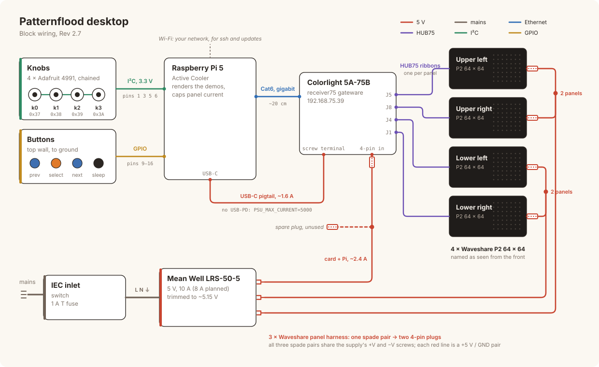

# Wiring

Everything electrical in the Rev 2.7 desktop build, in one place. For the order
to do it in, see [`BUILD.md`](BUILD.md). The design reasoning is in
[`driver-colorlight.md`](driver-colorlight.md).



## 1. Knob chain → Pi header (I²C)

The four Adafruit 4991 encoders are daisy-chained by their STEMMA QT
connectors. The free end goes to the Pi's 40-pin header.

| STEMMA QT wire | Signal | Pi header pin | Pi name |
|---|---|---|---|
| **Red** | V+ | **pin 1** | **3V3** (not 5 V) |
| **Black** | GND | **pin 6** | GND |
| **Blue** | SDA | **pin 3** | GPIO2 / SDA1 |
| **Yellow** | SCL | **pin 5** | GPIO3 / SCL1 |

```
            Pi 40-pin header (pin 1 is the square pad)

     Red ──  3V3   (1) (2)   5V
    Blue ──  SDA   (3) (4)   5V
  Yellow ──  SCL   (5) (6)   GND  ── Black
                   (7) (8)   TXD    console (§5)
                   (9) (10)  RXD    console (§5)
                  ...          buttons: §4
```

- **Cable:** a STEMMA QT / Qwiic to female-socket cable (Adafruit 4397).
- **⚠ 3.3 V only.** Each 4991 pulls SDA and SCL up to its own supply. On 5 V
  it would put 5 V on GPIO2/3, which are not 5 V-tolerant.
- **Addresses:** 0x37, 0x38, 0x39 and 0x3A (k0–k3), set by the solder jumpers
  (A0; A1; A0 + A1; A2). Chain order doesn't matter: knobs are numbered by
  address. **k0 is the leftmost knob** seen from the front.
- **One I²C master.** If you used a FeatherS3 knob bridge on the bench
  ([`firmware/knob_bridge/`](../../firmware/knob_bridge/)), unplug it from the
  chain: two masters corrupt each other's transfers.
- **Pull-ups:** the Pi's on-board 1.8 kΩ in parallel with four boards' 10 kΩ
  gives about 1.1 kΩ. Fine at 3.3 V and 100 kHz. Keep the chain under ~1 m.
- **Power:** the knob lights follow the panel brightness. Four boards draw about
  50 mA dim, and up to ~250 mA from the Pi's 3V3 with all four lit white.

## 2. Pi → Colorlight card (Ethernet)

A ~20 cm flat Cat6 patch cable from the Pi's own jack to either of the card's.
The card **won't link at 100 Mbit**, so it must be a gigabit port, which the
Pi 5's is.

The appliance gives any wired interface **192.168.75.1/24**, with no default
route. The card is at **192.168.75.39**: it answers ARP, but not ping.

### HUB75: card → panels

One panel per output, each ribbon into the panel's **IN** (on the left, seen
from behind):

| Panel (seen from the front) | Card connector | receiver75 slot |
|---|---|---|
| Upper left | **J5** | 9 |
| Upper right | **J8** | 15 |
| Lower left | **J4** | 7 |
| Lower right | **J1** | 1 |

All upright. `firmware/colorlight/r75_frame.py` maps a 128 × 128 frame onto
these slots, and the card's boot splash has the same map compiled in. Change
both if you rewire.

## 3. Power

From the LRS-50-5, **trimmed to ~5.15 V**. Mains wiring and safety are in
[`BUILD.md` §8](BUILD.md#8-mains-and-5-v); read that first.

The 5 V side is three of the power harnesses that come with Waveshare's
panels. Each is one pair of spade (fork) terminals at the supply end, split to
two 4-pin panel power plugs, the Molex-style plug HUB75 panels use. All three
spade pairs go under the supply's +V and −V screws, which gives six plugs:

| Harness | Plugs into | Carries |
|---|---|---|
| A | two panels | ≤ 2.8 A capped; 4.8 A if both were full white |
| B | the other two panels | the same |
| C | the Colorlight's 4-pin power input, and a spare | ~2.4 A: the card's ~0.8 A and the Pi's ~1.6 A |

- **The card has two 5 V inputs on one rail:** a 4-pin plug the same as a
  panel's, and a screw terminal. Harness C goes into the plug, and the Pi's
  **5 V → USB-C pigtail** screws into the terminal, so the card passes the
  Pi's power through. Harness C carries less than one panel at full white,
  which is what the harness is made for, and the Pi shares no harness with a
  panel.
- **The spare plug is live.** Cap or tape it, and tie it back away from the
  boards. It's there for a fifth 5 V load.
- **The pigtail does no USB-PD**, so set `PSU_MAX_CURRENT=5000` with
  `sudo rpi-eeprom-config -e`, or the Pi limits its USB ports and warns about
  the supply.

## 4. Buttons (GPIO)

Four momentary buttons on the top wall. Each joins its GPIO to ground. There
are no resistors: the Pi's internal pull-up holds the line high, and a press
pulls it low.

| Button | Where (top wall, seen from the front) | Colour | Does | Pi header pin | Pi name | Ground |
|---|---|---|---|---|---|---|
| **btn0** | left end, 1st of the row | blue | **previous** demo | **pin 11** | GPIO17 | pin 9 |
| **btn1** | 2nd | orange | **select** | **pin 13** | GPIO27 | pin 9 |
| **btn2** | 3rd | blue | **next** demo | **pin 15** | GPIO22 | pin 9 |
| **btn3** | right end, alone | black | **sleep** (blackout) | **pin 16** | GPIO23 | pin 14 |

```
            Pi 40-pin header

                    (7) (8)   TXD     console (§5)
  common ── GND     (9) (10)  RXD     console (§5)
    btn0 ── GPIO17 (11) (12)
    btn1 ── GPIO27 (13) (14)  GND     ── btn3's ground
    btn2 ── GPIO22 (15) (16)  GPIO23  ── btn3
                   (17) (18)  GPIO24  ┐
                   (19) (20)  GND     │ free for two more
                   (21) (22)  GPIO25  ┘
```

Pins 9, 11, 13 and 15 sit next to each other in the odd column, so one 4-pin
Dupont wire connector (female, 2.54 mm) carries the row and its ground. The
sleep button is a 2-pin Dupont connector on pins 14 and 16. Its lead runs the length of the top wall, ~270 mm, under the
top doubler.

- **⚠ 3.3 V only, and switch to ground.** Never wire a button to 5 V. If the
  buttons have LEDs, power those separately.
- **Room for more:** GPIO24 (pin 18) and GPIO25 (pin 22), with GND on pin 20.
  Past that, MCP23017 expanders on the knob chain (0x20–0x27) don't clash with
  the knobs.

**What they will do.** Playing: previous and next step through the demos on
the current shelf, and select opens the menu. In the menu, previous and next
step along the shelf, and select picks the highlighted demo. Sleep blanks the
panels and wakes them again. The k0 + k3 chord stays, for a box without
buttons.

**Software: not done yet.** The plan is the kernel's `gpio-key` overlay, which
turns each button into a debounced key on `/dev/input` (pull-up and active-low
are its defaults), so the renderer decides what each one does:

```
dtoverlay=gpio-key,gpio=17,keycode=59,label=btn0
dtoverlay=gpio-key,gpio=27,keycode=60,label=btn1
dtoverlay=gpio-key,gpio=22,keycode=61,label=btn2
dtoverlay=gpio-key,gpio=23,keycode=62,label=btn3
```

The keycodes are F1–F4. The renderer's user, `patternflood`, will need group
`input` as well as `i2c`. Once that's in, `evtest` lists `btn0`–`btn3`.

## 5. Serial console

The appliance puts the console on the header: GPIO14 TXD (pin 8) and GPIO15 RXD
(pin 10), 115200 baud (on the Pi 5, `dtparam=uart0_console` moves it there from
the debug connector). Use any 3.3 V USB serial adapter; free grounds are pins
20, 25, 30, 34 and 39. With a Glasgow on port B (Pi TXD → B0, Pi RXD → B1):

    glasgow run uart -V B=3.3 --rx B0 --tx B1 -b 115200 tty

## 6. Bring-up check

1. Power on with the knobs and the card connected. The first boot takes a few
   minutes: it installs packages over Wi-Fi and compiles upstream's patterns.
2. `ssh patternflood.local`
3. `i2cdetect -y 1` shows 37, 38, 39 and 3a.
4. `journalctl -u patternflood -f` shows a `knobs:` line, then frames per
   second every 5 s.
