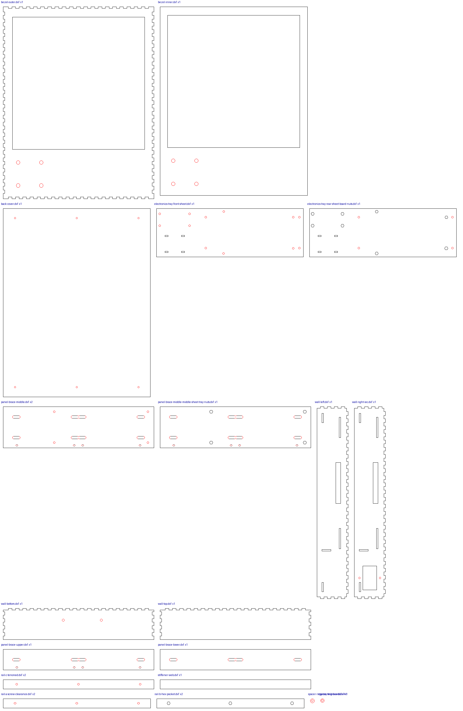

# Laser-cut parts

Generated by `hardware/cad/tools/export_dxf.py` from the Onshape enclosure studio —
do not edit by hand; change the model and re-run.

- **33 parts, 19 files.** DXF R12, millimetres, one closed cut path per
  outline/hole on layer `CUT`. Every part is a through-cut of one sheet.
- Cut with **#thickness = 3.18 mm** and **#kerf = 0.2 mm** baked in: tabs and
  holes are already compensated. **Both are placeholders** until the real sheet is
  measured and the test comb is cut — set them, then re-run this export.
- **Cut [`test-cuts/`](test-cuts/README.md) first** — kerf, nut pockets, hole sizes, the
  panel jig and the board templates, all on one 12 × 12" sheet.
- Material: 3 mm Baltic birch, B/BB (enclosure-lasercut.md §13). Everything fits
  a 12 × 24" sheet across the xTool P2's 305 mm axis.

| File | Qty | Size (mm) | Parts |
|---|---|---|---|
| `bezel-outer.dxf` | 1 | 293.0 × 373.0 | Bezel outer |
| `bezel-inner.dxf` | 1 | 286.6 × 366.6 | Bezel inner |
| `back-cover.dxf` | 1 | 286.0 × 366.0 | Back cover |
| `electronics-tray-front-sheet.dxf` | 1 | 285.6 × 94.0 | Electronics tray, front sheet |
| `electronics-tray-rear-sheet-board-nuts.dxf` | 1 | 285.6 × 94.0 | Electronics tray, rear sheet (board nuts) |
| `panel-brace-middle.dxf` | 2 | 293.0 × 80.2 | Panel brace middle; Panel brace middle, rear sheet |
| `panel-brace-middle-middle-sheet-tray-nuts.dxf` | 1 | 293.0 × 80.2 | Panel brace middle, middle sheet (tray nuts) |
| `wall-left.dxf` | 1 | 60.7 × 373.0 | Wall left |
| `wall-right-iec.dxf` | 1 | 60.7 × 373.0 | Wall right (IEC) |
| `wall-bottom.dxf` | 1 | 293.0 × 60.7 | Wall bottom |
| `wall-top.dxf` | 1 | 293.0 × 60.7 | Wall top |
| `panel-brace-upper.dxf` | 1 | 293.0 × 40.2 | Panel brace upper |
| `panel-brace-lower.dxf` | 1 | 293.0 × 40.2 | Panel brace lower |
| `rail-c-tenoned.dxf` | 2 | 293.0 × 18.2 | Rail C lower (tenoned); Rail C upper (tenoned) |
| `stiffener-web.dxf` | 1 | 293.0 × 18.0 | Stiffener web |
| `rail-a-screw-clearance.dxf` | 2 | 286.6 × 18.0 | Rail A lower (screw clearance); Rail A upper (screw clearance) |
| `rail-b-hex-pocket.dxf` | 2 | 286.6 × 18.0 | Rail B lower (hex pocket); Rail B upper (hex pocket) |
| `spacer-ring-tray-to-brace.dxf` | 4 | 8.0 × 8.0 | Spacer ring — tray to brace |
| `spacer-ring-board.dxf` | 8 | 7.0 × 7.0 | Spacer ring — Colorlight 1; Spacer ring — Colorlight 2; Spacer ring — Colorlight 3; Spacer ring — Colorlight 4; Spacer ring — Pi 1; Spacer ring — Pi 2; Spacer ring — Pi 3; Spacer ring — Pi 4 |

