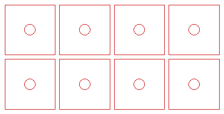

# Knob light diffusers (paper)

Generated by `hardware/cad/tools/diffusers.py` from the Onshape variables — do not
edit by hand; change the variables and re-run.

One square of paper per knob, in the inner bezel sheet's pocket behind it, flat
against the outer sheet's back: it spreads the NeoPixel on the knob's Adafruit
4991 into an even glow through the whole ring of light slits.

| File | What |
|---|---|
| `knob-diffuser.dxf` | one diffuser: 34.5 mm square (the 35 mm `#knobPocket` less 0.25 a side), Ø7.3 hole (`#boreDia` 7 + 0.3) |
| `knob-diffusers.dxf` | 8 of them, 4 across, 3 mm apart: 4 knobs + 4 spares, 147 × 72 mm |

DXF R12, millimetres, layer `CUT`, drawn nominal (paper's kerf is small enough to
ignore).

**Paper:** plain 80–120 gsm copy paper, or tracing paper / drafting vellum for a
brighter ring. If the LED still shows as a spot, stack two. On the xTool P2 cut
paper at low power and high speed, with air assist on gently or off so the
pieces don't blow away; tape the sheet down at its edges.

**Fitting:** with the encoder out, drop the square into the pocket, push the
encoder's bushing through the hole from behind, and put the jam nut on from the
front: the encoder's face clamps the paper against the outer sheet. The hole is
not keyed and the square fits either way round.

