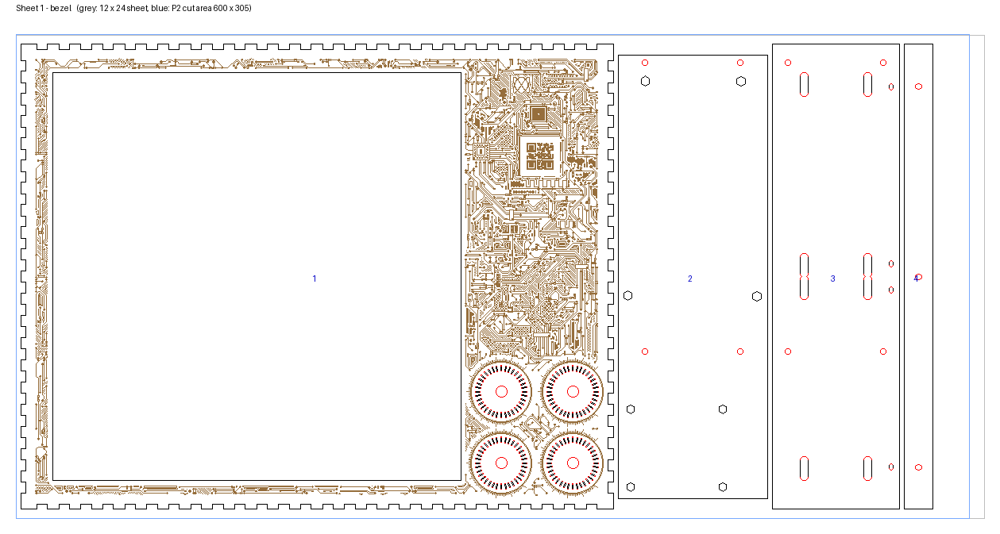
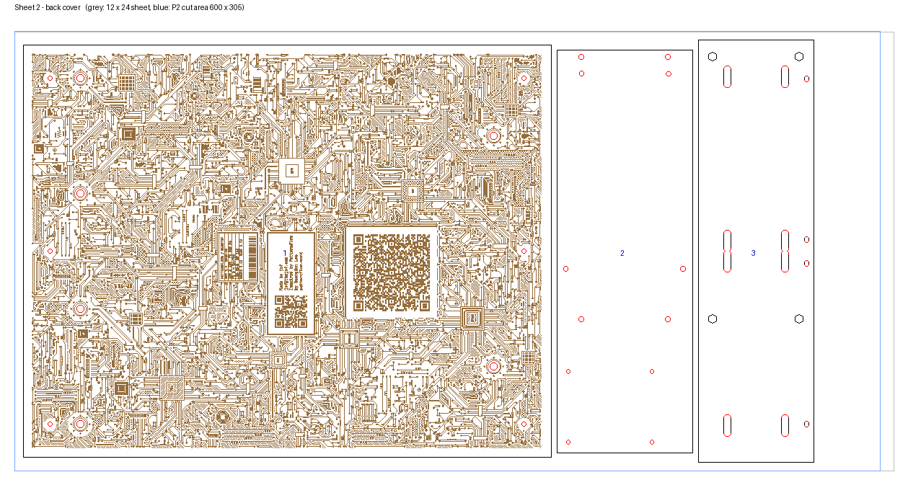
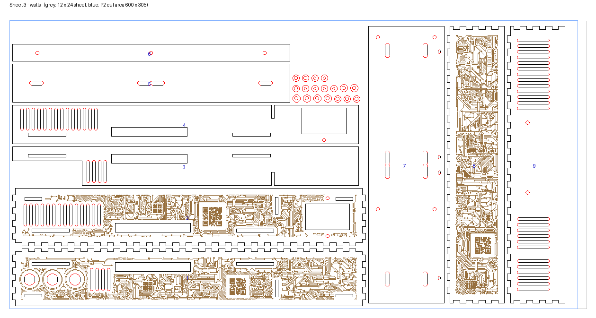
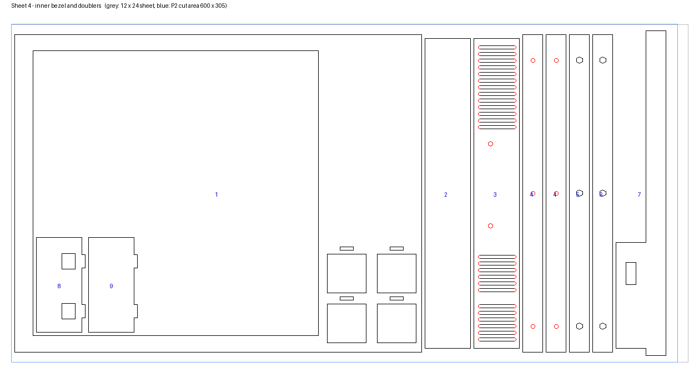
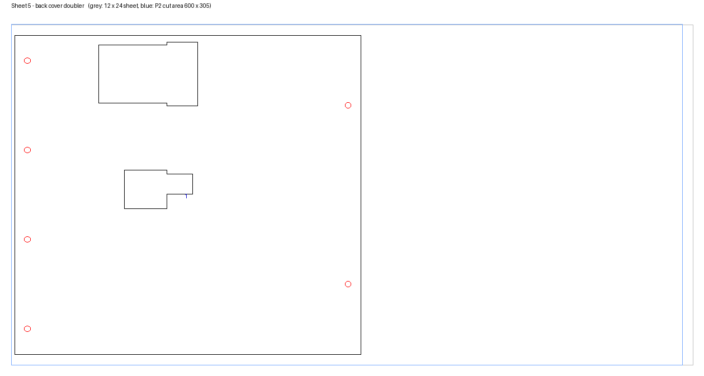
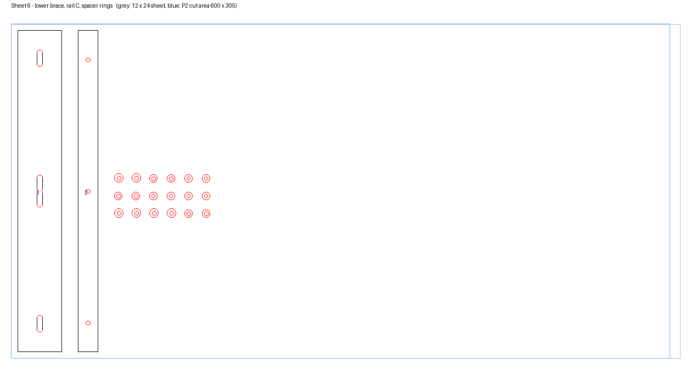

# Cut sheets — the enclosure on 6 12 × 24" sheets

Generated by `hardware/cad/tools/nest_sheets.py` from the part DXFs one level up — do not edit by hand; re-run `export_dxf.py` and then this after any model change.

- **Material:** 3 mm Baltic birch, B/BB, 12 × 24" (304.8 × 609.6 mm). Caliper it: the model is cut for `#thickness` 3.18 and `#kerf` 0.15, as set from the test cuts.
- **Placement:** the P2 cuts 600 × 305 mm, so a 24" sheet overhangs the cut area by 9.6 mm at one end. Every part is at least 6 mm from the sheet's start edge and the cut area's far end, 5.5 from the long edges, and 4 mm from its neighbours. Each DXF's origin is the corner of the cut area; put the sheet's corner there.
- **Inner shapes first.** The knob ribs are nested inside the inner bezel's display aperture on sheet 4. xTool Creative Space cuts inner shapes before outer ones by default; keep it that way, or the aperture drops out with the ribs still in it.
- **Cut paths only.** No sheet outline or labels in the DXFs — the laser would cut them. Use the pictures below to tell the parts apart as they come off.
- **Etched art (sheets 1–3).** The outer faces — bezel, side walls, top wall, back cover — carry a circuit-board pattern from `art.py`. To etch, load **`sheet-N.svg`** instead of the DXF: one file, so the art stays on its part. In xTool Creative Space assign processing **by colour**: **red = Cut**, **blue = Score** — all of the art, dots included (they are tight concentric circles that burn in solid: a raster engrave of thousands of dots would run line by line over the whole part). Make sure the score runs **before** the cut, so nothing has moved when the art goes on: each colour imports as its own layer, so drag the blue layer above the red one and set the processing order to **by layer**. XCS does not keep settings with a colour, only with the objects, so set both layers up once per sheet and save that as a project (.xcs) to reopen, rather than re-importing. The file holds a `score` group and then a `cut` group, and inside each a group per part (`p<N>-<part>`, N as in the tables below), so the parts come in as separate objects and the art comes first. Every outline and hole is one closed path, so XCS sees shapes (it needs them to cut inner ones first) and cuts each one in a single pass. The art's rings and closed traces are merged into compound paths, one per 50 mm patch of each part; the open traces stay one polyline each, because XCS closes every subpath of a compound path (it folded each trace back to its start, in blobs). Sheet 2 is ~21,000 objects: XCS is slow on it but draws it right. **Or import the cuts and the art separately**, `sheet-N-cut.svg` and `sheet-N-score.svg`: both carry the same green L-marks at the corners of the cut area, so the two imports are the same size — select both, **align left** and **align bottom**, and they are registered; then delete the green marks (they sit in the margin, clear of every part, so nothing is lost if one is left in). It is a lot of line: ~101 m on the back cover, ~23 m on the bezel, ~10–12 m per wall — budget roughly 20–30 min for sheet 2 and 5–15 for sheets 1 and 3 at a typical score speed. Set the score settings on test piece 16 first (`../test-cuts/part-2/`): you want a fine, even, light line and a QR code that scans. The art faces up on the bed, which is the outside face. Skip it by loading the DXF instead: same cuts.
- **Cut the test sheets first** ([`../test-cuts/`](../test-cuts/README.md), parts 1 and 2, a 12 × 12 each), and again after any change of stock.
- **Good face up, and don't mirror anything.** Every part is drawn as seen from outside the box, so the face that is up on the bed becomes the outside: the bezel's front, each wall's outer face, the back of the back cover. Mask that face (transfer tape) against smoke marks; the face against the honeycomb, with its flash-back marks, ends up inside.
- **Buy 8:** 6 for the box, one for the test cuts (two 12 × 12s), and one spare.
- **Laminated:** the bezel, every wall and the back cover are two sheets, the second glued on (PVA, clamped flat) before the box goes together — `docs/desktop/BUILD.md` §7.1.

## Sheet 1 — bezel — `sheet-1.dxf`

Parts span 577.3 × 293.0 mm.

| # | Part | Qty | From |
|---|---|---|---|
| 1 | Bezel, outer (front face) | 1 | `bezel-outer.dxf` |
| 2 | Electronics tray, rear sheet (board nuts) | 1 | `electronics-tray-rear-sheet-board-nuts.dxf` |
| 3 | Panel brace middle (front or rear sheet; identical) | 1 | `panel-brace-middle.dxf` |
| 4 | Rail C, tenoned (upper or lower; identical) | 1 | `rail-c-tenoned.dxf` |

## Sheet 2 — back cover — `sheet-2.dxf`

Parts span 548.2 × 293.0 mm.

| # | Part | Qty | From |
|---|---|---|---|
| 1 | Back cover | 1 | `back-cover.dxf` |
| 2 | Electronics tray, front sheet | 1 | `electronics-tray-front-sheet.dxf` |
| 3 | Panel brace middle, middle sheet (tray nuts) | 1 | `panel-brace-middle-middle-sheet-tray-nuts.dxf` |

## Sheet 3 — walls — `sheet-3.dxf`

Parts span 524.4 × 293.0 mm.

| # | Part | Qty | From |
|---|---|---|---|
| 1 | Wall left | 1 | `wall-left.dxf` |
| 2 | Wall right (IEC cutout) | 1 | `wall-right-iec.dxf` |
| 3 | Wall left doubler (glued inside) | 1 | `wall-left-doubler.dxf` |
| 4 | Wall right doubler, IEC cutout (glued inside) | 1 | `wall-right-doubler-iec.dxf` |
| 5 | Wall top | 1 | `wall-top.dxf` |
| 6 | Wall bottom | 1 | `wall-bottom.dxf` |

## Sheet 4 — inner bezel and doublers — `sheet-4.dxf`

Parts span 544.9 × 286.6 mm.

| # | Part | Qty | From |
|---|---|---|---|
| 1 | Bezel, inner (glued behind the outer; knob pockets) | 1 | `bezel-inner.dxf` |
| 2 | Wall top doubler (glued inside) | 1 | `wall-top-doubler.dxf` |
| 3 | Wall bottom doubler, PSU holes (glued inside) | 1 | `wall-bottom-doubler-psu.dxf` |
| 4 | Rail A, screw clearance (upper or lower; identical) | 2 | `rail-a-screw-clearance.dxf` |
| 5 | Rail B lower, hex pockets | 1 | `rail-b-lower-hex-pocket.dxf` |
| 6 | Rail B upper, hex pockets | 1 | `rail-b-upper-hex-pocket.dxf` |
| 7 | Knob rib 1, between the knob columns (cable holes) | 1 | `knob-rib-1.dxf` |
| 8 | Knob rib 2, between the knobs and the PSU | 1 | `knob-rib-2.dxf` |

## Sheet 5 — back cover doubler, braces, shelf — `sheet-5.dxf`

Parts span 486.8 × 293.0 mm.

| # | Part | Qty | From |
|---|---|---|---|
| 1 | Back cover doubler (glued inside the cover, between the rails) | 1 | `back-cover-doubler.dxf` |
| 2 | Panel brace upper | 1 | `panel-brace-upper.dxf` |
| 3 | Panel brace middle (front or rear sheet; identical) | 1 | `panel-brace-middle.dxf` |
| 4 | Stiffener shelf (props the knob band under the aperture) | 1 | `stiffener-shelf.dxf` |

## Sheet 6 — lower brace, rail C, spacer rings — `sheet-6.dxf`

Parts span 175.3 × 293.0 mm.

| # | Part | Qty | From |
|---|---|---|---|
| 1 | Panel brace lower | 1 | `panel-brace-lower.dxf` |
| 2 | Rail C, tenoned (upper or lower; identical) | 1 | `rail-c-tenoned.dxf` |
| — | Spacer ring, tray to brace (8 mm) | 6 | `spacer-ring-tray-to-brace.dxf` |
| — | Spacer ring, Colorlight (7 mm, M3 bore) | 6 | `spacer-ring-colorlight.dxf` |
| — | Spacer ring, Pi 5 (7 mm, M2.5 bore) | 6 | `spacer-ring-pi-m2.5.dxf` |

## Totals

| Part | Qty | Sheet |
|---|---|---|
| Bezel, outer (front face) | 1 | 1 |
| Bezel, inner (glued behind the outer; knob pockets) | 1 | 4 |
| Back cover | 1 | 2 |
| Back cover doubler (glued inside the cover, between the rails) | 1 | 5 |
| Electronics tray, front sheet | 1 | 2 |
| Electronics tray, rear sheet (board nuts) | 1 | 1 |
| Panel brace middle (front or rear sheet; identical) | 2 | 1, 5 |
| Panel brace middle, middle sheet (tray nuts) | 1 | 2 |
| Wall left | 1 | 3 |
| Wall right (IEC cutout) | 1 | 3 |
| Wall bottom | 1 | 3 |
| Wall top | 1 | 3 |
| Wall left doubler (glued inside) | 1 | 3 |
| Wall right doubler, IEC cutout (glued inside) | 1 | 3 |
| Stiffener shelf (props the knob band under the aperture) | 1 | 5 |
| Panel brace upper | 1 | 5 |
| Panel brace lower | 1 | 6 |
| Wall bottom doubler, PSU holes (glued inside) | 1 | 4 |
| Wall top doubler (glued inside) | 1 | 4 |
| Rail C, tenoned (upper or lower; identical) | 2 | 1, 6 |
| Rail A, screw clearance (upper or lower; identical) | 2 | 4 |
| Rail B lower, hex pockets | 1 | 4 |
| Rail B upper, hex pockets | 1 | 4 |
| Knob rib 1, between the knob columns (cable holes) | 1 | 4 |
| Knob rib 2, between the knobs and the PSU | 1 | 4 |
| Spacer ring, tray to brace (8 mm) | 4 | 6 |
| Spacer ring, Colorlight (7 mm, M3 bore) | 4 | 6 |
| Spacer ring, Pi 5 (7 mm, M2.5 bore) | 4 | 6 |

**40 parts on 6 sheets**, plus 6 spare spacer rings on sheet 6 (the 7 mm board ring is only 1.8 mm of wood round its hole).
