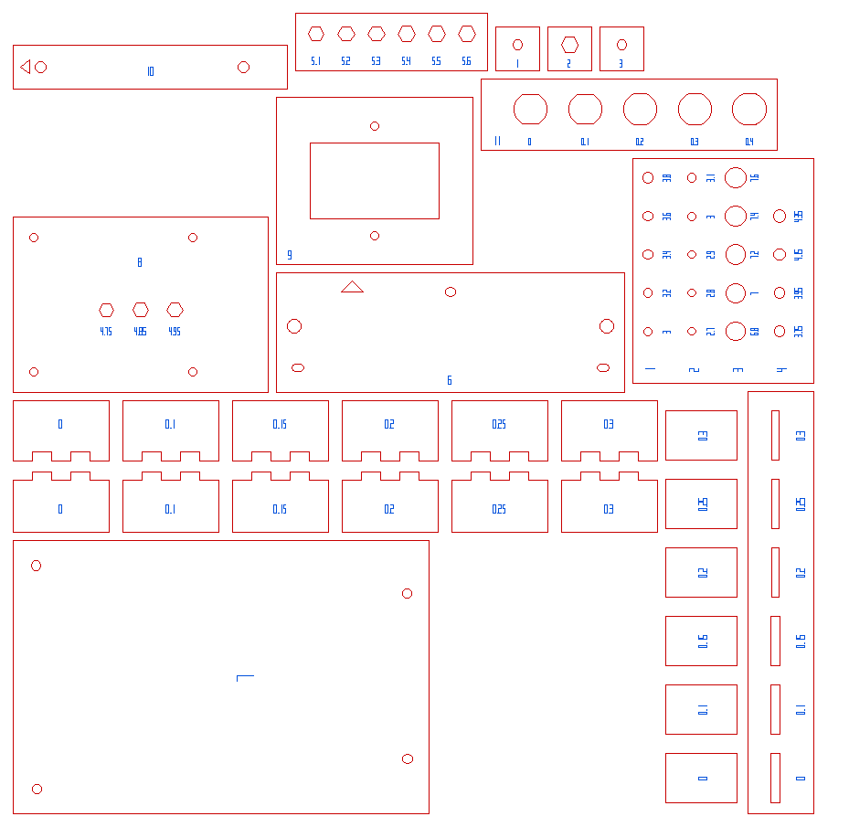

# Test cuts — validate before the full sheet

Generated by `hardware/cad/tools/test_cuts.py` from the live Variable Studio and the board data in `enclosure.fs`; re-run after changing either.

Everything below fits one 12 × 12" sheet (`all-test-cuts.dxf`, 300 × 292 mm), or cut the pieces singly. Every path is safe to cut: outlines and holes on layer **CUT** (red), the engraved numbers on layer **SCORE** (blue) — set blue to a light engrave if your laser software maps by colour; if it cuts everything, the digits just come out as small slots and holes. Cut them in the same 3 mm Baltic birch as the box, with the same laser settings you'll use for the real parts, or the numbers mean nothing.

**Order:** caliper the sheet's thickness first, then tests 1–2 to settle **#kerf** (everything else is compensated by it), set the variables, re-run this script, and cut the rest.

Values used for this cut: `#kerf` 0.15, `#thickness` 3.18, `#screwDia` 3.05, `#nutAcrossFlats` 5.5, `#boreDia` 7, `#pinHoleDia` 2.95, `#psuHoleDia` 4.1.

## 1. Kerf: finger-joint pairs — `01-kerf-finger-comb.dxf`

**Cut:** Six pairs of finger plates, compensated exactly as the box corners are, one pair per kerf value (0, 0.1, 0.15, 0.2, 0.25, 0.3 mm, engraved on both plates). Push each pair's finger edges together, in plane and then at 90° like a box corner.

**Read:** The pair that goes together with a firm hand press and holds without glue is your kerf. Loose → the kerf is bigger than that label; won't go in → smaller. The finger depth is #thickness (3.18): at 90° the tabs should finish flush — proud or short means the sheet isn't that thickness.

**Sets:** #kerf (and #thickness)

## 2. Kerf: through-tenon and mortise — `02-kerf-tenon-mortise.dxf`

**Cut:** A wall coupon with six mortises and six 18 mm tenon strips, one per kerf value, compensated as the braces and rail C are (tenon +kerf, mortise −kerf, in both directions).

**Read:** Push each strip into the mortise with the same label. It should agree with test 1; this one also checks the sheet thickness against the mortise's short side.

**Sets:** #kerf

## 3. Captive nut: hex pocket sweep — `03-hex-nut-pockets.dxf`

**Cut:** Six hex pockets drawn at 5.1, 5.2, 5.3, 5.4, 5.5, 5.6 mm across flats. The model cuts 5.35 (#nutAcrossFlats 5.5 − kerf).

**Read:** Drop an M3 nut into each. You want the smallest pocket it still drops into by hand and in which it can't turn. Set #nutAcrossFlats so that #nutAcrossFlats − #kerf equals that label.

**Sets:** #nutAcrossFlats

## 4. Captive nut: the three-layer sandwich — `04-captive-nut-sandwich.dxf`

**Cut:** Three 16 mm squares: 1 clearance Ø3.55, 2 hex 5.35 AF, 3 clearance — the stack every nut in the box sits in (rails, middle brace, tray).

**Read:** Stack 1-2-3 with a nut in 2, drive an M3 x 8 through 3. The nut should not spin, should pull up tight against 1, and should stay put when the screw is backed out.

**Sets:** #nutAcrossFlats, #screwDia

## 5. Hole gauge (labels are the DRAWN diameter) — `05-hole-gauge.dxf`

**Cut:** Row 1: M3 clearance. Row 2: panel registration pin (Ø2.83–2.87). Row 3: EC11 encoder bushing (the knob bore). Row 4: PSU side-screw clearance. Each hole is engraved with the diameter drawn; the cut comes out about one kerf bigger.

**Read:** Row 1: the smallest an M3 passes freely — the model draws 2.9 for the back cover and 3.55 in the rails and braces. Row 2: the one the pin drops into with no play — the model draws 2.8. Row 3: the encoder bushing should pass and not wobble — the model draws 7. Row 4: the model draws 3.95: loose for the PSU's hole tolerance (±0.48 mm), tight enough for a 5.5 mm screw head to bear on with no washer.

**Sets:** #screwDia, #pinHoleDia, #boreDia, #psuHoleDia

## 6. Panel fit jig — `06-panel-fit-jig.dxf`

**Cut:** The upper brace's footprint on one panel: 127 wide, the panel's rear width. Registration pin holes at (±55.75, 29), screw slots at (±57, 44), and a sight hole over the mid-edge insert at (0, 56.65). The triangle points at the pin (top) edge.

**Read:** Lay it on a panel's back, flush with the rear top and side edges. Both pins should drop into their holes with no rocking, both inserts should sit inside their slots (M3 screws go in square), and the insert should be centred in the sight hole.

**Sets:** #pinXOffset, #pinYOffset, #postXOffset, #braceYOffset, #midPostYOffset

## 7. Colorlight 5A-75B template — `07-colorlight-template.dxf`

**Cut:** The card's footprint plus 4 mm, with its four mounting holes at the positions measured off the scans, at the tray's hole size. The RJ45 end is the end with the two holes 5 mm in from the corners.

**Read:** Set the card on it component side up. All four M3 screws should go through card and template together. If one doesn't, the scan is off at that hole — measure it and correct CL_HOLES in enclosure.fs.

**Sets:** CL_HOLES (enclosure.fs)

## 8. Raspberry Pi 5 template + M2.5 nut pockets — `08-pi-5-template.dxf`

**Cut:** The board's footprint plus 4 mm, with the four 58 × 49 mounting holes at the tray's M2.5 hole size (2.9), and three M2.5 hex pockets in the middle: 4.75, 4.85, 4.95 across flats, the middle one being what the tray draws.

**Read:** Set the Pi on it: an M2.5 screw should go through every hole of Pi and template together. Then push an M2.5 nut into each pocket — you want the one that holds the nut like the M3 pockets did (5.3–5.4 for M3). If it isn't the middle one, move #piNutAF by the difference.

**Sets:** PI_HOLES (enclosure.fs), #piScrewDia, #piNutAF

## 9. IEC inlet cutout — `09-iec-cutout.dxf`

**Cut:** The 47.1 × 27.6 cutout and its two flange screw holes 40 apart, as cut in the right wall.

**Read:** The inlet body should pass with a slight drag and the flange sit flat around it; M3 screws through both lobes. Mains part — do not skip this one.

**Sets:** #iecCutW, #iecCutH, #iecScrewSpacing, #iecScrewDia

## 10. PSU side-screw holes — `10-psu-side-holes.dxf`

**Cut:** A strip with the two holes 74 apart, at 10 and 84 from the end the triangle points at — the PSU's terminal end.

**Read:** Hold it on the PSU's threaded side face, that end flush with the terminal end: two M3 x 8 should thread in square.

**Sets:** #psuHoleAX, #psuHoleBX, #psuHoleDia

## 11. Push buttons: keyed hole sweep — `11-push-button-keys.dxf`

**Cut:** Five keyed holes for the 12 mm push buttons (Ø12 thread, flats 11 apart), each drawn as the left wall cuts it: thread and flats plus the engraved clearance, minus kerf. The flats run horizontally.

**Read:** Push a button through each. You want the smallest clearance it goes through by hand, flats engaged, and doesn't turn when the nut is tightened. The model uses 0.2; set BTN_CLEAR in enclosure.fs to the label that fits.

**Sets:** BTN_CLEAR (a constant in enclosure.fs)

## Not cuttable — measure

- **Sheet thickness** — calipers, several places on the sheet you'll cut. Finger depth and every mortise follow `#thickness`.
- **EC11 bushing thread length** — measured 5.5 mm (2026-10-18): it clamps one sheet, so the bezel is one sheet.
