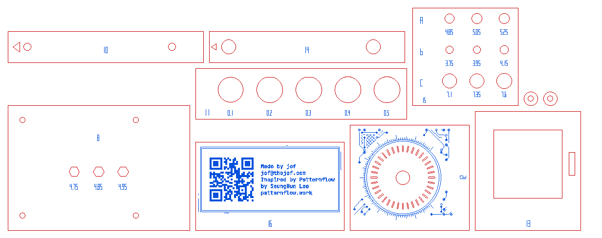

# Test cuts, part 2

Generated by `hardware/cad/tools/test_cuts_part2.py` from the live variables, `enclosure.fs` and the part DXFs; re-run after changing any of them.

Cut this after [part 1](../README.md), which settles kerf, thickness, joints and nut pockets. This sheet checks the details of the laminated bezel and knobs, the Pi 5, the buttons, the supply's screws, and the etched art. Pieces 8, 10 and 11 are on both sheets; cut them once.

**Load `all-part-2.svg`** (300 × 114 mm, fits a 12 × 12" sheet): one file, so the art stays registered on its coupons. In xTool Creative Space every colour imports as its own layer — set **red = Cut** and **blue = Score**, put the blue layer above the red one and process **by layer**, so all the scoring runs before anything is cut loose. XCS keeps those settings with the objects, not the colour: save the set-up as a project (.xcs) and reuse the settings you settle on here for the box's sheets. Or import `all-part-2-cut.svg` and `all-part-2-score.svg` separately: both have the same green corner marks, so select both, align left and align bottom, and they register; then delete the marks. The DXF (`all-part-2.dxf`) has the cuts and engraved labels only, no art, and is safe to cut even if the software ignores layers.

Same 3 mm Baltic birch and the same settings as the box, or the results mean nothing.

## What it checks

| Detail | Test piece |
|---|---|
| Two-sheet bezel: the outer sheet clamped by the encoder, the inner one pocketed 35 mm at each knob | 12 + 13 |
| Knob light slits, 36 × 0.7 mm per knob | 12 |
| Etched art: dials, QR codes, JetBrains Mono plates, score fill | 12 (dial), 16 |
| Raspberry Pi 5 holes, M2.5 nut pockets and spacer rings | 8, 17 |
| Push buttons, keyed 12 mm holes | 11 |
| `#psuHoleDia` 4.1 and the head recesses, M3 × 8 no washer | 10 + 14, 15 |
| French cleat holes Ø5.2 | 15 |
| Knob rib tabs in blind slots in the inner bezel | 13 (slot); same kerf rule as piece 2 |
| Wall doublers and the back cover doubler, glued; mortises through both sheets | not cut: the same 2-D fits as pieces 1–2, now through two glued sheets — glue them with a brace pushed through to register, as BUILD.md §7.1 says |
| Back cover doubler between the rail A strips, 0.5 mm clear; its relief windows | not cut: clearances, checked in the model |
| Intake/exhaust vents, shelf wire passthroughs, the top doubler's button notches | not cut: openings, nothing fits in them |
| Paper knob diffusers | paper, not birch: `../../diffusers/`; try one with 12 + 13 |

## 12. Knob, outer bezel sheet (bore, light slits, dial) — `12-knob-outer-sheet.dxf`

**Cut:** A 54 mm square of the real outer bezel round knob K1: the Ø7 bore and the 36 light slits (0.7 wide as cut, ~1.5 mm of wood between them at the inner end), and in the SVG its etched dial.

**Read:** The slits should be cut clean through with every web whole and unscorched — if the webs burn or break, the slits want a faster/lower-power cut, or KNOB_SLIT_W/KNOB_SLITS changed. Glue 13 behind it, fit the encoder and its jam nut, and light the 4991's NeoPixel behind a paper diffuser (`../../diffusers/`): you want an even ring.

**Sets:** KNOB_SLITS, KNOB_SLIT_W (enclosure.fs); cut settings for fine slots

## 13. Knob, inner bezel sheet (35 mm pocket) — `13-knob-inner-sheet.dxf`

**Cut:** The same square of the inner bezel: the 35 mm pocket behind the knob, and the knob rib's slots where they fall inside it.

**Read:** Glued behind 12, both outer face up, label strips together and edges flush: the EC11's jam nut should pull its face tight against 12 alone (5.5 mm of thread, 2.3 mm nut), the 4991 breakout and its STEMMA plugs should sit inside the pocket, and a paper diffuser should drop in flat. The rib slot takes a 3.18 tab like piece 2's tenons.

**Sets:** #knobPocket

## 8. Raspberry Pi 5 template + M2.5 nut pockets — `08-pi-5-template.dxf`

**Cut:** The board's footprint plus 4 mm, with the four 58 × 49 mounting holes at the tray's M2.5 hole size (2.9), and three M2.5 hex pockets in the middle: 4.75, 4.85, 4.95 across flats, the middle one being what the tray draws.

**Read:** Set the Pi on it: an M2.5 screw should go through every hole of Pi and template together. Then push an M2.5 nut into each pocket — you want the one that holds the nut like the M3 pockets did (5.3–5.4 for M3). If it isn't the middle one, move #piNutAF by the difference.

**Sets:** PI_HOLES (enclosure.fs), #piScrewDia, #piNutAF

## 10. PSU side-screw holes — `10-psu-side-holes.dxf`

**Cut:** A strip with the two holes 74 apart, at 10 and 84 from the end the triangle points at — the PSU's terminal end.

**Read:** Hold it on the PSU's threaded side face, that end flush with the terminal end: two M3 x 8 should thread in square.

**Sets:** #psuHoleAX, #psuHoleBX, #psuHoleDia

## 14. PSU screw-head recesses (outer sheet) — `14-psu-head-recesses.dxf`

**Cut:** Piece 10's strip with the outer sheet's Ø7.5 head recesses (drawn 7.35) at the same spacing, triangle at the same end.

**Read:** Stack 14 under 10, triangles together, and screw two M3 × 8, no washers, up through both into the PSU's side face: they should thread in square, and each head should sit inside 14 at or just below its face, so the stack lies flat on the bench.

**Sets:** PSU_HEAD_RECESS (enclosure.fs), #psuHoleDia

## 11. Push buttons: keyed hole sweep (the lip) — `11-push-button-keys.dxf`

**Cut:** Five keyed holes for the 12 mm push buttons, shaped to the lip between head and thread: Ø13 with one flat 12.88 across to the round side, plus the engraved clearance, minus kerf, each drawn as the top wall cuts it. The flat is at the top, and small: 0.12 deep, ~2.5 long. A hole sized for the thread alone won't take the lip.

**Read:** Push a button in from the face side, lip into the hole. You want the smallest clearance the lip seats in by hand, flat to flat, and that doesn't turn when the nut is tightened. The model uses 0.2; set BTN_CLEAR in enclosure.fs to the label that fits.

**Sets:** BTN_CLEAR (a constant in enclosure.fs)

## 15. Hole gauge for the new holes (labels are the DRAWN diameter) — `15-new-holes-gauge.dxf`

**Cut:** Row A: French cleat screw clearance (the model draws 5.05). Row B: PSU clamp hole (3.95). Row C: PSU head recess (7.35).

**Read:** A: a #10 / 5 mm wood screw should pass with no thread bite. B: an M3 passes with a little play, and a 5.5 mm head can't pull in. C: the 5.5 mm head drops in with room round it.

**Sets:** CLEAT_HOLE, PSU_HEAD_RECESS (enclosure.fs), #psuHoleDia

## 16. Etch sampler: the back cover's credits plate — `16-etch-sampler.dxf`

**Cut:** A crop of the real back cover round its credits plate: the QR code to patternflow.work (dark modules filled with score lines 0.12 apart), the plate's lettering in JetBrains Mono and the grid font, and the traces, vias and pours round it. The art is in the SVG only.

**Read:** Score it with the settings you mean to use for the whole box, then cut. The QR code should scan with a phone, its modules solid; the small lettering should read; lines should be fine and even, not charred. Tune the Score process here, not on the back cover.

**Sets:** Score speed/power (laser settings, not the model)

## 17. Pi 5 spacer rings (M2.5) — `17-pi-spacer-rings.dxf`

**Cut:** Two of the tray's M2.5 spacer rings, 7 mm round, as on sheet 6.

**Read:** They should come out whole (1.8 mm of wood round the hole) and an M2.5 screw pass through.

**Sets:** #piScrewDia
